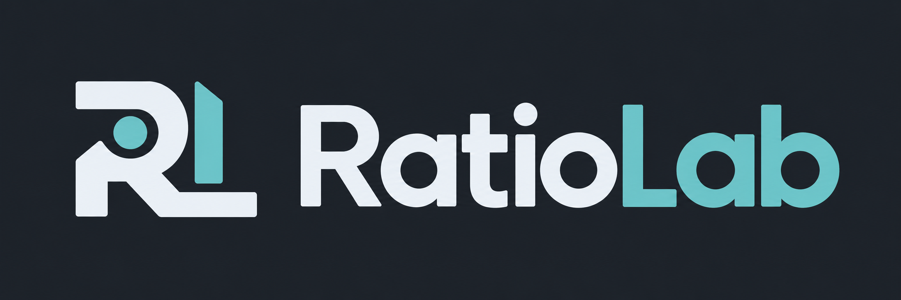
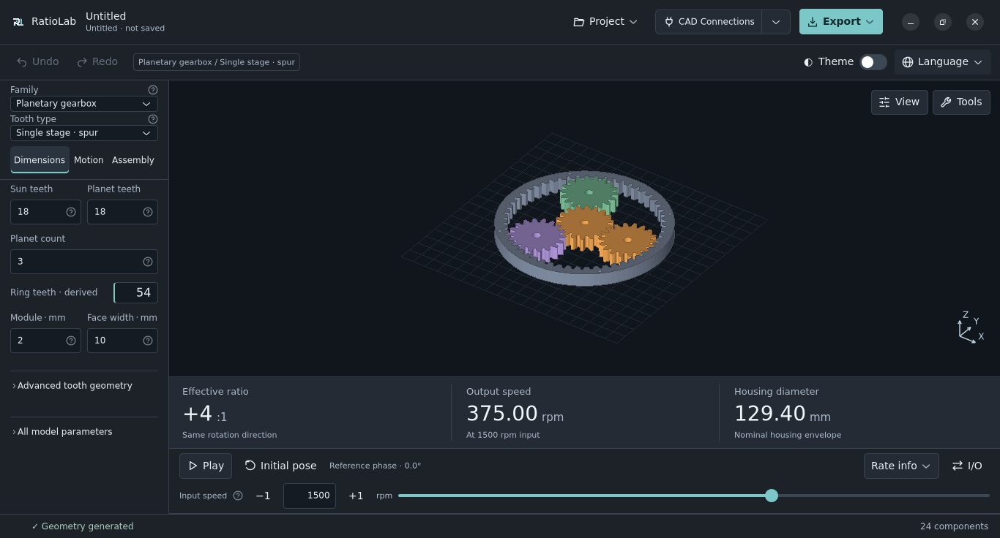

# RatioLab

**Progetta ingranaggi e riduttori. Osservane il movimento. Esporta i modelli per CAD o stampa 3D.**

RatioLab è un ambiente gratuito e open source per la progettazione parametrica
di ingranaggi e riduttori. Scegli un meccanismo, modificane le dimensioni e
controlla il risultato in un'anteprima 3D animata. Puoi lavorare dall'app desktop,
dal browser oppure creare e modificare progetti con un agente tramite il server MCP locale.

**15 famiglie di meccanismi · 9 lingue dell'interfaccia · Windows, macOS, Linux e browser · GPL-3.0-only**

[Sito](https://ratiolab.dev) · [Prova nel browser](https://ratiolab.dev/app/) · [Download](#scarica-e-installa) · [Manuale](docs/user-guide.md) · [Discord](https://discord.gg/G8NVHNg6J)

**Leggi questa introduzione in:** [English](README.md) · **Italiano** · [Español](docs/readme/es.md) · [Français](docs/readme/fr.md) · [Deutsch](docs/readme/de.md) · [Português (Portugal)](docs/readme/pt.md) · [Русский](docs/readme/ru.md) · [简体中文](docs/readme/zh-CN.md) · [தமிழ்](docs/readme/ta.md)

## Scegli come lavorare

| Modalità | Da dove iniziare | Cosa offre |
|---|---|---|
| **Desktop** | [Scarica un installer](#scarica-e-installa) | Progettazione offline, file locali, esportazioni e collegamenti CAD facoltativi. |
| **Browser** | [Apri l'app web](https://ratiolab.dev/app/) | Prova l'ambiente senza installare l'app desktop; la geometria viene calcolata nel browser. |
| **Agenti e automazione** | [Configura MCP](docs/mcp.md) | Esplora il catalogo, modifica progetti, consulta i risultati ed esporta tramite un server locale, senza aprire la GUI. |

Desktop e browser condividono il formato JSON dei progetti. I collegamenti CAD
nativi e gli aggiornamenti dell'app sono funzioni desktop. La [guida web](docs/web-app.md)
descrive le funzioni supportate e i requisiti WebAssembly/WebGL 2.

## Lavora nella tua lingua

**L'interfaccia è disponibile nelle nove lingue indicate sopra, sia su desktop sia nel browser.**
Scegli la lingua dal menu **Language / Lingua**: la preferenza viene ricordata separatamente
dalle dimensioni del modello e dai progetti salvati. Gli installer desktop includono
anche i caratteri per cinese e tamil.

I README tradotti presentano RatioLab nelle rispettive lingue. Il manuale tecnico
completo e le relazioni di calcolo sono attualmente in inglese; le spiegazioni
dell'interfaccia non ancora tradotte usano l'inglese. Puoi contribuire alle
traduzioni [segnalando testi poco chiari](https://github.com/NoOneExceptEnderk/RatioLab/issues)
con lingua e schermata del problema.

## Scarica e installa

Versione disponibile: **0.2.4**.

**Gli installer includono Python, GTK, le librerie necessarie e tutte le nove lingue dell'interfaccia.**
Scegli la tua piattaforma: per usare l'app non serve installare Python né scaricare
il codice sorgente. Le note di rilascio riportano i controlli CI e i limiti delle piattaforme.

| Il tuo computer | Download | Installazione |
|---|---|---|
| Windows 11, Intel/AMD a 64 bit | [Setup Windows](https://github.com/NoOneExceptEnderk/RatioLab/releases/download/v0.2.4/RatioLab-0.2.4-windows-x86_64-setup.exe) | Apri il file scaricato; al termine avvia RatioLab dal menu Start. |
| macOS 15+, Apple Silicon (M1 o successivi) | [DMG Apple Silicon](https://github.com/NoOneExceptEnderk/RatioLab/releases/download/v0.2.4/RatioLab-0.2.4-macos-arm64.dmg) | Apri il DMG e trascina RatioLab in Applicazioni. |
| macOS 15+, Intel | [DMG Intel](https://github.com/NoOneExceptEnderk/RatioLab/releases/download/v0.2.4/RatioLab-0.2.4-macos-x86_64.dmg) | Apri il DMG e trascina RatioLab in Applicazioni. |
| Ubuntu 24.04+ / Linux compatibile, x86-64 | [Pacchetto Debian/Ubuntu](https://github.com/NoOneExceptEnderk/RatioLab/releases/download/v0.2.4/ratiolab_0.2.4_amd64.deb) · [Installer per altri Linux](https://github.com/NoOneExceptEnderk/RatioLab/releases/download/v0.2.4/RatioLab-0.2.4-linux-x86_64.run) | Apri il `.deb` con il gestore software; per il `.run` segui la guida. |

Linux richiede glibc 2.39 o successiva. Serve un driver grafico compatibile.
L’installer Windows non ha ancora una firma del produttore; l’app macOS ha
firma ad-hoc e non è notarizzata da Apple. Il sistema può mostrare un avviso o bloccare l’avvio.

[Guida all’installazione e alla disinstallazione](docs/installation.md) · [Tutti i file e i checksum](https://github.com/NoOneExceptEnderk/RatioLab/releases/tag/v0.2.4) · [Changelog](CHANGELOG.md)

## Cosa puoi fare

- **Progettare dai parametri.** Modifica numero di denti, moduli, spessori, fori
  e opzioni costruttive con controlli numerici precisi.
- **Esplorare geometria e movimento.** Anima il meccanismo, cambia velocità e
  configurazioni di ingresso/uscita supportate, osserva sezioni e viste esplose,
  seleziona o misura i componenti.
- **Conservare e confrontare le modifiche.** Salva i progetti, usa annulla e
  ripristina, cerca combinazioni in intervalli finiti e verifica le interferenze
  con campionamento discreto.
- **Proseguire il progetto.** Esporta il modello completo o i soli componenti
  selezionati, con distinte, calcoli nominali e pacchetti di progetto.

### 15 famiglie di meccanismi

| Gruppo | Modelli e costruzioni |
|---|---|
| **Ingranaggi singoli** | Denti diritti, elicoidali e a doppia elica unita o separata. |
| **Riduttori epicicloidali e composti** | [Treni epicicloidali](docs/technical/variants.md) e riduttori [Wolfrom / 3K a due corone](docs/technical/wolfrom.md), anche con costruzioni elicoidali. |
| **Riduttori cicloidali e strain wave** | [Cicloidali a disco singolo o doppio](docs/tutorials/cycloidal-drive-generator.md) e [costruzioni strain wave](docs/technical/strain-wave.md). |
| **Assi paralleli e dentature interne** | [Riduttori ad assi paralleli a uno, due o tre stadi](docs/technical/parallel.md) e coppie con ingranaggio interno. |
| **Assi concorrenti e disassati** | Coppie [coniche](docs/technical/bevel-pair.md), [ipoidi](docs/technical/hypoid.md) e [face gear](docs/technical/face-gears.md). |
| **Vite e trasmissioni lineari** | [Vite e corona](docs/technical/worm.md) e [pignone e cremagliera finita](docs/technical/rack.md). |
| **Differenziali** | [Differenziali conici](docs/technical/differential.md) in configurazione polso o classica. |

Le varianti disponibili dipendono dalla famiglia. Le guide collegate spiegano
ogni costruzione, le ipotesi adottate e i controlli geometrici.

## Esporta e collega un CAD

| Formato | A cosa serve |
|---|---|
| **STEP** | Geometria solida per continuare il progetto in CAD. |
| **STL** | Mesh per slicer e stampa 3D. |
| **SVG / DXF** | Scambio dei profili 2D. |
| **JSON del progetto** | Riapertura e modifica dei parametri originali di RatioLab. |
| **Distinte, relazioni e pacchetti** | Dati dei componenti, calcoli nominali ed esportazioni associate al modello. |

Le esportazioni autonome non richiedono un CAD installato. Da desktop puoi anche
inviare i modelli a [SolidCraft](docs/user-guide.md#create-in-solidcraft) o ad [Autodesk Fusion](docs/fusion360.md).
Fusion usa il modulo aggiuntivo incluso per ricevere solidi STEP e metadati dei
parametri di RatioLab. L'importazione CAD non crea un assieme meccanico completamente vincolato.

## Primo progetto

1. Apri l'app e scegli famiglia e costruzione dal catalogo illustrato.
2. Imposta dimensioni e opzioni di assemblaggio supportate; osserva anteprima e movimento.
3. Salva il progetto e scegli **Export…** per creare file CAD, per la stampa o un pacchetto di progetto.

Per un primo progetto guidato, segui il [tutorial sul riduttore epicicloidale](docs/tutorials/planetary-gear-generator.md)
o quello sul [riduttore cicloidale](docs/tutorials/cycloidal-drive-generator.md).
Entrambi includono progetti di esempio scaricabili. Trovi altre configurazioni
in [`examples/`](examples/).

## Documentazione

L'[indice dei docs](docs/README.md) raccoglie i percorsi per attività, compresi
[topping e semitopping](docs/tooth-tips.md), [temi e Impostazioni](docs/preferences.md)
e [preset di tastiera e mouse](docs/keyboard-shortcuts.md). Le guide descrivono
i sorgenti attuali: installer scaricabili e app ospitata possono differire.
La [guida al motore Rust](docs/technical/rust-kernel.md) spiega esecuzione nativa/Wasm,
input decimali e limiti della geometria campionata. I docs completi sono in inglese.

[Manuale](docs/user-guide.md) · [Guida web](docs/web-app.md) · [MCP e strumenti per agenti](docs/mcp.md) · [Collegamenti degli organi di trasmissione](docs/technical/io-models.md) · [Calcoli](docs/technical/calculations.md)

## Limiti attuali

RatioLab genera geometrie nominali e moto ideale. I controlli costruttivi, i giochi
e i limiti di campionamento sono riportati nel modello e nella relazione di
calcolo; non certificano resistenza, durata o idoneità alla produzione.
Misure e interferenze usano superfici campionate. Completa in CAD collegamenti,
ritenute, supporti e scelte produttive richiesti dalla costruzione selezionata.

Consulta i [limiti documentati](docs/user-guide.md#accuracy-and-limitations)
e la guida della famiglia prima di usare i modelli per un meccanismo fisico.

## Community

Entra nel [Discord di RatioLab](https://discord.gg/G8NVHNg6J) per condividere
progetti, fare domande e inviare feedback. Per un problema riproducibile,
[apri una segnalazione](https://github.com/NoOneExceptEnderk/RatioLab/issues)
con versione di RatioLab, sistema operativo, passaggi e, se possibile, un progetto di esempio.

## Contribuire e licenza

Puoi contribuire con progetti di esempio, documentazione, correzioni alle
traduzioni, segnalazioni riproducibili o codice. [CONTRIBUTING.md](CONTRIBUTING.md)
descrive ambiente e convenzioni del progetto; la [guida allo sviluppo](docs/development.md)
spiega come compilare dai sorgenti. Il codice è in [`src/`](src/), i test in
[`tests/`](tests/) e la documentazione in [`docs/`](docs/).

Copyright © 2026 **NoOneExceptEnderk**. Licenza [GNU GPL versione 3 only](LICENSE)
(`GPL-3.0-only`), con [attribuzioni e avvisi](COPYRIGHT).
Le dipendenze mantengono le proprie licenze.
