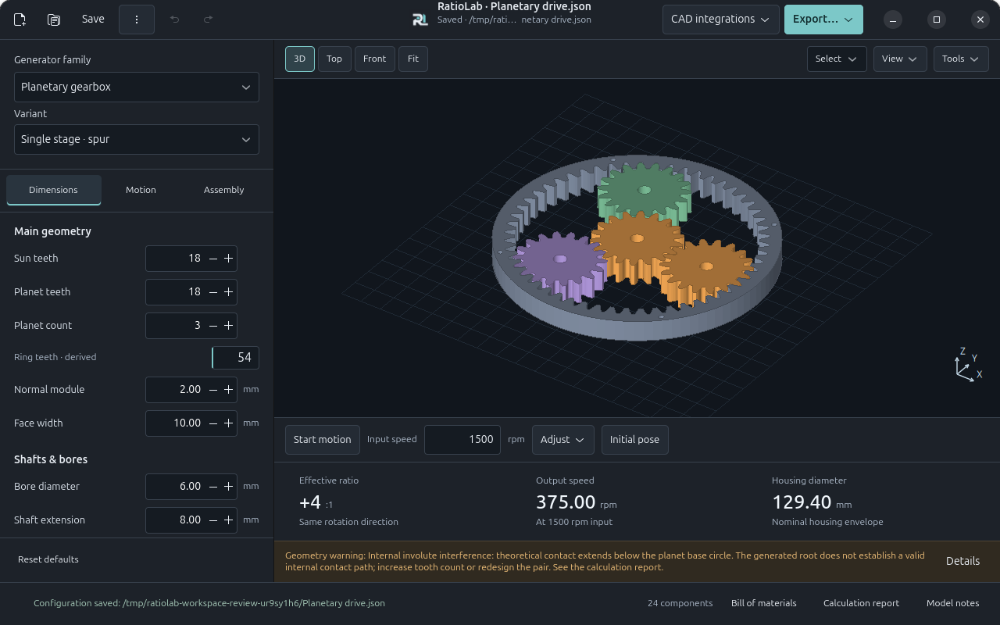

# RatioLab


**Parametric gear and reducer generator.**

Python / GTK 4 desktop application for generating gears and reducers, viewing them in an OpenGL 3D preview and exporting their geometry. SolidCraft integration creates bodies in a connected CAD document; STL export works independently.

For installation on another computer, see [INSTALL.md](INSTALL.md). Native
installers include Python, GTK and the app's other libraries: Linux `.run`/`.deb`,
Windows 11 Setup and macOS `.app`/`.dmg` for Intel and Apple Silicon. Native CI
tests the installed application; downloadable artifacts are attached to successful
jobs. See the [installer builds](https://github.com/NoOneExceptEnderk/RatioLab/actions/workflows/installers.yml)
and the supported OS versions in `INSTALL.md`. Wheel/source installation remains
available for development.

Launch with:

```bash
./avvia.sh
# or
/usr/bin/python3 app.py
```

The desktop shortcut launches this project directly through `avvia.sh`. Source edits are picked up the next time the application starts; no installation copy or manual update is required. The old desktop installation is retained for existing exports and data. Run `/usr/bin/python3 install_desktop.py` to register RatioLab in the user's application menu and update the desktop shortcut. The installed filename matches GTK's application ID so GNOME can show the correct name and icon in its application bar. `RatioLab.desktop` records the launcher identity. The selected compact RL identity, application icon and logos for light/dark backgrounds are saved in `assets/branding/`; `brand.json` records the chosen design and palette for the GitHub release.

All application labels, parameter descriptions, validation messages, calculation reports and bill of materials are in English. Saved configuration format identifiers and parameter keys are retained so existing JSON configurations remain compatible. Previously exported documents are independent snapshots; regenerate them to obtain English descriptions.

## Controls

The application uses the **Technical workspace**: a persistent parameter panel on the left, a dominant 3D preview, a single motion bar and three geometric results below the model. The window displays the RatioLab name and RL icon.



The parameter panel has three tabs:

- **Dimensions:** geometry, tooth counts, modules, profiles and clearances.
- **Motion:** input/output members, operating speed, torque and nominal loads.
- **Assembly:** bearings, fits, housing/flanges, standard hardware and existing eccentric shaft construction options.

Parameters update the preview and calculations automatically. Main geometry, shafts/bores and output connections are grouped; profile parameters and clearances are under **Advanced**. Nominal operating loads are collapsed under Motion. Read-only results show effective ratio/direction, output speed and a relevant geometric dimension; single gears show pitch diameter, tooth count and width. Nominal torque remains in the operating assumptions and calculation report, rather than appearing as a capacity rating.

**Open… / Save…** and **Export…** stay in the header. **CAD integrations** groups SolidCraft connection, status and creation. The bottom bar provides model status, component count, bill of materials, calculation report and notes. The panel remembers its active tab, advanced section and scroll position when choices rebuild its fields. Linked dimensions explain their source and provide **Change source…** to open the relevant Assembly section.

Invalid input remains visible, with a field message when the generator identifies the cause. Geometry actions are blocked immediately while an update is pending. Invalid geometry or speed stops motion; the last valid model of the same family remains visible with an explicit warning that it does not match the current parameters. No automatic correction replaces an invalid numeric entry on focus loss.

Saved configurations from earlier versions still load their geometry and kinematics. Obsolete material, stress and production settings are ignored and omitted from newly saved configurations and reports. Previously exported files remain independent snapshots.

## Active catalog

Only these nine families are available, in this order:

| Family | Main variants or purpose |
|---|---|
| Spur gear | Single involute gear |
| Helical gear | Adjustable helix angle and hand |
| Double helical gear | Joined helices or separated by a groove |
| Planetary gearbox | Spur, helical, double helical, one or two stages |
| Cycloidal reducer | Single or dual disc with opposing eccentrics |
| Strain wave reducer | Cup, flat cup, silk hat; geometric study |
| Worm and wheel | Cylindrical ZA / ZI; concept gear pair |
| Parallel shaft reducer | Spur, helical, double helical |
| Internal gear reducer | Fixed axes; spur, helical, double helical |

Unsupported families are rejected by both the interface and generator. Previously exported files remain independent artifacts.

## Preview and motion

Drag to rotate, scroll to zoom, and double click or use Fit to reset the camera. **Supports**, **Housing**, **Exploded** and **Section** control the view. Cycloidal output pins remain visible when Supports is disabled, in both single and dual disc variants.

Use the single motion bar below the preview: **Start motion / Pause**, a precise RPM entry, **Adjust** and **Initial pose**. Adjust opens a progressive RPM slider and ±1 controls; playback is not duplicated in that popover. Press Enter or leave the entry to apply; both decimal points and commas are accepted. Zero RPM freezes the phase. Changing only valid RPM preserves the current phase.

Closing Adjust does not stop playback. Starting motion returns from exploded view to the assembly pose. At high speeds, video sampling may cause visual aliasing.

Animation illustrates kinematics. It does not verify continuous contact, collisions, force, fatigue or usable travel. CAD and STL exports use the nominal assembly pose; a complete export resets the preview before saving the PNG.

The preview panel shows geometry warnings for single-gear undercut and gear-pair interference. They update from calculation data when dimensions change; full warnings remain available in the calculation report and model notes.

## Input and output connections

**Motion → Drive · input and output** selects which member is driven, which delivers motion, and which is fixed. Planetary, cycloidal and strain wave drives offer all six physical member combinations. The planetary two-stage variants have independent connections for each stage.

Parallel shaft, internal gear and worm drives offer forward/reverse operation. Reverse kinematics do not guarantee worm backdrivability. Role colors and nominal mounting interfaces follow the selected arrangement; see [MODELLI-IO.md](MODELLI-IO.md).

## Printed cycloidal eccentric shaft

Cycloidal models offer **Eccentric shaft construction → FDM · printed shaft + 2 through bolts** in both modes. The printed shaft/cam stack is held by an asymmetric pair of off-axis M3 bolts, with removable bearing retainers, recessed heads, washers and nuts. It uses dedicated NSK 6804 eccentric bearings. Both single and dual disc builds keep the shaft and its metal reinforcement visible without Supports.

The selector preserves the entered shaft diameter and disc thickness. If they are incompatible, use **Apply compatible FDM dimensions** explicitly: input shaft Ø17 mm, bearing seat Ø32.2 mm and disc thickness 16 mm. The seat is linked to the 6804 bearing plus allowance. With eccentric input, choose either pin flange output with a fixed ring or **Ring / housing output with a fixed pin flange**. Housing output adds an annular six-hole load flange and a separate eight-hole stationary frame connection while preserving the two-bolt shaft. Other driving members and general automatic hardware require the standard construction. Printable-only shaft kits and complete examples are in `outputs/cycloidal-fdm-single/` and `outputs/cycloidal-fdm-dual/`. Assembly, fit calibration, limitations and primary research sources are in [PRINTED-SHAFT.md](PRINTED-SHAFT.md). This is an untested physical prototype, without a load rating or a universal motor coupling.

## Bearings and hardware

The verified local NSK catalog provides nominal open deep groove ball bearing dimensions and official source links. It does not automatically substitute sealed variants, other clearances or manufacturers. Linked dimensions are highlighted and locked in the interface.

Automatic bearing and hardware options apply to supported standard arrangements of single spur/helical/double helical gears, planetary gearboxes and cycloidal reducers. Hardware options include retaining rings and grooves, compatible keys and keyways, flange screws/nuts/washers, shims and spacers.

Grooves, keyways and through holes are represented in the shared geometry. Commercial hardware is simplified: threads, drive recesses and bearing raceways are not fully modelled. Codes are assigned only when selected from the catalog; unresolved envelopes remain **TO BE DEFINED**. Custom spacers are **MANUFACTURE** items.

## Save, load and export

**Open…** and **Save…** manage parameter JSON files. **Reset** restores defaults and offers **Undo reset**. Keyboard shortcuts: Ctrl+O, Ctrl+S and Ctrl+E.

**Export…** remembers the destination folder and provides:

- **STL for 3D printing:** a binary assembly STL and a `.stl-parts/` folder with one STL per component.
- **Complete package:** STL files, parameter JSON, CAD script, required STEP assets, preview PNG, BOM and calculation reports.
- **BOM and calculations:** TXT, CSV and JSON component lists plus `.calcoli.txt` and `.calcoli.json` reports.

STL coordinates are in **millimetres**; select mm in the importer because STL has no unit field. All parts are exported, including hidden supports, housing and nominal commercial components. Individual parts retain assembly coordinates and can be arranged on the slicer bed. STL export does not require SolidCraft.

BOM and calculation windows support text search, previous/next matches and **Copy all**. Invalid configurations prevent geometry exports and CAD creation.

## Create in SolidCraft

Under **CAD integrations**, **Connect SolidCraft** connects to the authenticated local control service on port 7878 or launches the configured AppImage. **Create in SolidCraft** adds a new unique group to the active CAD document. Finish any active sketch before insertion. Save the document as `.solidcraft` or export it from CAD.

Each send creates a separate group; changing the generator does not update existing CAD bodies. Regenerate and remove the old group when replacing a design. Straight parts use native sketches and extrusions where possible. Twisted and other shared surfaces use faceted STEP BRep solids with explicit hole walls. CAD uses the same sampled coordinates as the preview rather than an interpolated smooth loft.

A checkpoint spans modelling batches and STEP imports. Failed commands or imports request restoration of the prior document and history. Imports with warnings are rejected. If a connection is interrupted, check SolidCraft before retrying: a received operation may still be running.

Compatible command scripts can also be replayed with:

```bash
solidcraft-cli run model.script.json --out part.step
```

## Accuracy and limitations

These are dimensional design models, not certified production designs. Materials, manufacturing tolerances, lubrication, seals, fastening details, strength, bearing life and load capacity must be defined and verified. Reports provide nominal geometry, contact ratios, kinematic relations and static force estimates using assumed operating data; no ISO/AGMA strength verification is performed.

Involute flanks use adaptive sampling with midpoint/quarter checks at 0.015 mm; root fillets and undercut remain simplified. Shared circular profiles use a maximum radial sampling deviation of 0.002 mm where specified. These sample thresholds do not certify global analytical profile error. Tubes and freeform surfaces use their documented sampling. Complex bodies have a 250,000 face limit.

Strain wave teeth and flexspline deformation are illustrative. The worm wheel is approximate rather than generated by a conjugate tool envelope. Nominal interface contact is not proof of torque transmission. Tests on presets do not certify all parameter combinations.

## Development and verification

Requirements: Python 3.10+, PyGObject, GTK 4.12+, Cairo, libepoxy and desktop OpenGL 3.3. Native dependencies come from the platform package manager; no cloud services are required. Installed preferences and exports use per-user directories described in [INSTALL.md](INSTALL.md).

```bash
/usr/bin/python3 -m unittest discover -s . -p 'test_*.py' -v
```

GTK popup and workspace tests require access to a graphical display and otherwise skip their widget checks. CAD protocol tests simulate sockets and replies: they cover authentication, timeouts without duplicate submissions, pending results, atomic batches, STEP import warnings and checkpoint restoration without launching SolidCraft or changing a CAD document. Run these separately with `/usr/bin/python3 -m unittest test_connection -v`.

Git tracks source code, documentation, catalogs and examples. Generated exports under `outputs/` (except the verification screenshot), temporary work under `work/`, local UI preferences, custom material libraries and control tokens remain local.

Development priorities are recorded in [TODO.md](TODO.md): simplify the feature set and redesign the interface around gear/reducer generation, strengthen exports and project handling, prepare an open-source GitHub release, then migrate to Rust. Additional reducer families and dedicated print preparation are deferred.

| Module | Responsibility |
|---|---|
| `app.py`, `workspace_ui.py`, `gui_workflow.py`, `result_controls.py` | Application actions, technical workspace, navigation and result presentation |
| `geometry.py`, `solid_geometry.py` | Profiles, shared surfaces and CAD commands |
| `assemblies.py`, `geartrains.py`, `special_drives.py` | Gear and reducer builders |
| `kinematics.py`, `mounting.py`, `io_controls.py` | Physical ports, relationships and interfaces |
| `motion.py`, `motion_controls.py`, `preview3d.py` | Animation, speed controls and OpenGL rendering |
| `catalog.py`, `standard_parts.py` | Bearings and catalog geometry |
| `hardware_catalog.py`, `hardware.py` | Standard dimensions and assembly hardware |
| `bom.py`, `engineering.py`, `stl_export.py` | BOM, calculation reports and STL |
| `connection.py` | Authenticated local CAD protocol and rollback |

