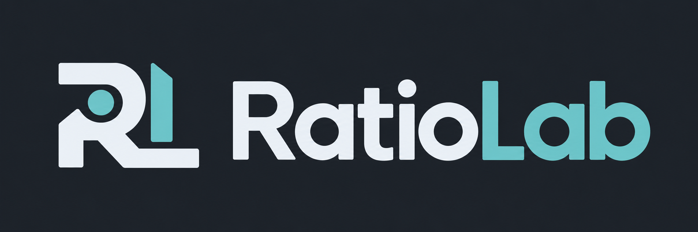
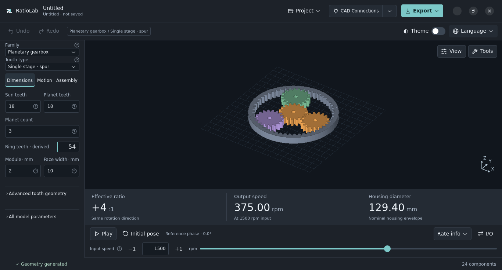

# RatioLab

**Design gears and reducers. Explore their motion. Export models for CAD or 3D printing.**

RatioLab is a free, open-source workspace for parametric gear and reducer design.
Choose a mechanism, adjust its dimensions and inspect the result in an animated
3D preview. Work visually on your desktop or in your browser, or use the local
MCP server to create and edit projects with an agent.

**15 mechanism families · 9 interface languages · Windows, macOS, Linux and browser · GPL-3.0-only**

[Website](https://ratiolab.dev) · [Try in your browser](https://ratiolab.dev/app/) · [Download](#download-and-install) · [User guide](docs/user-guide.md) · [Discord](https://discord.gg/G8NVHNg6J)

**Read this introduction in:** **English** · [Italiano](README.it.md) · [Español](docs/readme/es.md) · [Français](docs/readme/fr.md) · [Deutsch](docs/readme/de.md) · [Português (Portugal)](docs/readme/pt.md) · [Русский](docs/readme/ru.md) · [简体中文](docs/readme/zh-CN.md) · [தமிழ்](docs/readme/ta.md)

## Choose how to work

| Workflow | Get started | What it offers |
|---|---|---|
| **Desktop** | [Download an installer](#download-and-install) | Offline design, local project files, exports and optional CAD connections. |
| **Browser** | [Open the web app](https://ratiolab.dev/app/) | Try the workspace without installing desktop software; geometry runs in your browser. |
| **Agents and automation** | [Set up MCP](docs/mcp.md) | Discover models, edit projects, inspect results and export through a local server, without opening the GUI. |

Desktop and browser exchange the same JSON project format. Native CAD connections
and in-app desktop updates are desktop features. See the [browser guide](docs/web-app.md)
for supported features and WebAssembly/WebGL 2 requirements.

## Work in your language

**The interface is available in all nine languages linked above, on desktop and in the browser.**
Choose one from the **Language** menu; the preference is remembered separately
from your model dimensions and saved projects. Chinese and Tamil fonts are
included in the desktop installers.

The translated READMEs introduce RatioLab in each language. The full technical
documentation and calculation reports are currently in English; untranslated
interface explanations fall back to English. Help improve the translations by
[reporting unclear text](https://github.com/NoOneExceptEnderk/RatioLab/issues)
with the language and a screenshot.

## Download and install

Current release: **0.2.2**.

**Every installer includes Python, GTK, the required libraries and all nine interface languages.**
Choose your platform; there is no need to install Python or download the source
code to use the app. The release notes record native CI checks and platform limits.

| Your computer | Download | What to do |
|---|---|---|
| Windows 11, 64-bit Intel/AMD | [Windows Setup](https://github.com/NoOneExceptEnderk/RatioLab/releases/download/v0.2.2/RatioLab-0.2.2-windows-x86_64-setup.exe) | Open the installer, then launch RatioLab from Start. |
| macOS 15+, Apple Silicon (M1 or newer) | [Apple Silicon DMG](https://github.com/NoOneExceptEnderk/RatioLab/releases/download/v0.2.2/RatioLab-0.2.2-macos-arm64.dmg) | Open the DMG and drag RatioLab to Applications. |
| macOS 15+, Intel | [Intel DMG](https://github.com/NoOneExceptEnderk/RatioLab/releases/download/v0.2.2/RatioLab-0.2.2-macos-x86_64.dmg) | Open the DMG and drag RatioLab to Applications. |
| Ubuntu 24.04+ / compatible Linux, x86-64 | [Debian/Ubuntu package](https://github.com/NoOneExceptEnderk/RatioLab/releases/download/v0.2.2/ratiolab_0.2.2_amd64.deb) · [Other Linux installer](https://github.com/NoOneExceptEnderk/RatioLab/releases/download/v0.2.2/RatioLab-0.2.2-linux-x86_64.run) | Open the `.deb` with your software installer. For the `.run`, follow the installation guide. |

Linux requires glibc 2.39 or newer. A compatible graphics driver is required on all systems.
Windows Setup is unsigned; macOS uses ad-hoc signing without Apple notarization.
Your system may show an unrecognized-publisher warning or block launch.

[Installation guide, requirements and removal](docs/installation.md) · [All release files and checksums](https://github.com/NoOneExceptEnderk/RatioLab/releases/tag/v0.2.2) · [Changelog](CHANGELOG.md)

## What you can do

- **Build from parameters.** Edit tooth counts, modules, widths, bores and
  construction options through precise numeric controls.
- **Explore motion and geometry.** Animate the mechanism, change speeds and
  supported input/output arrangements, inspect sections and exploded views,
  and select or measure components.
- **Keep iterating.** Save projects, undo and redo edits, search finite parameter
  combinations and run sampled interference checks.
- **Take the result further.** Export full models or selected components,
  together with component lists, nominal calculations and project packages.

### 15 mechanism families

| Group | Models and constructions |
|---|---|
| **Individual gears** | Spur, helical and joined/separated double-helical gears. |
| **Planetary and compound reducers** | [Planetary trains](docs/technical/variants.md) and two-rim [Wolfrom / 3K reducers](docs/technical/wolfrom.md), including helical constructions. |
| **Cycloidal and strain-wave reducers** | [Single- or dual-disc cycloidal drives](docs/tutorials/cycloidal-drive-generator.md) and [strain-wave constructions](docs/technical/strain-wave.md). |
| **Parallel and internal gearing** | [Single-, two- and three-stage parallel-shaft reducers](docs/technical/parallel.md), plus internal gear pairs. |
| **Intersecting and offset axes** | Standalone [bevel](docs/technical/bevel-pair.md), [hypoid](docs/technical/hypoid.md) and [face-gear](docs/technical/face-gears.md) pairs. |
| **Worm and linear drives** | [Worm pairs](docs/technical/worm.md) and finite [rack-and-pinion drives](docs/technical/rack.md). |
| **Differentials** | [Bevel differentials](docs/technical/differential.md) with wrist or classic configurations. |

Available variants depend on the family. The linked guides explain each
construction, its assumptions and its geometric checks.

## Export and connect to CAD

| Output | Use it for |
|---|---|
| **STEP** | Solid geometry for continuing a design in CAD. |
| **STL** | Meshes for slicers and 3D-printing workflows. |
| **SVG / DXF** | 2D profile exchange. |
| **Project JSON** | Reopening and editing the original RatioLab parameters. |
| **Component lists, reports and packages** | Taking component data, nominal calculations and related exports with the model. |

Standalone exports work without a CAD application. On desktop, you can also
send models to [SolidCraft](docs/user-guide.md#create-in-solidcraft) or [Autodesk Fusion](docs/fusion360.md).
Fusion uses the included add-in to receive STEP solids and RatioLab parameter
metadata. CAD import does not create a fully constrained mechanical assembly.

## Start a design

1. Open the app and choose a family and construction from the illustrated catalog.
2. Set dimensions and supported assembly options; inspect the preview and motion.
3. Save your project, then choose **Export…** for CAD, printing files or a project package.

For a guided first project, follow the [planetary reducer tutorial](docs/tutorials/planetary-gear-generator.md)
or the [cycloidal reducer tutorial](docs/tutorials/cycloidal-drive-generator.md).
Both include downloadable example projects. More configurations are in
[`examples/`](examples/).

## Documentation

[User guide](docs/user-guide.md) · [Browser guide](docs/web-app.md) · [MCP and agent tools](docs/mcp.md) · [Drive connections](docs/technical/io-models.md) · [Calculations](docs/technical/calculations.md)

Browse the [documentation index](docs/README.md) for task-based links, including
[tooth-tip treatments](docs/tooth-tips.md), [desktop themes and Settings](docs/preferences.md)
and [keyboard/mouse presets](docs/keyboard-shortcuts.md). The guides describe
the current source tree; downloaded installers and the hosted app can differ.
The [Rust engine guide](docs/technical/rust-kernel.md) explains native/Wasm
execution, exact inputs and the limits of sampled geometry.

## Current limits

RatioLab generates nominal geometry and ideal motion. Construction checks,
clearances and numerical sampling limits are recorded in the model and its
calculation report; they do not certify strength, service life or manufacturing
readiness. Interference checks and measurements use sampled surfaces. Complete
connections, retention, supports and manufacturing choices in CAD as required
by the selected construction.

Read the [accuracy and limitations](docs/user-guide.md#accuracy-and-limitations)
and the relevant family guide before using exported designs for a physical mechanism.

## Community

Join the [RatioLab Discord](https://discord.gg/G8NVHNg6J) to share designs, ask
questions and give feedback. For a reproducible problem, [open an issue](https://github.com/NoOneExceptEnderk/RatioLab/issues)
with your RatioLab version, operating system, steps and an example project if possible.

## Contribute

Contributions can include example projects, documentation, translation corrections,
reproducible bug reports or code. Start with [CONTRIBUTING.md](CONTRIBUTING.md)
for setup and project conventions, or the [development guide](docs/development.md)
to build from source. Application code is in [`src/`](src/), tests in [`tests/`](tests/)
and documentation in [`docs/`](docs/).

## License

Copyright © 2026 **NoOneExceptEnderk**. Licensed under [GNU GPL version 3 only](LICENSE)
(`GPL-3.0-only`). See [COPYRIGHT](COPYRIGHT) for attribution and notices.
Third-party components retain their own licenses.
