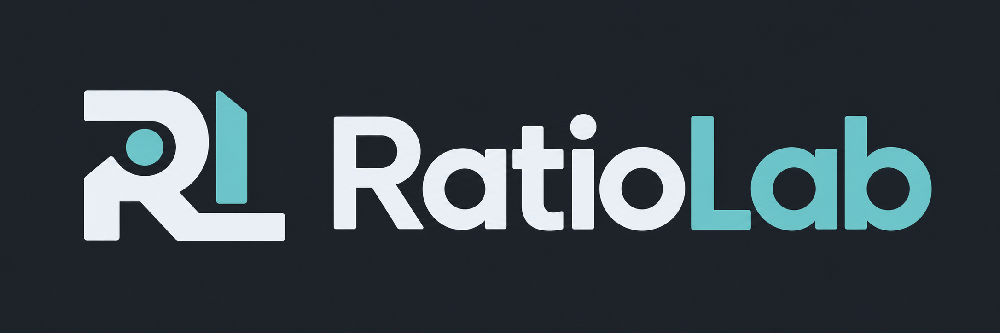

# RatioLab

**Design gears and reducers, explore their motion, and export models for CAD or 3D printing.**

[Download](#download-and-install) · [User guide](docs/user-guide.md) · [Italiano](README.it.md) · [Report a problem](https://github.com/NoOneExceptEnderk/RatioLab/issues) · [Discord](https://discord.gg/G8NVHNg6J)

## Download and install

**Download an installer below. Python, GTK and the required libraries are included.**
You do not need to download the source code or install development tools.

Current release: **0.1.0 Preview 2** — an early version; feedback is welcome.

| Your computer | Download | What to do |
|---|---|---|
| Windows 11, 64-bit Intel/AMD | [Windows Setup](https://github.com/NoOneExceptEnderk/RatioLab/releases/download/v0.1.0-preview.2/RatioLab-0.1.0-windows-x86_64-setup.exe) | Open the installer, then launch RatioLab from Start. |
| macOS 15+, Apple Silicon (M1 or newer) | [Apple Silicon DMG](https://github.com/NoOneExceptEnderk/RatioLab/releases/download/v0.1.0-preview.2/RatioLab-0.1.0-macos-arm64.dmg) | Open the DMG and drag RatioLab to Applications. |
| macOS 15+, Intel | [Intel DMG](https://github.com/NoOneExceptEnderk/RatioLab/releases/download/v0.1.0-preview.2/RatioLab-0.1.0-macos-x86_64.dmg) | Open the DMG and drag RatioLab to Applications. |
| Ubuntu 24.04+ / compatible Linux, x86-64 | [Debian/Ubuntu package](https://github.com/NoOneExceptEnderk/RatioLab/releases/download/v0.1.0-preview.2/ratiolab_0.1.0_amd64.deb) · [Other Linux installer](https://github.com/NoOneExceptEnderk/RatioLab/releases/download/v0.1.0-preview.2/RatioLab-0.1.0-linux-x86_64.run) | Open the `.deb` with your software installer. For the `.run`, follow the installation guide. |

Linux requires glibc 2.39 or newer. A compatible graphics driver is required on all systems.
Windows Setup is unsigned; macOS uses ad-hoc signing without Apple notarization.
Your system may show an unrecognized-publisher warning or block launch.

[Installation guide, requirements and removal](docs/installation.md) · [All release files and checksums](https://github.com/NoOneExceptEnderk/RatioLab/releases/tag/v0.1.0-preview.2)

## What you can do

- Build nine gear/reducer families: spur, helical, double helical, planetary, cycloidal, strain wave, worm, parallel shaft and internal gear.
- Edit parameters and inspect an animated 3D model with component selection and sampled measurements.
- Save projects, undo changes, search finite parameter combinations and run discrete interference checks.
- Export STEP, STL, SVG/DXF, component lists, calculation reports or complete packages.
- Use the included offline [MCP companion](docs/mcp.md) to work with an agent. SolidCraft integration is optional; standalone exports work without a CAD application.

## Start a design

1. Open RatioLab and choose a gear or reducer family.
2. Set dimensions and assembly options; inspect the preview and reported results.
3. Save your project, then choose **Export…** for CAD or printing files.

See the [user guide](docs/user-guide.md) and [example projects](examples/) for more detail.
The application interface is in English.

## Current limits

This preview provides geometric and kinematic study models. It does not certify
strength, service life or manufacturing readiness. Interference checks and
measurements use sampled surfaces; worm and strain-wave constructions remain
study models. Read the [accuracy and limitations](docs/user-guide.md#accuracy-and-limitations)
before using exported designs.

## Community

Join the [RatioLab Discord](https://discord.gg/G8NVHNg6J) for questions, feedback and project discussions.

## Contribute

Code is in [`src/`](src/), automated tests in [`tests/`](tests/) and documentation
in [`docs/`](docs/). See [CONTRIBUTING.md](CONTRIBUTING.md) for setup, architecture
and checks, and [CHANGELOG.md](CHANGELOG.md) for release changes.

Found a problem? [Open an issue](https://github.com/NoOneExceptEnderk/RatioLab/issues)
with your system, RatioLab version, reproduction steps and relevant project file.

## License

Copyright © 2026 **NoOneExceptEnderk**. Licensed under [GNU GPL version 3 only](LICENSE)
(`GPL-3.0-only`). See [COPYRIGHT](COPYRIGHT) for attribution and notices.
Third-party components retain their own licenses.
