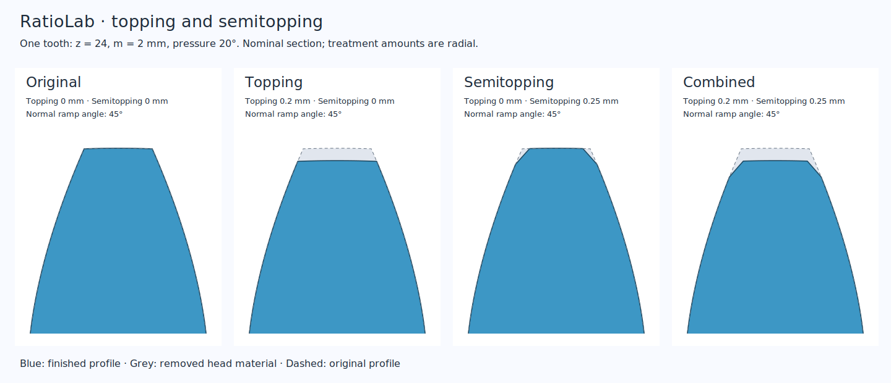

# Topping and semitopping

These controls change the nominal tooth-head geometry in the shared native/Wasm
Rust kernel. They are available in the current source tree; use the running
app's release notes to check availability in an older installer or hosted app.



The blue region is the finished section. Grey shows material removed from the
original head. The example has 24 teeth, normal module 2 mm, pressure angle 20°,
zero profile shift and a 45° normal ramp angle.

## Set a treatment

1. Choose a supported model and open **Dimensions**.
2. Expand the component's **tooth tips** group. In the browser, first expand
   **All model parameters**. Labels follow the selected interface language;
   the Italian group ends with **testa dei denti**.
3. Enter **Topping removal** and/or **Semitopping height** in mm. Both default
   to zero. Set **Semitopping angle** when using a nonzero height; its default
   is 45°.
4. Wait for the updated geometry. Inspect the head and calculation report,
   then save or export normally. Invalid drafts keep the last accepted model
   visible and block geometry export until corrected.

| Control | Geometric meaning |
|---|---|
| **Topping removal** | Radial removal from the existing nominal tip, after profile shift and any derived internal-ring shortening. External tip radius decreases; internal tip radius increases; rack tooth height decreases. |
| **Semitopping height** | Radial height from the finished tip back to the unchanged working flank. If topping is also set, the height starts at the already shortened head. |
| **Semitopping angle** | Pressure angle of a virtual generating ramp in the normal rack plane. It must exceed the normal working pressure angle while semitopping is enabled. |

A cylindrical semitopped corner is a secondary involute. The matching rack
corner is straight. The angle describes the generating ramp; it is not a bevel
on the axial end faces. Root geometry, reference pitch, tooth counts and ideal
shaft speeds retain their existing construction.

For the illustrated gear, topping 0.2 mm changes the tip radius from 26 to
25.8 mm. Adding semitopping height 0.25 mm makes the primary working flank end
at radius 25.55 mm; the head above that point uses the secondary profile.
These example amounts explain the controls and are not production defaults.

## Inspect the removal on the desktop

Starting a component's tooth-tip session automatically frames the teeth of that
component, including the selected stage or compound-planet rim. The camera looks
perpendicularly at its local tooth-profile plane, with the tooth pointing up,
and pauses playback at the nominal pose. The view follows the component's actual
placement, including rotated axes. Orange transparent material shows what
topping and semitopping remove from three nearby tooth
heads, compared with the same untreated construction. At zero removal the
close-up remains available without an orange overlay. Small amounts are shown
at their actual size; scroll to zoom further if necessary.

The overlay covers an **upper working band**, following the actual helix or
explicit rack sections and avoiding a double helix's central groove. It is a
local geometric comparison, not the total removed volume, an axial end-face
chamfer, or a cutter simulation. The full finished member remains opaque.
The other visible components remain in the view. Components whose real surfaces
obstruct the focused tooth area use **opacity 0.25** (1 is solid, 0 is invisible).
Parts behind the viewed working band or clear of that area retain their normal appearance;
holes are respected. This comparison is prepared for the nominal view, rather
than tracking an animated or exploded pose.

**Components → Parts → View teeth** opens the same view for one selected
supported component. This also works for straight, spiral and Zerol-style bevel
pairs and the gears of wrist/classic differentials, using their individual shaft
orientations. For those families it is a viewing action: no topping/semitopping
controls or material-removal construction are added. Face and hypoid gears are
not supported by this viewing action.

Topping removal, semitopping height and semitopping angle share one session for
the component. Switching between them or clicking outside an input preserves
your current rotation, pan and zoom. Geometry updates also retain that camera.
Each field has its own **Step size** input on the right, controlling its +/− buttons
and arrow keys. Steps must be positive and no larger than the field range.
They are saved as interface preferences, independently for each family/member
field, and do not change project parameters or Undo history.
The **reset cam** button at the upper left of the viewport smoothly restores
the perpendicular tooth view. It is shown only for this treatment session.

**Home** returns to the full model in the isometric view. Fit, playback, phase
scrubbing or inspection also leaves a treatment close-up. A view
opened through **View teeth** follows accepted dimensional edits of its selected
component. Returning to the model restores the normal component visibility.
The view does
not add parts to the project, history, STL or STEP. Invalid drafts retain the
last valid preview, show the existing parameter warning and keep normal export blocked. Obsolete
background previews cannot replace the current document or reopen a closed
detail. This automatic close-up is currently a native desktop feature; browser
tooth-tip geometry and ordinary orbit/zoom controls remain available.

Open the complete [spur example](../examples/spur-tooth-tips.config.json) to
compare the combined treatment with zero values. The
[helical rack example](../examples/rack-tooth-tips.config.json) applies independent
settings to its pinion and rack.

## Supported members

| Family | Independent controls |
|---|---|
| Single spur, helical, double helical | The gear. |
| Parallel reducer | Pinion and wheel at every active stage, through three stages. |
| Internal reducer | Pinion and internal ring. |
| Planetary reducer | Sun, planets and ring at each active stage, including two-stage and double-helical variants. |
| Wolfrom / 3K | Sun, first planet rim, second planet rim, fixed ring and output ring. |
| Rack and pinion | Pinion and rack, including helical and double-helical variants. |

Repeated identical planets share the corresponding rim's values. Changing
one stage or member does not copy its treatment to the others. Double-helical
members retain their joined/separated construction and existing groove.
Bevel, differential, hypoid, face, worm, cycloidal and strain-wave families do
not expose these controls.

## Read the results

The calculation report distinguishes the **finished tip** from the **active
tip limit of the primary involute**. Finished tip widths include semitopping;
reference thickness and metrology contacts use the original primary flank.
A measurement at the chamfer is therefore not treated as a primary-involute
contact.

For gear pairs, compare nominal contact with **usable involute contact**.
Topping and semitopping can reduce useful coverage even though tooth counts
and speed ratio stay unchanged. Contact on the semitopping profile is excluded
from effective coverage. A modified pair is rejected when effective total
contact is one or less; rack transverse engagement must remain above one.
Helical overlap follows the existing active-width rules.

If generation fails, use the reported reason:

- Reduce removal or height when the treatment reaches the pitch surface or
  generated root transition.
- Reduce height or angle if the top land disappears.
- Use a ramp angle greater than the working normal pressure angle.
- Reduce the treatment if insufficient primary contact remains. Changing only
  preview/export detail does not restore a geometrically removed working flank.

Internal pairs rerun the existing neutral polygon clearance check on the
modified profiles. That check retains its own sampled/construction scope.

## Projects, exports and API fields

Save/Open, Undo/Redo and recovery retain the controls and exact decimal sources.
Zero amounts preserve the previous nominal geometry. Ordinary preview,
STEP/STL and SVG/DXF use the treated profiles. SVG/DXF for helical members
remain sections, and ordinary STEP does not reconstruct smooth tooth flanks.
The optional curved-CAD prototype and its continuous cylindrical-pair audit
explicitly reject semitopping. Ordinary discrete interference uses the treated
triangles and retains its existing sampling limits.

For automation, [discover the contextual fields](mcp.md#tools-and-a-normal-workflow)
before updating a project. The suffixes are `topping_mm`, `semitopping_mm` and
`semitopping_angle_deg`, with these member prefixes:

| Family | Prefix before the suffix |
|---|---|
| Single gear | None: `topping_mm`. |
| Parallel | `pinion_`, `wheel_`; later stages use `pinion2_`, `wheel2_`, `pinion3_`, `wheel3_`. |
| Internal | `pinion_`, `ring_`, even though ring tooth count is the existing `wheel` field. |
| Planetary | `sun_`, `planet_`, `ring_`; stage 2 uses `sun2_`, `planet2_`, `ring2_`. |
| Wolfrom | `sun_`, `planet_`, `planet2_`, `ring_`, `output_ring_`; here `planet2` means the second rim. |
| Rack | `pinion_`, `rack_`. |

For example, this Python parameter patch treats only the second-stage wheel:

```python
from geometry import generate

design = generate("parallel", {
    "variant": "two_stage_helical",
    "wheel2_topping_mm": 0.02,
    "wheel2_semitopping_mm": 0.03,
    "wheel2_semitopping_angle_deg": 45,
})
```

The same parameter keys can be sent in an MCP `project_create` or
`project_update` request. A patch is not a complete saved configuration; use
Save or `project_save` to obtain an importable project.

See the [construction equations and primary references](technical/variants.md#cylindrical-topping-and-semitopping)
and [contact/metrology conventions](technical/calculations.md). This is nominal
finished geometry. Internal roots remain constructed blends; a production
shaping cutter, strength, loaded contact and manufacturing suitability are
not qualified.
