# RatioLab Tools: bebilderte Anleitungen

Sechs nachvollziehbare Beispiele: von den Eingaben zum überprüfbaren Ergebnis.

Desktop 0.2.2 mit der lokalen Tools-Überarbeitung · 2026-11-10

Die Bilder zeigen diese Oberflächensprache. In der Anwendung englisch gebliebene Befehle behalten ihren sichtbaren Namen. Verwenden Sie bei den Beispieleingaben einen Dezimalpunkt. Dateinamen und Modellkennungen bleiben unverändert.

Speichern Sie zuerst Ihre aktuelle Arbeit. Öffnen Sie die JSON-Projekte über Datei → Öffnen. Beginnen Sie jede Übung mit Datei 01. Dateien 02 und 03 enthalten fertige Ergebnisse, keine gespeicherten Suchanfragen. Anwendungseinstellungen werden nicht verändert.

[English](tools-en.md) · [Italiano](tools-it.md) · [Español](tools-es.md) · [Français](tools-fr.md) · [Deutsch](tools-de.md) · [Português (Portugal)](tools-pt.md) · [Русский](tools-ru.md) · [简体中文](tools-zh-CN.md) · [தமிழ்](tools-ta.md)

## Beispielprojekte

- [tools-01-base.config.json](../../examples/tools-01-base.config.json)
- [tools-02-rapporto3-compatto.config.json](../../examples/tools-02-rapporto3-compatto.config.json)
- [tools-03-backlash05.config.json](../../examples/tools-03-backlash05.config.json)

## Inhalt

- [Ein Ausgangsmodell, sechs Übungen](#inizio)
- [Welches Werkzeug brauche ich?](#scegliere)
- [Ritzel auswählen und isolieren](#componenti)
- [Zwei sichtbare Oberflächenpunkte messen](#misurare)
- [Nur das ausgewählte Ritzel exportieren](#esportare)
- [Ein kleineres 3:1-Zahnradpaar suchen](#ricerca)
- [Genau festlegen, was variieren darf](#intervalli)
- [Vorschlag vergleichen, übernehmen und rückgängig machen](#applicare-ricerca)
- [Abgetastete Bewegung prüfen](#interferenze)
- [Kontakt und Durchdringung unterscheiden](#leggere-interferenze)
- [Das theoretische Kugelmaß berechnen](#metrologia)
- [Die Wildhaber-Zahnweite ablesen](#wildhaber)
- [Betriebsspiel von 0.15 auf 0.50 mm ändern](#backlash)
- [Den neuen Achsabstand übernehmen](#applicare-backlash)
- [Bauteile, Berechnungen und Hinweise finden](#report)
- [Wenn Ihr Ergebnis abweicht](#problemi)

## Ein Ausgangsmodell, sechs Übungen

Beginnen Sie mit festgelegten Daten statt mit geratenen Parametern.

1. **Beispiel öffnen.** Eigene Arbeit zuerst speichern. Über **Datei** → **Öffnen…** die Datei tools-01-base.config.json öffnen.

2. **Modell kontrollieren.** Parallelwellengetriebe, eine Stufe, Stirnverzahnung: Ritzel 20, Rad 60, Modul 2 mm, Breite 10 mm, Achsabstand 80 mm. Übersetzung -3:1;1500 min⁻¹am Eingang ergeben -500 min⁻¹am Ausgang.

3. **Jede Übung neu beginnen.** Vor dem nächsten Werkzeug Datei 01 erneut öffnen. Die Suche kann Zähnezahlen ändern, die Spielanpassung den Achsabstand. Dateien 02 und 03 zeigen die fertigen Ergebnisse.

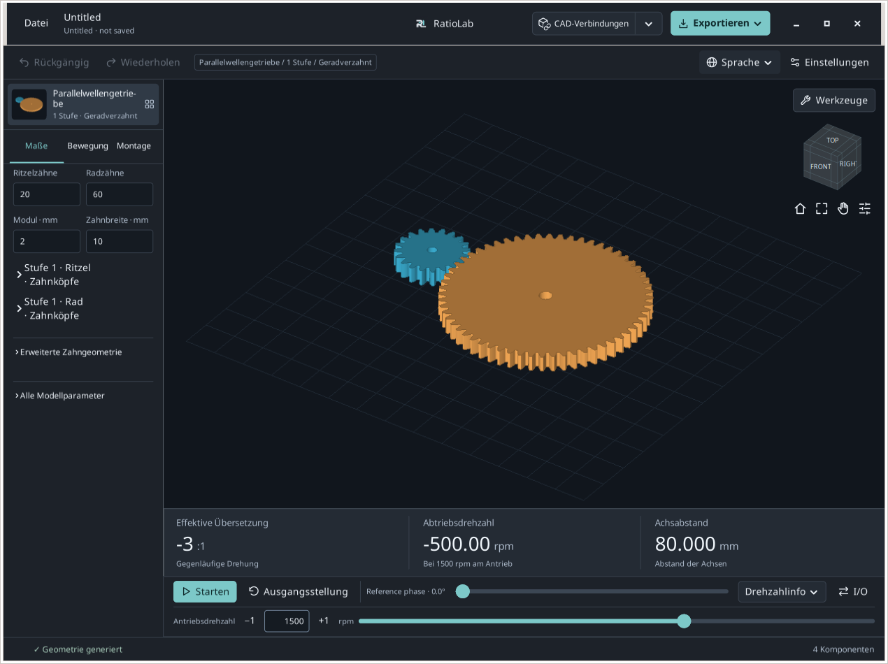

**Erwartetes Ergebnis.** 20/60 Zähne und 80 mm Achsabstand kennzeichnen das richtige Ausgangsmodell.

**Bei Problemen / Einordnung.** Die Anleitung beschreibt die lokale Tools-Überarbeitung auf Basis 0.2.2. Öffentliche Installer und Browser können andere Bedienelemente enthalten.

## Welches Werkzeug brauche ich?

Über der 3D-Ansicht **Werkzeuge** öffnen und die gewünschte Aufgabe wählen.

1. **Bauteil auswählen, messen oder exportieren.** **Komponenten / Maße…** bietet Bauteilauswahl, Isolation, Oberflächenpunkte und Auswahlexport.

2. **Übersetzung suchen oder Bewegung prüfen.** **Kombinationen finden…** vergleicht endliche Parameterkombinationen. **Interferenz prüfen…** untersucht diskrete Stellungen und zeigt die beteiligten Teile.

3. **Theoretisches Prüfmaß bestimmen.** **Zahnradmesstechnik…** berechnet unterstützte Kugel-/Rollenmaße und Zahnweiten für geradverzahnte Zylinderräder.

4. **Betriebsspiel ändern.** **Arbeitsspiel lösen…** schlägt für ein einzelnes außenverzahntes Parallelradpaar einen Achsabstand vor. Darunter stehen die Modellberichte.

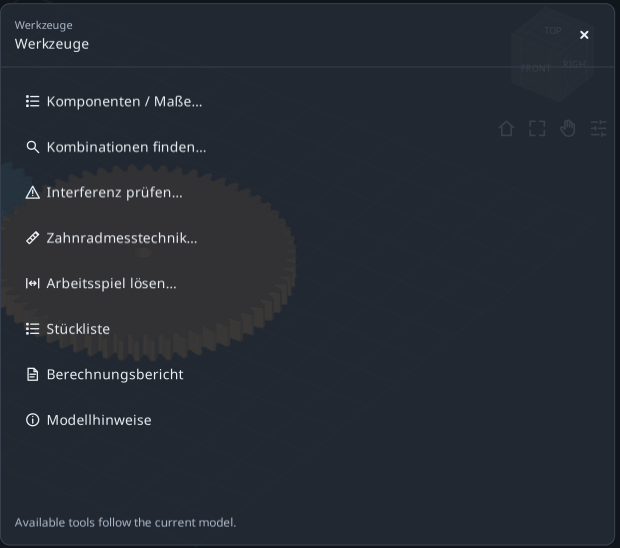

**Erwartetes Ergebnis.** Das Lesen eines Ergebnisses ändert nichts. Suche und Spielanpassung benötigen eine ausdrückliche Übernahme.

**Bei Problemen / Einordnung.** **Werkzeug erweitern** vergrößert das Formular; **Arbeitsbereich wiederherstellen** bringt das Modell zurück. **Alle Werkzeuge** wechselt das Werkzeug, × schließt es. Sitzungsentwürfe ersetzen kein gespeichertes Projekt.

## Ritzel auswählen und isolieren

Das richtige Bauteil erkennen, ohne seine Geometrie zu ändern.

1. **Ein Bauteil auswählen.** Datei 01 öffnen, dann **Werkzeuge** → **Komponenten / Maße…**. Unter **Teile** die erste Ritzelzeile wählen. Die Zusammenfassung muss genau ein ausgewähltes Teil zeigen.

2. **Kennung lesen.** **Komponentendetails · Nenngrenzen in mm** öffnen. Der Quellname ist S1_Pinion. XYZ-Grenzen sind Nennabmessungen entlang der Weltachsen, keine drei Durchmesser.

3. **Isolieren und zurückkehren.** **Isolieren** anklicken, Bauteil betrachten, dann **Ansicht wiederherstellen**. Die vorherigen Ansichtsfilter kehren zurück. Strg/Umschalt erweitert die Auswahl.

4. **Zähne ansehen.** **Verzahnung anzeigen** öffnet bei einem geeigneten ausgewählten Zahnrad die Zahnansicht. **Zurück zum Modell** führt zurück. Für theoretische Maße die Metrologie verwenden.

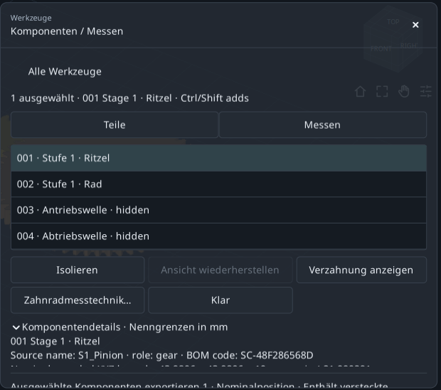

**Erwartetes Ergebnis.** Das Ritzel ist identifiziert; Zähnezahlen, Modul und Achsabstand bleiben unverändert.

**Bei Problemen / Einordnung.** Deaktivierte Zahn-/Metrologiefunktionen bedeuten meist, dass kein einzelnes geeignetes Zahnrad ausgewählt ist. Eine Welle ist kein Zahnrad.

## Zwei sichtbare Oberflächenpunkte messen

Die gerade Strecke A-B und ihre XYZ-Differenzen ermitteln.

1. **Ruhende Stellung einstellen.** In Components **Messen** und **Verwenden Sie eine nominale Pose** wählen. Verdeckt das Bedienfeld das Rad, Pan aktivieren, Modell nach links verschieben und Pan wieder ausschalten.

2. **A und B auswählen.** Eine massive Stelle der oberen Ritzelfläche und danach der oberen Radfläche anklicken. Sichtbare Flächen außerhalb des Bedienfelds wählen, nicht die leere Bohrungsmitte.

3. **Werte lesen.** Gerade Strecke und B−A ΔXYZ ablesen. Bei zwei oberen ebenen Flächen gleicher Höhe liegt ΔZ ungefähr bei null.

4. **Gezielt wiederholen.** **Klare Punkte** beginnt neu. Ihre Klicks liefern normalerweise einen anderen Abstand als im Bild.

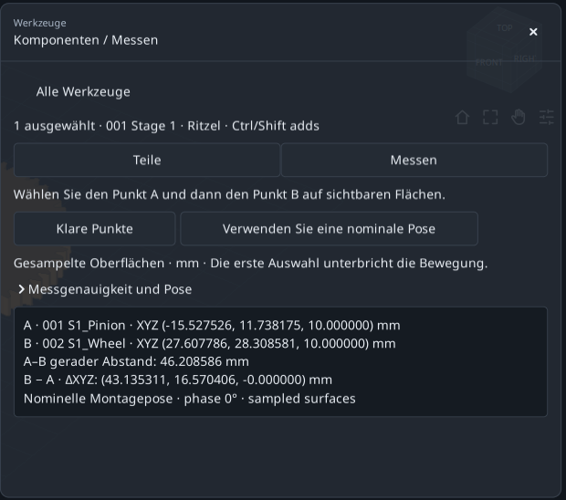

**Erwartetes Ergebnis.** Zwei markierte Punkte, ein Abstand in mm und drei Koordinatendifferenzen.

**Bei Problemen / Einordnung.** Ohne Fangfunktion: gemessen werden Punkte auf abgetasteten Flächen, kein analytischer Durchmesser, exakter Achsabstand oder kleinster Flächenabstand.

## Nur das ausgewählte Ritzel exportieren

Auswahlexport und Export des vollständigen Getriebes unterscheiden.

1. **Auswahl prüfen.** Zu **Teile** zurückkehren, nur das Ritzel auswählen und nach unten scrollen. Der Exporthinweis muss ein ausgewähltes Teil zeigen.

2. **Ziel zuerst festlegen.** Im oberen Menü **Exportieren** über **Ordner wechseln…** einen Übungsordner wählen, dann zum Werkzeug zurückkehren.

3. **Im Werkzeug exportieren.** STEP für CAD, STL für das Netz, **DXF / SVG** für unterstützte Schnitte oder **Paket** anklicken. Bestätigung abwarten und **Ordner öffnen** wählen.

4. **Dateien prüfen.** Nur das Ritzel muss in Nennmontagekoordinaten enthalten sein. Ein ausgeblendetes, aber ausgewähltes Teil wird trotzdem exportiert.

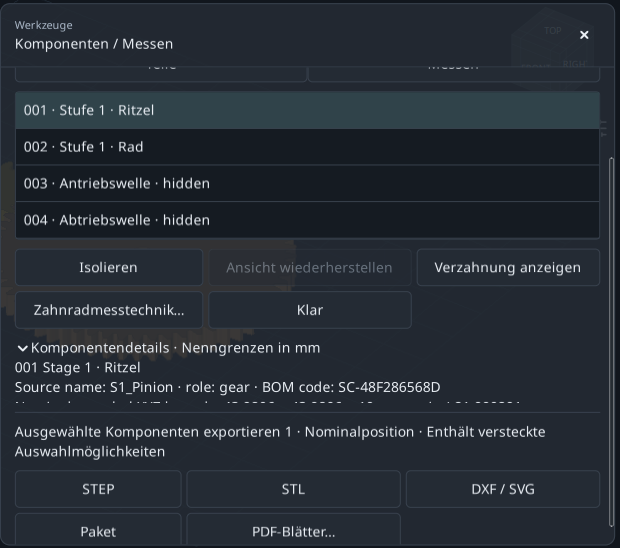

**Erwartetes Ergebnis.** Die Auswahl bestimmt den Inhalt; Sichtbarkeit ersetzt keine Auswahl.

**Bei Problemen / Einordnung.** **PDF-Blätter…** benötigt ein ausgewähltes Bauteil und öffnet Firmenblätter. DXF/SVG-Schnitte sind nicht automatisch Fertigungsschablonen.

## Ein kleineres 3:1-Zahnradpaar suchen

18/54 mit 20/60 vergleichen; Modul, Breite, Variante und Anschlüsse bleiben fest.

1. **Mit Datei 01 beginnen.** **Werkzeuge** → **Kombinationen finden…** öffnen; **Sucheinstellungen bearbeiten** geöffnet lassen.

2. **Ziel eingeben.** **Gewünschtes Verhältnis**=3 und **Zulässiger Fehler ± (%)**=0. Gemeint ist der Betrag Eingangsdrehzahl/Ausgangsdrehzahl, nicht 0.333.

3. **Vergleich wählen.** **In beide Richtungen** beibehalten und unter **Ergebnisse vergleichen nach** die Option **Kleinster Bauraum** wählen. Der aktuelle Anschluss ergibt Gegenlauf.

4. **Bauraumgrenzen offen lassen.** Maximale X/Y/Z-Werte bei 1000 mm belassen. Der Bauraum umfasst alle erzeugten, auch ausgeblendeten Komponenten.

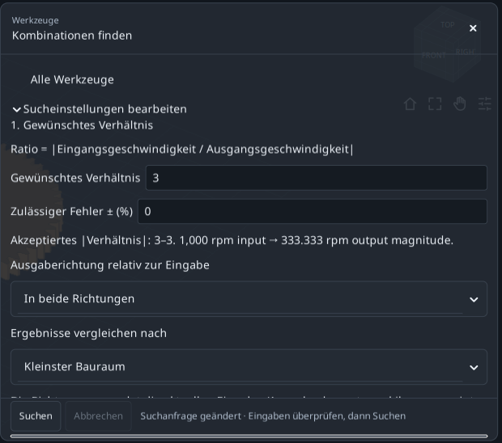

**Erwartetes Ergebnis.** Das Ziel steht fest. Nun vier Kandidaten festlegen.

**Bei Problemen / Einordnung.** Die Suche braucht eine Baugruppe mit eindeutigem Ein-/Ausgangsverhältnis. Einzelräder und Differenziale liefern dieses nicht.

## Genau festlegen, was variieren darf

Unter **2. Parameter zum Erkunden** kleine endliche Bereiche verwenden.

1. **Ritzelbereich.** Bei **Zähne des Antriebsritzels** die Optionen **Variieren** und **Reichweite** wählen: **Von** 18, **To** 20, **Schritt** 2. Damit werden 18 und 20 geprüft.

2. **Radbereich.** Bei **Zähne des angetriebenen Rades**: **Variieren**, **Reichweite**, **Von** 54, **To** 60, **Schritt** 6. Damit werden 54 und 60 geprüft.

3. **Andere Werte festhalten.** In **Weitere Abmessungen** die übrigen Variablen auf **Bleiben Sie auf dem Laufenden** lassen. Zwei mal zwei Werte ergeben vier Kandidaten.

4. **Suche starten.** Unter Advanced genügen 100 maximale Kandidaten und 60 Sekunden. **Suchen** anklicken und warten.

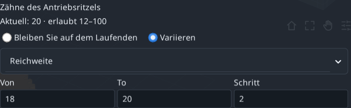

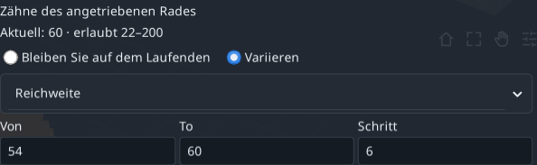

**Erwartetes Ergebnis.** 18/54 und 20/60 erfüllen exakt 3:1; die beiden anderen Kombinationen nicht.

**Bei Problemen / Einordnung.** Bereiche multiplizieren sich über die Variablen. Klein beginnen und Feldfehler vor dem Start korrigieren.

## Vorschlag vergleichen, übernehmen und rückgängig machen

Eine Ergebniszeile bleibt bis zur ausdrücklichen Übernahme ein Vorschlag.

1. **Ersten Vorschlag lesen.** Nach kleinstem Bauraum steht 18/54 zuerst: Ritzel 20→18, Rad 60→54; Übersetzung 3:1 und Gegenlauf bleiben.

2. **Geometrie vergleichen.** Nennbauraum ungefähr 147.933 × 111.990 × 26 mm; nutzbare Profilüberdeckung etwa 1.64876. Das sind Geometriewerte, keine Festigkeitsnachweise.

3. **Vor der Übernahme speichern.** 18/54 auswählen. Falls nötig zuerst mit **Bericht speichern…** den TXT-Bericht sichern, dann **Anwenden ausgewählt**. Die Übernahme macht die Suche ungültig.

4. **Kontrollieren und zurücknehmen.** Im Modell stehen 18 und 54. Ein **Rückgängig** stellt 20/60 wieder her. Datei 02 ist der fertige kompakte Vergleichsstand.

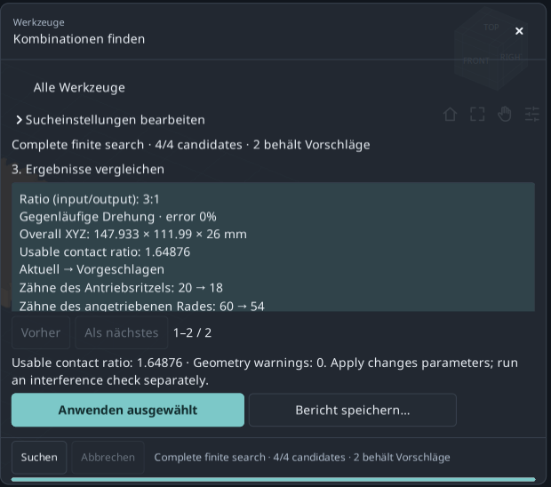

**Erwartetes Ergebnis.** Kompakteres Paar bei gewünschter Übersetzung mit reversibler Modelländerung.

**Bei Problemen / Einordnung.** Bei der unveränderten 20/60-Zeile bleibt Apply deaktiviert. Nach Modell- oder Bereichsänderungen neu suchen.

## Abgetastete Bewegung prüfen

Zuerst die Abdeckung lesen, dann die Kontaktliste einordnen.

1. **Zu Datei 01 zurückkehren.** **Werkzeuge** → **Interferenz prüfen…** öffnen. Nicht das kompakte Ergebnis der vorigen Übung verwenden.

2. **Abtastung einstellen.** Unter **Überprüfen Sie die Einstellungen**: Winkelschritt 30°, Randtoleranz 0.01 mm, Zeitlimit 120 s.

3. **Prüfung ausführen.** **Zyklus prüfen** anklicken und warten. Verdeckte Lager-/Gehäuseteile werden ebenfalls berücksichtigt. Ausblenden schließt sie nicht aus.

4. **Abdeckung lesen.** Dieses Beispiel erreicht 37/37 Stellungen bei Schritt≤30°. Bei INCOMPLETE mehr Zeit oder einen gröberen Schritt einstellen und erneut prüfen.

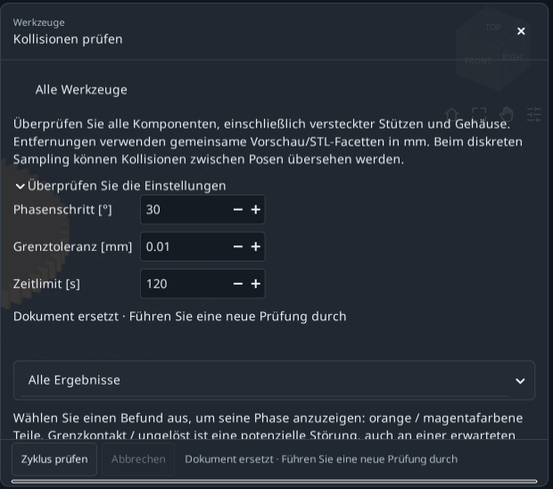

**Erwartetes Ergebnis.** Vollständige diskrete Abdeckung heißt: alle 37 geplanten Stellungen wurden geprüft.

**Bei Problemen / Einordnung.** Die kinematische Periode markierter Teile kann größer als 360°sein. Kleinere Schritte benötigen mehr Arbeit; verstrichene Zeit allein belegt keine Abdeckung.

## Kontakt und Durchdringung unterscheiden

Der Filter ändert die Liste, nicht Prüfung oder Abdeckung.

1. **Ungeklärte Kontakte zeigen.** **Ungeklärte Kontakte** wählen. Die Basis markiert Ritzel/Eingangswelle und Rad/Ausgangswelle.

2. **Zeile untersuchen.** Eine Meldung anklicken: Phase und orange/magentafarbene Teile erscheinen. **Vorschau wiederherstellen** stellt die Ansicht wieder her; nötigenfalls zuerst den erweiterten Modus verlassen.

3. **Klassen vergleichen.** **Mögliche Kollision** zeigt Intersection/Containment, **Getrennt** getrennte Paare und **Alle Ergebnisse** sämtliche Klassen.

4. **Speichern und neu prüfen.** **Bericht speichern…** speichert TXT über einen Dateidialog. Änderungen an Einstellungen oder Geometrie machen die alte Prüfung ungültig.

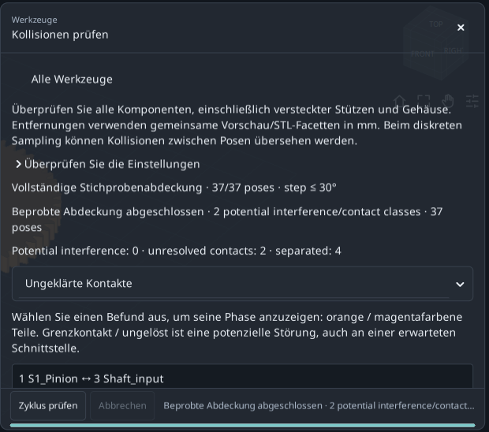

**Erwartetes Ergebnis.** Basis: 0 potenzielle Interferenzklassen, 2 ungeklärte Kontaktklassen und 4 getrennte Klassen.

**Bei Problemen / Einordnung.** Boundary contact/unresolved ist nicht automatisch ein Modellfehler. Vollständige diskrete Abdeckung beweist keine kontinuierliche Kollisionsfreiheit.

## Das theoretische Kugelmaß berechnen

Das passende erzeugte Zahnrad statt einer angenäherten 3D-Klickmessung verwenden.

1. **Ritzel auswählen.** Datei 01 öffnen. In Components nur das erste Ritzel auswählen, dann **Zahnradmesstechnik…**.20 Zähne, Referenzdurchmesser 40 mm und S1_Pinion prüfen.

2. **Vorgeschlagene Kugel verwenden.** **Bälle** beibehalten, **Verwenden Sie den theoretischen Messdurchmesser** anklicken und den berechneten Wert von etwa 3.534085 mm übernehmen. Keinen gerundeten Bildwert abtippen.

3. **Berechnen.** **Berechnen** anklicken. Erwartet: Maß über Kugeln≈44.876412 mm, Kontaktradius 20 mm. Das ist nicht der 40-mm-Referenzdurchmesser.

4. **Abfrage exportieren.** **Exportbericht · TXT + JSON** speichert Eingaben und Ergebnis im unter **Exportieren** → **Zielordner** angezeigten Ordner. Nach Kugel-/Bauteiländerung neu berechnen.

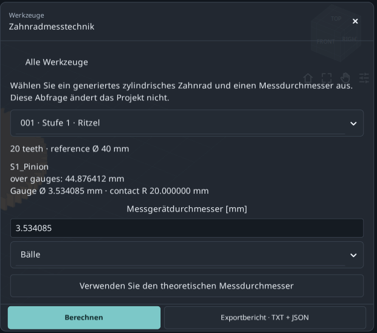

**Erwartetes Ergebnis.** Reproduzierbares theoretisches Ritzelmaß. Axiale Rollen liefern in diesem geradverzahnten Fall denselben Querwert.

**Bei Problemen / Einordnung.** Nur unterstützte außen-/innenverzahnte geradverzahnte Evolventenräder. Schrägverzahnung, tatsächlicher Instrumentenzugang und Toleranzen sind nicht abgedeckt.

## Die Wildhaber-Zahnweite ablesen

Eine Flachbackenmessung über eine ausgewählte Zahnzahl.

1. **Dasselbe Ritzel behalten.** Bei S1_Pinion mit 20 Zähnen bleiben; nicht zum 60-Zähne-Rad wechseln.

2. **Zahnweitenabschnitt öffnen.** Zu **Zahnweitenmessung** scrollen. Unter **Wildhaber span · number of teeth** die 3 wählen.

3. **W3lesen.** W3≈15.250402 mm und Kontaktradius≈20.281829 mm. 3 ist hier die Messzahnzahl, nicht die Getriebeübersetzung.

4. **Verfügbare Werte beachten.** Die Liste enthält nutzbare Kontakte des erzeugten Profils. Fehlende Zahnzahlen nicht erzwingen; Innen-/Schrägverzahnung bietet diese äußere Flachbackenmessung nicht.

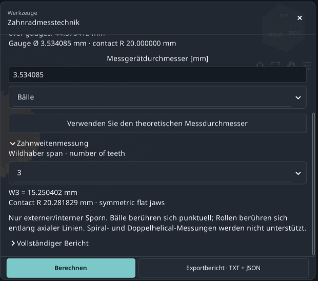

**Erwartetes Ergebnis.** Kugelmaß und Wk sind unterschiedliche Maße; jeweils Bauteil und Eingaben festhalten.

**Bei Problemen / Einordnung.** Angezeigte Dezimalstellen definieren weder Fertigungstoleranz noch Messunsicherheit, Verzahnungsqualität oder vollständige Normkonformität.

## Betriebsspiel von 0.15 auf 0.50 mm ändern

Einen neuen Achsabstand für das tangentiale Betriebsspiel im Querschnitt vorschlagen.

1. **Mit Datei 01 beginnen.** **Arbeitsspiel lösen…** öffnen. Aktuellen Achsabstand 80 mm und Betriebsspiel 0.15 mm kontrollieren.

2. **Ziel einstellen.** In **Gewünschtes Quer-Tangential-Arbeitsspiel [mm]** den Wert 0.5 eingeben. Nicht das Zahnverdünnungsfeld Backlash im Modell ändern.

3. **Gültigen Bereich prüfen.** **Nominal target range** lesen: 0.5 mm liegt für diese Basis darin. Die Grenzen hängen von der aktuellen Geometrie ab.

4. **Berechnen und ansehen.** Unter **Diskrete Interferenzeinstellungen**: Schritt 30°, Zeit 120 s, maximal 721 Stellungen. **Berechnen und Vorschau anzeigen** anklicken.

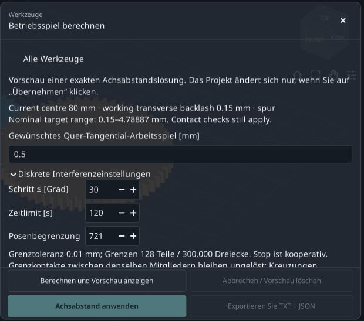

**Erwartetes Ergebnis.** Der Solver berechnet und prüft einen Vorschlag, ohne das Hauptprojekt schon zu ändern.

**Bei Problemen / Einordnung.** Nur ein außenverzahntes Parallelradpaar: gerade/schräg/doppelschräg. Mehrstufige, interne und planetarische Triebe sind ausgeschlossen. Das Ziel ist kein Radial- oder Normalspiel.

## Den neuen Achsabstand übernehmen

Aktuelle/vorgeschlagene Werte gemeinsam mit dem Prüfhinweis lesen.

1. **Werte vergleichen.** Erwartet: Achsabstand≈80.466750 mm, Betriebsspiel≈0.500000 mm, nutzbare Profilüberdeckung≈1.44449.

2. **Ungeklärte Schnittstellen lesen.** Die diskrete Abdeckung ist vollständig, aber zwei Schnittstellen zu Wellen desselben kinematischen Körpers bleiben ungeklärt. Sie sind nicht als gelöst eingestuft.

3. **Vorschlag anwenden.** **Achsabstand anwenden** anklicken. Unter erweiterten Abmessungen steigt **Erhöhung des Achsabstands [mm]** von 0 auf etwa 0.466750. Referenzabstand plus Erhöhung ergibt den neuen Abstand.

4. **Vor Undo exportieren.** **Exportieren Sie TXT + JSON** speichert Vorschlag und Anwendungsstatus im aktuellen Zielordner. **Rückgängig** stellt danach 80 mm wieder her. Datei 03 ist der fertige Vergleichsstand.

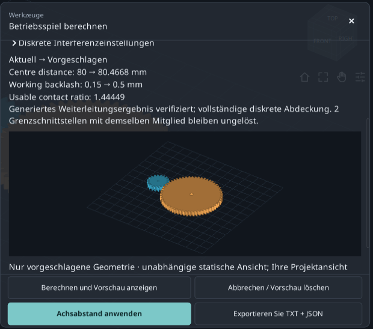

**Erwartetes Ergebnis.** Zielspiel durch Achsabstandsänderung; 20/60 Zähne und Modul 2 mm bleiben gleich.

**Bei Problemen / Einordnung.** Bei deaktiviertem Apply die Ursache lesen: ungültiges Ziel, unvollständige Prüfung, Interferenz oder geändertes Projekt können eine Neuberechnung erfordern. Eine Vorschau reicht nicht.

## Bauteile, Berechnungen und Hinweise finden

Berichte helfen, das Ausgangsmodell zu verstehen und Werte zu finden.

1. **Stückliste öffnen.** Mit Datei 01 **Werkzeuge** → **Stückliste** wählen. Erzeugte Bauteilnamen, Kennungen und Mengen mit Components vergleichen.

2. **Berechnungen öffnen.** **Berechnungsbericht** öffnet **Nominalberechnungsbericht**: Übersetzung, Eingriffsgeometrie und Nennberechnungen.

3. **Im Dokument suchen.** Unter **Dieses Dokument durchsuchen…** etwa S1_Pinion eingeben. **Zurück**/**Als nächstes** wechselt Treffer, **Alles kopieren** kopiert den Bericht.

4. **Modellhinweise lesen.** **Modellhinweise** erklärt Konstruktionsdetails. Modell- oder Werkzeugausgabe über die jeweilige Exportfunktion erhalten.

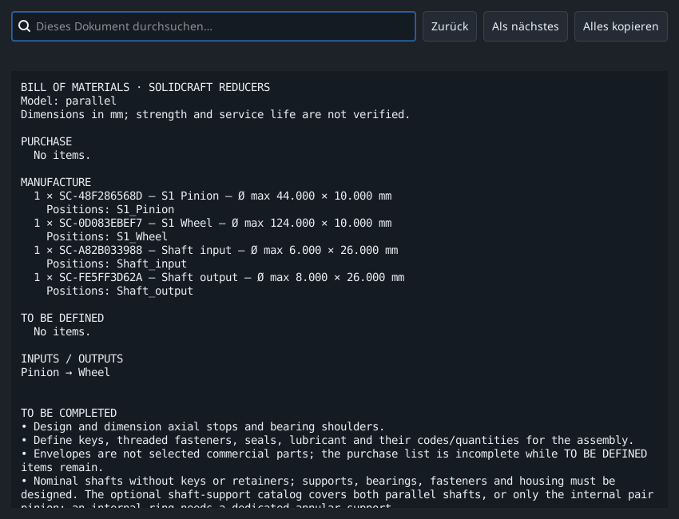

**Erwartetes Ergebnis.** Stückliste der Baugruppe, Nennberechnungen, Hinweise und einzelne Werkzeugabfragen sind auffindbar.

**Bei Problemen / Einordnung.** Eine erzeugte Stückliste ist nicht automatisch eine vollständige Einkaufsliste. CAD-Ergänzungen und betriebliche Entscheidungen können fehlen.

## Wenn Ihr Ergebnis abweicht

Vor vielen Parameteränderungen jeweils eine Bedingung prüfen.

1. **Andere Abmessungen.** Datei 01 erneut öffnen: 20/60 Zähne, Modul 2, Breite 10, gerade Zähne und 80 mm Achsabstand. Dateien 02 und 03 enthalten absichtlich andere Ergebnisse.

2. **Bedienelement fehlt.** Scrollen oder **Werkzeug erweitern** verwenden; Sprache und Version vergleichen. Die Bilder zeigen die lokale Tools-Überarbeitung auf 0.2.2.

3. **Apply oder Export deaktiviert.** Ändernden Vorschlag oder geeignetes Teil auswählen, Feldfehler beheben und nach Änderungen neu rechnen. Metrologie braucht ein gültiges Ergebnis.

4. **Abweichende Messung / unvollständige Prüfung.** Punktklicks variieren ohne Fangfunktion. Suche vereinfachen oder Prüfzeit erhöhen; Abdeckung statt nur Laufzeit kontrollieren.

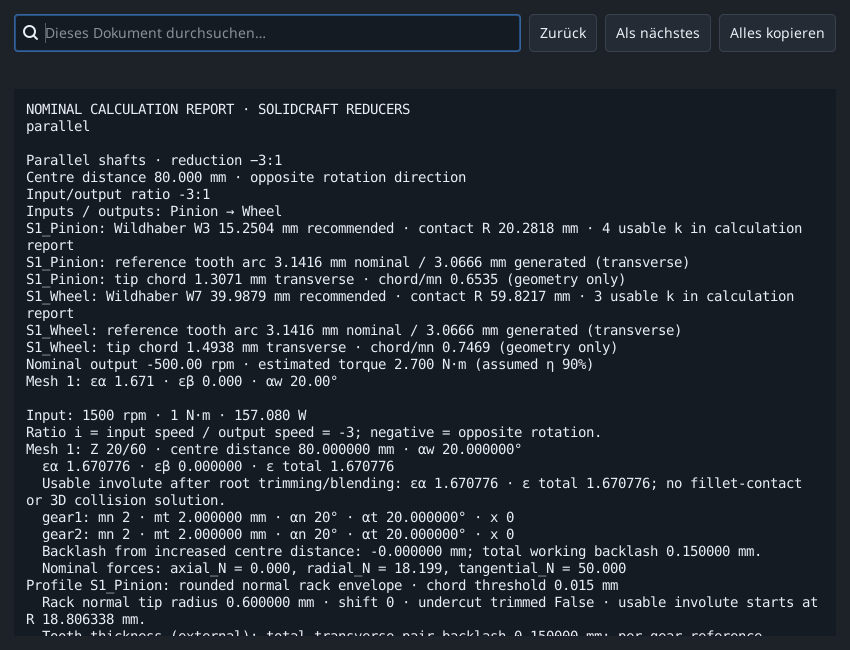

**Erwartetes Ergebnis.** Eine Übung nach der anderen wiederholen; Ausgangsprojekt und Ergebnisbericht aufbewahren.

**Bei Problemen / Einordnung.** Eigene Arbeit vorher sichern. Hier geht es um Nenngeometrie und diskrete Bewegung, nicht um Festigkeit, Lebensdauer oder Fertigungsfreigabe.

## Quellen und Geltungsbereich

Der didaktische Ablauf orientiert sich an offiziellen KISSsoft-Tutorials und feldweisen GearTrax-Anweisungen. Die herangezogene GearTrax-Hilfe stammt aus 2009. Texte, Beispiele und Bilder sind von RatioLab; die Quellen erweitern dessen Berechnungsumfang nicht.

- [KISSsoft, Tutorial 15 - Bevel gears (2022)](https://www.kisssoft.com/files/eu64So/KISSsoft-Tutorial-015-Bevelgear-en.pdf)
- [KISSsoft, offizielles Tutorial-Verzeichnis](https://development.startpage.services.kisssoft.com/)
- [Camnetics, GearTrax - Creating a Spur Gear (historische Hilfe, 2009)](https://camnetics.com/geartrax/FlashHelp/geartrax2009/creating_a_spur_gear.htm)
- [Camnetics, GearTrax - Between Pins Example (historische Hilfe, 2009)](https://camnetics.com/geartrax/FlashHelp/geartrax2009/between_pins_example.htm)

Nenngeometrie, theoretische Messmaße und diskrete Prüfungen belegen weder Festigkeit noch Lebensdauer oder Fertigungseignung.
