# RatioLab Tools: illustrated walkthroughs

Six worked examples, from input to a result you can recognise.

Desktop 0.2.2 with the local Tools revision · 2026-11-10

Screenshots use this interface language. Commands that remain English in the app retain that visible name. Enter the example decimals with a dot. Model identifiers and filenames stay unchanged.

Open the JSON projects using File → Open… after saving your current work. Start each exercise with file 01. Files 02 and 03 are result checkpoints, not saved tool requests. These examples do not change application preferences.

[English](tools-en.md) · [Italiano](tools-it.md) · [Español](tools-es.md) · [Français](tools-fr.md) · [Deutsch](tools-de.md) · [Português (Portugal)](tools-pt.md) · [Русский](tools-ru.md) · [简体中文](tools-zh-CN.md) · [தமிழ்](tools-ta.md)

## Example projects

- [tools-01-base.config.json](../../examples/tools-01-base.config.json)
- [tools-02-rapporto3-compatto.config.json](../../examples/tools-02-rapporto3-compatto.config.json)
- [tools-03-backlash05.config.json](../../examples/tools-03-backlash05.config.json)

## Contents

- [One starting model, six exercises](#inizio)
- [Which Tool should I open?](#scegliere)
- [Select and isolate the pinion](#componenti)
- [Measure two visible surface points](#misurare)
- [Export only the selected pinion](#esportare)
- [Find a smaller 3:1 pair](#ricerca)
- [Specify exactly what may vary](#intervalli)
- [Compare, apply and undo a solution](#applicare-ricerca)
- [Check sampled motion](#interferenze)
- [Distinguish contact from interference](#leggere-interferenze)
- [Calculate the theoretical over-gauges dimension](#metrologia)
- [Read a Wildhaber tooth span](#wildhaber)
- [Change working backlash from 0.15 to 0.50 mm](#backlash)
- [Accept the new centre distance](#applicare-backlash)
- [Find parts, calculations and notes](#report)
- [When your result differs](#problemi)

## One starting model, six exercises

Start with known data rather than guessing which parameters to use.

1. **Open the example.** Save your own project first. Choose **File** → **Open…** and open tools-01-base.config.json.

2. **Check the model.** Parallel shaft reducer, one stage, Spur: pinion 20, wheel 60, module 2 mm, face width 10 mm and centre distance 80 mm. The ratio is -3:1; 1500 rpm input gives -500 rpm output.

3. **Restart each exercise.** Reopen file 01 before moving to another Tool. Search can change tooth counts; backlash adjustment changes centre distance. Files 02 and 03 show their completed results.

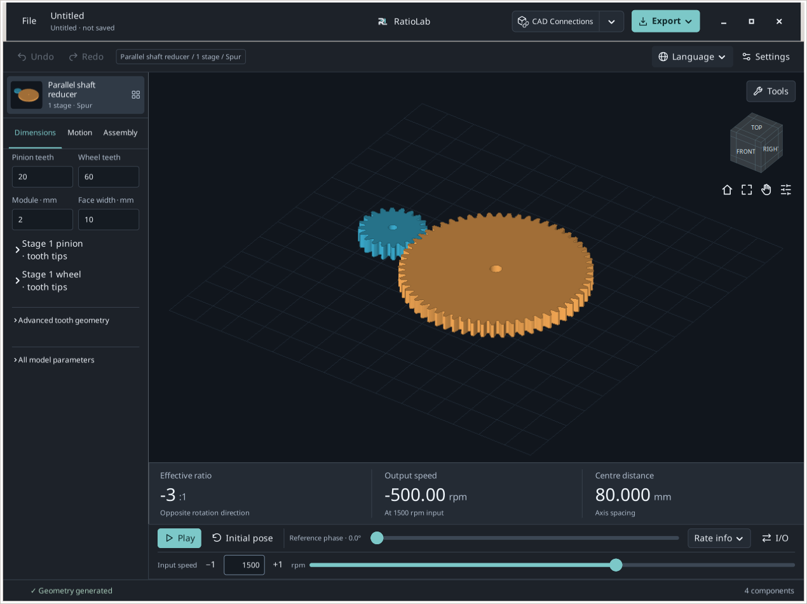

**Expected result.** 20/60 teeth and 80 mm centre distance identify the correct starting point.

**If you get stuck / interpretation.** These guides describe the local Tools revision on 0.2.2. Public installers and the hosted browser may have different controls.

## Which Tool should I open?

Open **Tools** above the 3D view and choose the task you want to complete.

1. **Select, measure or export a part.** **Components / measure…** handles part selection, isolation, surface points and selected-part export.

2. **Find a ratio or check motion.** **Find combinations…** compares finite parameter grids. **Check interference…** examines sampled poses and shows the involved parts.

3. **Get a theoretical inspection dimension.** **Gear metrology…** calculates supported spur-component gauge and tooth-span dimensions.

4. **Change working backlash.** **Solve working backlash…** proposes centre distance for one external parallel pair. Reports are listed below the analysis Tools.

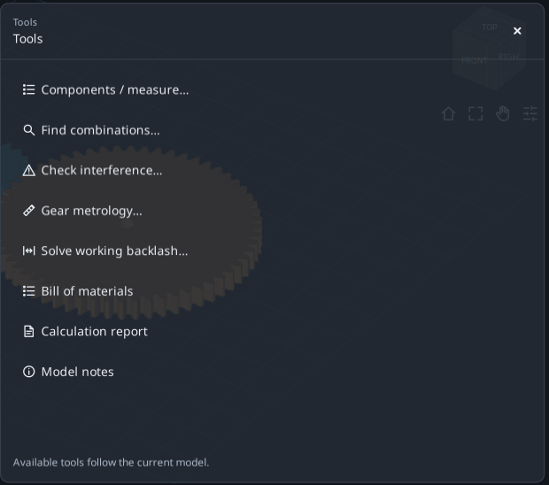

**Expected result.** Reading a result does not alter the model. Search and backlash need an explicit Apply.

**If you get stuck / interpretation.** **Expand tool** enlarges a form; **Restore workspace** returns the model. **All tools** switches forms; × closes one. Session drafts are not saved projects.

## Select and isolate the pinion

Identify the intended part without editing its geometry.

1. **Select one part.** Open file 01, then **Tools** → **Components / measure…**. In **Parts**, select the first pinion row; the summary must show one selected component.

2. **Read its identity.** Expand **Component details · nominal bounds in mm**. Its source name is S1_Pinion. XYZ bounds are nominal world-axis extents, not three diameters.

3. **Isolate and restore.** Click **Isolate**, inspect the part, then **Restore view**. This restores the previous display filters. Ctrl/Shift adds parts to the selection.

4. **Inspect the teeth.** With one supported gear selected, **View teeth** opens the tooth view; **Back to model** returns. Use metrology for theoretical dimensions.

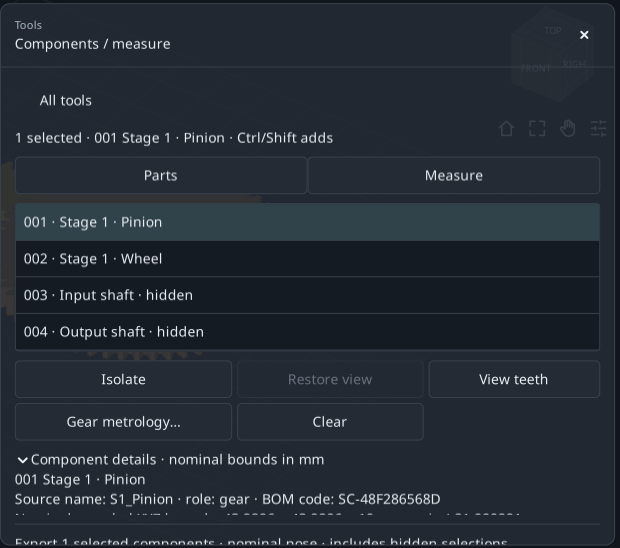

**Expected result.** You have located the pinion without changing tooth counts, module or centre distance.

**If you get stuck / interpretation.** Disabled tooth/metrology actions usually mean no single compatible gear is selected. A shaft is not a gear.

## Measure two visible surface points

Obtain a straight A-B distance and understand its XYZ differences.

1. **Set a stationary pose.** In Components choose **Measure**, then **Use nominal pose**. If the dock covers the wheel, enable Pan, drag the model left, then disable Pan.

2. **Choose A and B.** Click a solid area of the pinion top face, then the wheel top face. Click visible surfaces outside the dock, not the empty centre of a bore.

3. **Read the values.** Read the straight distance and B−A ΔXYZ. For two top planar faces at the same height, ΔZ is approximately zero.

4. **Repeat deliberately.** **Clear points** starts again. Your clicks normally give a different distance from the screenshot.

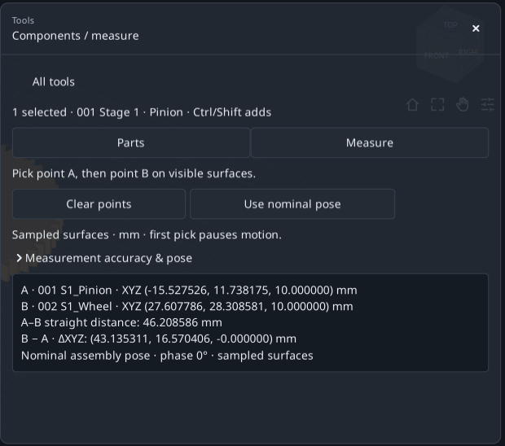

**Expected result.** Two marked points, a distance in mm and three coordinate differences.

**If you get stuck / interpretation.** There is no snapping. This is a sampled-surface point distance, not an analytic diameter, exact centre distance or minimum surface-to-surface gap.

## Export only the selected pinion

Separate selected-part export from exporting the whole reducer.

1. **Check the selection.** Return to **Parts**. Select only the pinion; scroll down until the export summary shows one selected component.

2. **Choose the destination first.** In the top **Export** menu use **Change folder…** to choose an exercise folder, then return to the Tool.

3. **Export from the Tool.** Click STEP for CAD, STL for a mesh, **DXF / SVG** for supported sections, or **Package**. Wait for confirmation and click **Open folder**.

4. **Check the files.** The export should contain the pinion only, in nominal assembly coordinates. A hidden selected part is still exported.

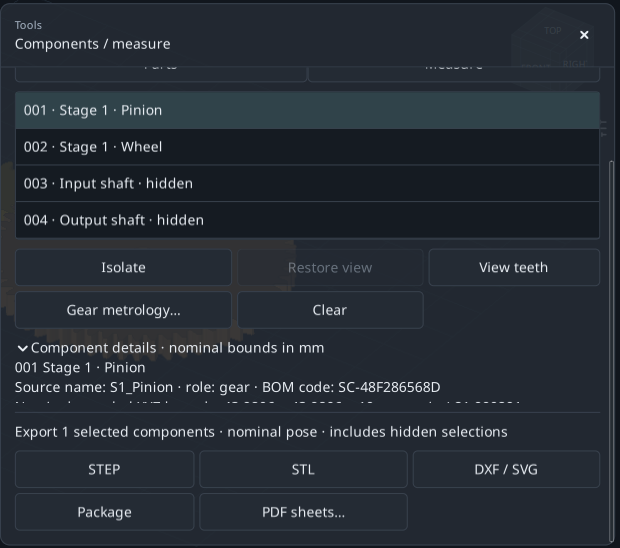

**Expected result.** The selection controls export membership; display visibility does not replace selection.

**If you get stuck / interpretation.** **PDF sheets…** requires one selected component and opens company sheets. DXF/SVG sections are not automatically cutting templates.

## Find a smaller 3:1 pair

Compare 18/54 with 20/60 while keeping module, width, variant and I/O fixed.

1. **Start from file 01.** Open **Tools** → **Find combinations…** and leave **Edit search settings** expanded.

2. **Set the target.** Enter 3 in **Desired ratio** and 0 in **Allowed error ± (%)**. This is the absolute input/output speed ratio, not 0.333.

3. **Choose the comparison.** Leave **Either direction**; choose **Smallest envelope** under **Compare results by**. The current I/O gives opposite rotation.

4. **Keep size limits broad.** Leave maximum X/Y/Z at 1000 mm. The envelope includes all generated components, even hidden ones.

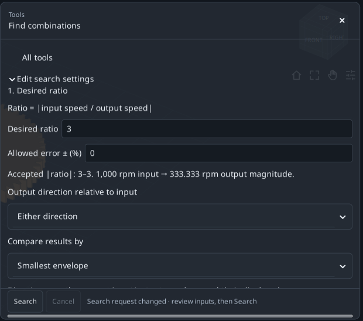

**Expected result.** The objective is set. Next, define four candidate combinations.

**If you get stuck / interpretation.** This search needs an assembly with one fixed I/O ratio. Single gears and differentials do not provide that unique ratio.

## Specify exactly what may vary

Use small finite ranges under **2. Parameters to explore**.

1. **Pinion range.** For **Input pinion teeth**, select **Vary** and **Range**: **From** 18, **To** 20, **Step** 2. This tries 18 and 20.

2. **Wheel range.** For **Driven wheel teeth**: **Vary**, **Range**, **From** 54, **To** 60, **Step** 6. This tries 54 and 60.

3. **Lock everything else.** Keep other variables at **Keep current** in **More dimensions**. Two values times two values gives four candidates.

4. **Run the search.** In Advanced, 100 maximum candidates and 60 seconds are ample for this exercise. Click **Search** and wait.

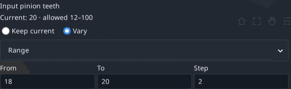

**Expected result.** 18/54 and 20/60 meet the exact 3:1 target; the two other combinations do not.

**If you get stuck / interpretation.** Ranges multiply across variables. Start small, and fix any field error before running.

## Compare, apply and undo a solution

A result row remains a proposal until you explicitly apply it.

1. **Read the first proposal.** Smallest envelope ranks 18/54 first: pinion 20→18, wheel 60→54; ratio stays 3:1 with opposite rotation.

2. **Compare its geometry.** Nominal XYZ is about 147.933 × 111.990 × 26 mm; usable contact ratio is about 1.64876. These are geometry results, not strength ratings.

3. **Save before applying.** Select 18/54. If you need the search record, use **Save report…** to save TXT before **Apply selected**; applying invalidates the search.

4. **Verify and undo.** Model counts become 18 and 54. One **Undo** restores 20/60. File 02 is the ready-to-open compact checkpoint.

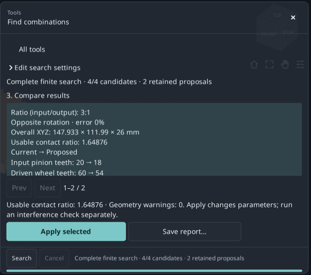

**Expected result.** A more compact pair with the requested ratio, plus a reversible model edit.

**If you get stuck / interpretation.** Apply stays disabled for the unchanged 20/60 row. After changing the model or ranges, run a new search.

## Check sampled motion

Read coverage before interpreting a collision list.

1. **Return to file 01.** Open **Tools** → **Check interference…**. Do not use the compact result from the previous exercise.

2. **Set the sampling.** In **Check settings**: phase step 30°, boundary tolerance 0.01 mm and time limit 120 s.

3. **Run the check.** Click **Check cycle** and wait. Hidden supports and housing are included; hiding parts does not exclude them.

4. **Read the coverage.** This example completes 37/37 poses at step≤30°. If coverage is INCOMPLETE, allow more time or a coarser step and rerun.

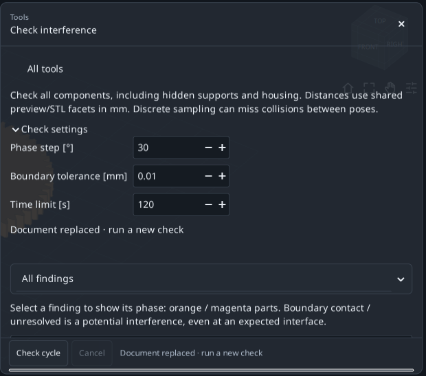

**Expected result.** Complete sampled coverage means all 37 planned poses were checked.

**If you get stuck / interpretation.** The labelled kinematic period can exceed 360°. Smaller steps increase work; elapsed time alone is not coverage evidence.

## Distinguish contact from interference

Filtering changes the list, not the completed analysis or its coverage.

1. **Show unresolved contacts.** Choose **Unresolved contacts**. The base example flags pinion/input-shaft and wheel/output-shaft interfaces.

2. **Inspect a row.** Click a finding to show its phase and orange/magenta parts. **Restore preview** returns the prior view; leave expanded mode first if needed.

3. **Compare classes.** **Potential interference** shows Intersection/Containment; **Separated** shows separated pairs; **All findings** restores all classes.

4. **Save and rerun when needed.** **Save report…** saves TXT through a file chooser. Edits to settings or geometry invalidate the old check.

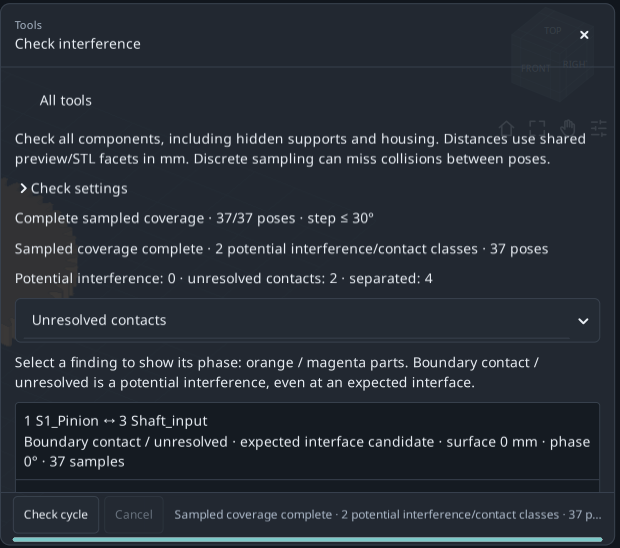

**Expected result.** The base example has 0 potential-interference classes, 2 unresolved-contact classes and 4 separated classes.

**If you get stuck / interpretation.** Boundary contact/unresolved is not automatically a model error. Complete discrete coverage does not prove continuous collision-free motion.

## Calculate the theoretical over-gauges dimension

Use the correct generated gear rather than approximating a diameter with 3D clicks.

1. **Select the pinion.** Open file 01. In Components select the first pinion only, then click **Gear metrology…**. Check 20 teeth, reference diameter 40 mm and source S1_Pinion.

2. **Use the proposed gauge.** Leave **Balls**, click **Use theoretical gauge diameter**, and retain the computed value, approximately 3.534085 mm. Do not retype a rounded screenshot value.

3. **Calculate.** Click **Calculate**. Expect over gauges≈44.876412 mm and contact radius 20 mm; this is not the 40 mm reference diameter.

4. **Export the query.** **Export report · TXT + JSON** saves inputs/results in the current destination shown under **Export** → **Destination folder**. Recalculate after a gauge/component change.

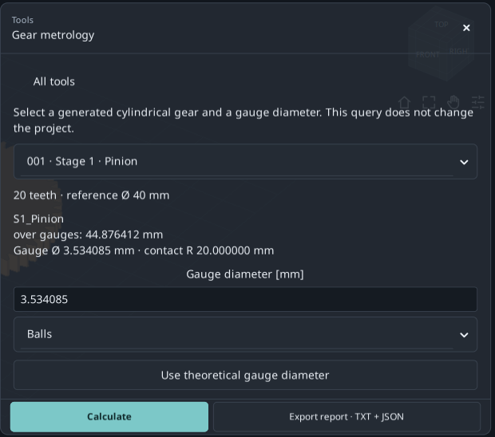

**Expected result.** The pinion has a reproducible theoretical measurement. Axial rollers give the same transverse value in this spur example.

**If you get stuck / interpretation.** Only supported external/internal spur involute components qualify. Helical/double-helical measurements, real gauge access and tolerances are outside this query.

## Read a Wildhaber tooth span

This is a flat-jaw span across a selected number of teeth.

1. **Keep the same pinion.** Continue with S1_Pinion, 20 teeth; do not switch to the 60-tooth wheel.

2. **Open the span controls.** Scroll to **Tooth span measurement**. Under **Wildhaber span · number of teeth**, choose 3.

3. **Read W3.** Expect W3≈15.250402 mm and contact radius≈20.281829 mm. Here 3 is the span tooth count, not the gearbox ratio.

4. **Respect the available choices.** The list contains usable contacts on the generated profile. Do not force an absent count; internal or helical gears do not provide this external flat-jaw span.

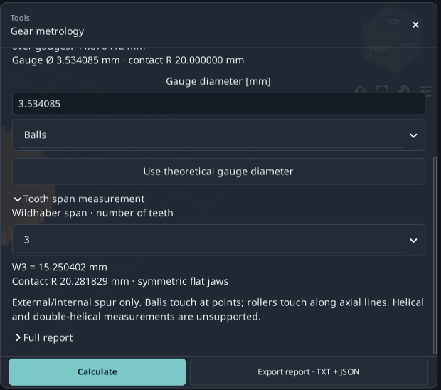

**Expected result.** Over-gauges and Wk are different dimensions; retain the component and input details for both.

**If you get stuck / interpretation.** Displayed decimal places do not define manufacturing tolerance, measurement uncertainty, gear quality or full standards conformity.

## Change working backlash from 0.15 to 0.50 mm

Propose a new centre distance for transverse tangential working backlash.

1. **Start from file 01.** Open **Solve working backlash…**. Check current centre 80 mm and working backlash 0.15 mm.

2. **Set the target.** Enter 0.5 in **Desired working transverse tangential backlash [mm]**. Do not edit the model’s tooth-thinning Backlash field for this exercise.

3. **Check the domain.** Read **Nominal target range**; 0.5 mm lies inside the interval for this base model. Limits depend on the current geometry.

4. **Calculate and preview.** In **Discrete interference settings**, use step 30°, time 120 s, pose limit 721. Click **Calculate & preview**.

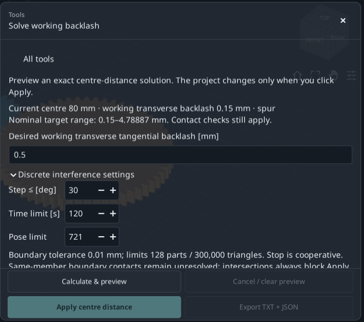

**Expected result.** The solver proposes and checks geometry without changing the main project yet.

**If you get stuck / interpretation.** One external parallel pair only: spur/helical/double. Multistage, internal and planetary trains are unsupported; the target is not radial or normal backlash.

## Accept the new centre distance

Read current/proposed values and the check message together.

1. **Compare the results.** Expect centre≈80.466750 mm, working backlash≈0.500000 mm and usable contact ratio≈1.44449.

2. **Read the unresolved interfaces.** The example reports complete discrete coverage but retains two unresolved same-member shaft interfaces. They have not been declared resolved.

3. **Apply the proposal.** Click **Apply centre distance**. In advanced Dimensions, **Centre distance increase [mm]** changes from 0 to about 0.466750; the reference centre plus this increment gives the new distance.

4. **Export before Undo.** **Export TXT + JSON** keeps the proposal and applied status in the current destination. Then **Undo** returns 80 mm. File 03 is the completed checkpoint.

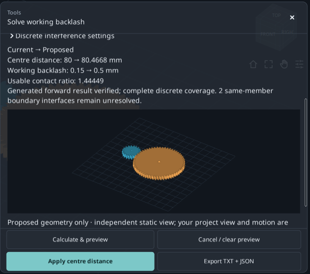

**Expected result.** The target is reached by changing centre distance, while 20/60 teeth and module 2 mm stay fixed.

**If you get stuck / interpretation.** Disabled Apply requires reading the reason: invalid target, incomplete check, interference or a changed project may require recalculation. A preview alone is not approval.

## Find parts, calculations and notes

Use the reports to understand the source model and locate a value.

1. **Open the BOM.** From file 01, choose **Tools** → **Bill of materials**. Compare generated part names, codes and quantities with Components.

2. **Open calculations.** **Calculation report** opens **Nominal calculation report**: ratio, mesh geometry and nominal calculations.

3. **Search the document.** In **Search this document…**, try S1_Pinion. **Previous**/**Next** navigate matches; **Copy all** copies the report text.

4. **Read model notes.** **Model notes** explains construction details. Model export or each Tool’s export preserves the relevant outputs.

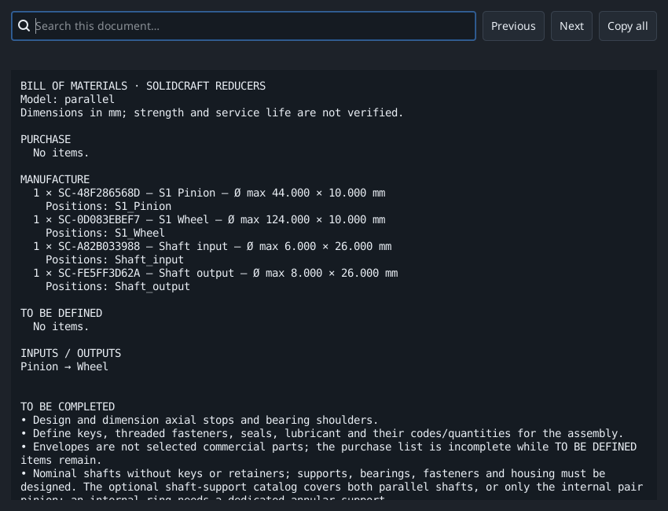

**Expected result.** You can locate assembly BOM, nominal calculations, notes and individual Tool queries.

**If you get stuck / interpretation.** A generated BOM is not automatically a complete procurement list; CAD completion and company choices can remain necessary.

## When your result differs

Check one condition at a time before changing many parameters.

1. **Different dimensions.** Reopen file 01:20/60 teeth, module 2, width 10, Spur and 80 mm centre. Files 02 and 03 intentionally contain different outcomes.

2. **Missing controls.** Scroll or use **Expand tool**; compare the interface language and version. These screenshots show the local Tools revision on 0.2.2.

3. **Disabled Apply or Export.** Select a changing proposal or compatible part; correct field errors and rerun after edits. Metrology needs a valid result.

4. **Unexpected measurement or incomplete check.** Point picks vary and do not snap. For an incomplete run, simplify the search or allow more check time; inspect coverage, not merely elapsed seconds.

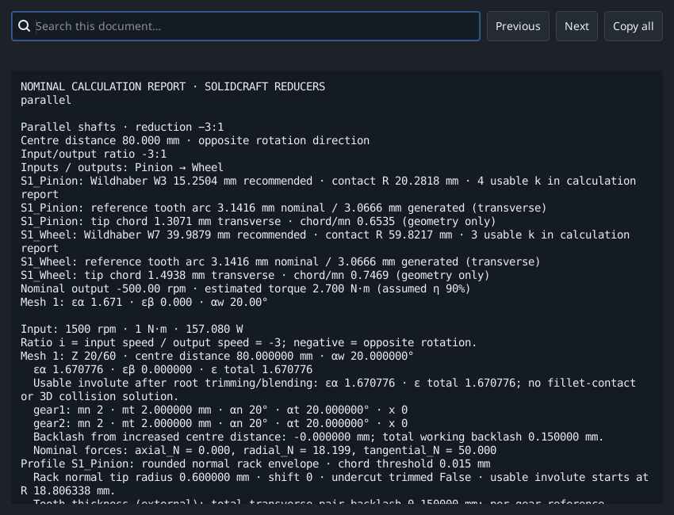

**Expected result.** Repeat one exercise at a time, retaining its starting project and result report.

**If you get stuck / interpretation.** Keep a saved copy of your own work. These exercises concern nominal geometry and sampled motion, not strength, life or production qualification.

## References and scope

The teaching sequence follows official KISSsoft tutorials and GearTrax field-by-field instructions. The GearTrax help consulted is historical (2009). All examples, screenshots and text here belong to RatioLab; references do not extend its calculation capabilities.

- [KISSsoft, Tutorial 15 - Bevel gears (2022)](https://www.kisssoft.com/files/eu64So/KISSsoft-Tutorial-015-Bevelgear-en.pdf)
- [KISSsoft, official tutorial index](https://development.startpage.services.kisssoft.com/)
- [Camnetics, GearTrax - Creating a Spur Gear (historical help, 2009)](https://camnetics.com/geartrax/FlashHelp/geartrax2009/creating_a_spur_gear.htm)
- [Camnetics, GearTrax - Between Pins Example (historical help, 2009)](https://camnetics.com/geartrax/FlashHelp/geartrax2009/between_pins_example.htm)

Nominal geometry, theoretical measurements and sampled checks do not establish strength, fatigue life or production suitability.
