# Tools de RatioLab: guías ilustradas

Seis ejemplos completos, desde los datos hasta un resultado reconocible.

Escritorio 0.2.2 con la revisión local de Tools · 2026-11-10

Las capturas usan este idioma de interfaz. Los comandos que siguen en inglés conservan su nombre visible. Escribe los decimales de los ejemplos con punto. Los nombres de archivo e identificadores no se traducen.

Guarda tu trabajo antes de abrir los proyectos JSON desde Archivo → Abrir. Cada ejercicio empieza con el archivo 01. Los archivos 02 y 03 son resultados preparados, no solicitudes guardadas de los Tools. No cambian las preferencias.

[English](tools-en.md) · [Italiano](tools-it.md) · [Español](tools-es.md) · [Français](tools-fr.md) · [Deutsch](tools-de.md) · [Português (Portugal)](tools-pt.md) · [Русский](tools-ru.md) · [简体中文](tools-zh-CN.md) · [தமிழ்](tools-ta.md)

## Proyectos de ejemplo

- [tools-01-base.config.json](../../examples/tools-01-base.config.json)
- [tools-02-rapporto3-compatto.config.json](../../examples/tools-02-rapporto3-compatto.config.json)
- [tools-03-backlash05.config.json](../../examples/tools-03-backlash05.config.json)

## Índice

- [Un modelo inicial, seis ejercicios](#inizio)
- [¿Qué Tool necesito?](#scegliere)
- [Seleccionar y aislar el piñón](#componenti)
- [Medir dos puntos visibles](#misurare)
- [Exportar solamente el piñón seleccionado](#esportare)
- [Buscar una pareja 3:1 más compacta](#ricerca)
- [Definir exactamente qué puede variar](#intervalli)
- [Comparar, aplicar y deshacer una propuesta](#applicare-ricerca)
- [Comprobar el movimiento muestreado](#interferenze)
- [Distinguir contacto e interferencia](#leggere-interferenze)
- [Calcular la cota teórica sobre bolas](#metrologia)
- [Leer la medida Wildhaber sobre dientes](#wildhaber)
- [Cambiar el juego de 0.15 a 0.50 mm](#backlash)
- [Aceptar la nueva distancia entre ejes](#applicare-backlash)
- [Encontrar piezas, cálculos y notas](#report)
- [Si tu resultado es distinto](#problemi)

## Un modelo inicial, seis ejercicios

Empieza con datos conocidos en lugar de adivinar parámetros.

1. **Abre el ejemplo.** Guarda antes tu proyecto. Elige **Archivo** → **Abrir…** y abre tools-01-base.config.json.

2. **Comprueba el modelo.** Reductor de ejes paralelos, una etapa, dientes rectos: piñón 20, rueda 60, módulo 2 mm, ancho 10 mm, distancia entre ejes 80 mm. Relación -3:1; entrada 1500 rpm, salida -500 rpm.

3. **Reinicia cada ejercicio.** Vuelve a abrir 01 antes de usar otro Tool. La búsqueda cambia los dientes; el ajuste de juego cambia la distancia entre ejes. 02 y 03 muestran los resultados terminados.

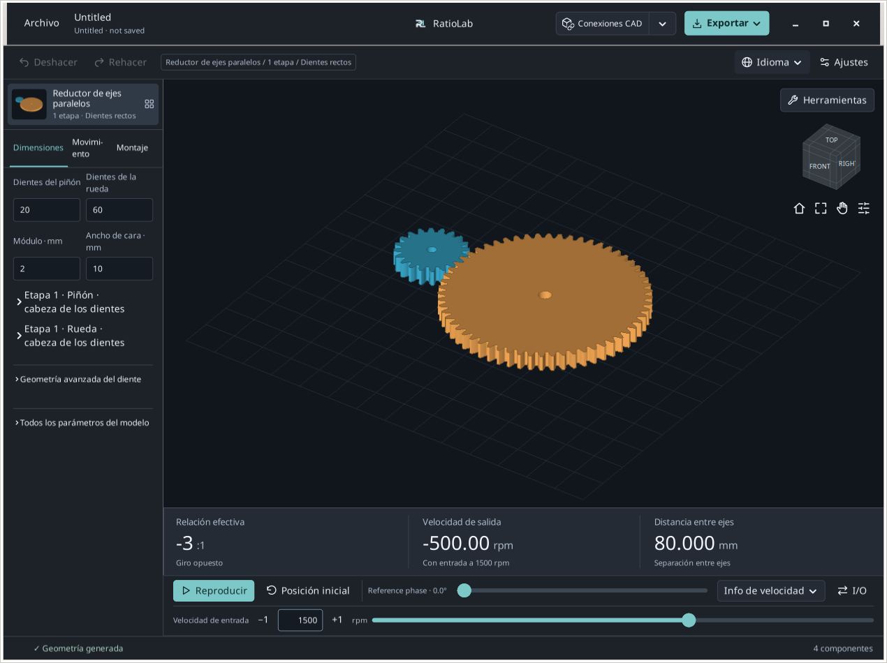

**Resultado esperado.** 20/60 dientes y 80 mm entre ejes identifican el punto de partida correcto.

**Si te atascas / interpretación.** Estas guías corresponden a la revisión local de Tools sobre 0.2.2. Los instaladores públicos y la web pueden mostrar controles distintos.

## ¿Qué Tool necesito?

Abre **Herramientas** encima de la vista 3D y elige tu tarea.

1. **Seleccionar, medir o exportar una pieza.** **Componentes / medida…** permite seleccionar, aislar, marcar puntos y exportar componentes seleccionados.

2. **Buscar una relación o revisar movimiento.** **Encuentra combinaciones...** compara combinaciones finitas. **Verifique la interferencia...** examina posiciones muestreadas y muestra las piezas implicadas.

3. **Obtener una cota teórica.** **Metrología de engranajes…** calcula medidas con bolas/rodillos y medidas sobre dientes para componentes rectos compatibles.

4. **Cambiar el juego de funcionamiento.** **Resolver la reacción de trabajo...** propone la distancia entre ejes de una única pareja paralela exterior. Debajo están los informes.

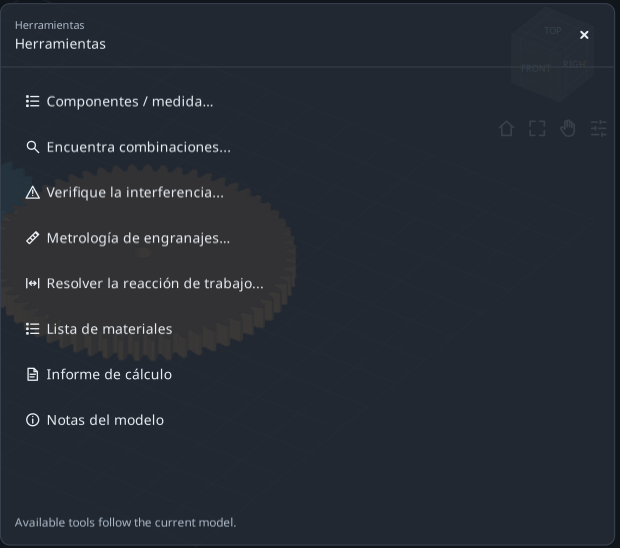

**Resultado esperado.** Consultar un resultado no cambia el modelo. La búsqueda y el ajuste de juego requieren aplicar expresamente.

**Si te atascas / interpretación.** **Ampliar herramienta** amplía el formulario; **Restaurar espacio de trabajo** recupera el modelo. **Todas las herramientas** cambia de formulario y × lo cierra. Los borradores de sesión no sustituyen proyectos guardados.

## Seleccionar y aislar el piñón

Identifica la pieza sin editar su geometría.

1. **Selecciona una pieza.** Abre 01 y **Herramientas** → **Componentes / medida…**. En **Piezas**, selecciona la primera fila del piñón. El resumen debe indicar una pieza seleccionada.

2. **Lee su identidad.** Expande **Detalles del componente · límites nominales en mm**. El nombre fuente es S1_Pinion. Los límites XYZ son dimensiones nominales según ejes globales, no tres diámetros.

3. **Aísla y restaura.** Pulsa **aislar**, observa la pieza y después **Restaurar vista**. Se recuperan los filtros anteriores. Ctrl/Mayús añade piezas a la selección.

4. **Observa los dientes.** Con un engranaje compatible seleccionado, **Ver dentado** abre la vista dental; **Volver al modelo** vuelve al modelo. Para cotas teóricas usa metrología.

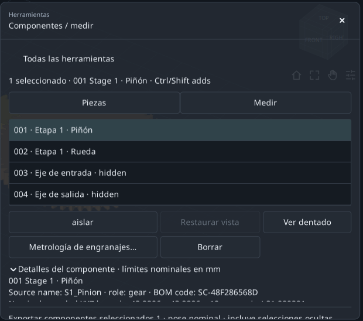

**Resultado esperado.** Piñón identificado sin cambiar dientes, módulo ni distancia entre ejes.

**Si te atascas / interpretación.** Las acciones deshabilitadas suelen indicar que no hay un único engranaje compatible seleccionado. Un eje no es un engranaje.

## Medir dos puntos visibles

Obtén la distancia recta A-B y sus diferencias XYZ.

1. **Fija una posición estática.** En Components elige **Medir** y **Usar pose nominal**. Si el panel tapa la rueda, activa Pan, mueve el modelo a la izquierda y desactiva Pan.

2. **Escoge A y B.** Haz clic en una zona maciza de la cara superior del piñón y luego de la rueda. Elige superficies fuera del panel, no el vacío del taladro.

3. **Lee los valores.** Consulta distancia recta y B−A ΔXYZ. En dos caras superiores planas a la misma altura, ΔZ es aproximadamente cero.

4. **Repite con intención.** **Puntos claros** reinicia la medida. Tus clics normalmente producirán una distancia distinta de la captura.

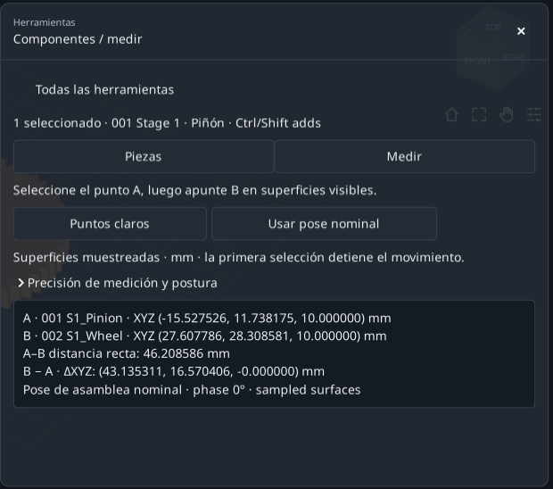

**Resultado esperado.** Dos puntos marcados, una distancia en mm y tres diferencias de coordenadas.

**Si te atascas / interpretación.** No hay ajuste a centros o aristas. Es una distancia entre puntos de superficies muestreadas, no diámetro analítico, entrecentros exacto ni separación mínima entre superficies.

## Exportar solamente el piñón seleccionado

Distingue la exportación de la selección de la del reductor completo.

1. **Revisa la selección.** Vuelve a **Piezas**, selecciona solo el piñón y desplázate al resumen de exportación: debe indicar un componente.

2. **Elige primero la carpeta.** En el menú superior **Exportar**, usa **Cambiar carpeta…** para seleccionar una carpeta de ejercicios y vuelve al Tool.

3. **Exporta desde el Tool.** Pulsa STEP para CAD, STL para malla, **DXF / SVG** para secciones compatibles o **Paquete**. Espera la confirmación y pulsa **Abrir carpeta**.

4. **Comprueba los archivos.** Deben contener solo el piñón en coordenadas nominales de montaje. Una pieza oculta que siga seleccionada también se exporta.

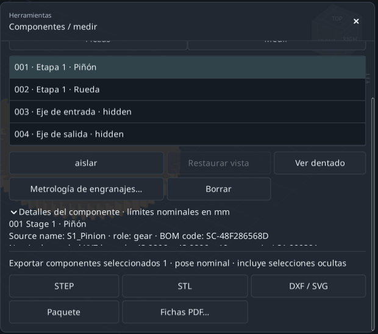

**Resultado esperado.** La selección determina el contenido; ocultar piezas no reemplaza seleccionarlas.

**Si te atascas / interpretación.** **Fichas PDF…** necesita un solo componente y abre fichas de empresa. Las secciones DXF/SVG no son automáticamente plantillas de fabricación.

## Buscar una pareja 3:1 más compacta

Compara 18/54 y 20/60 sin cambiar módulo, ancho, variante ni conexión.

1. **Parte del archivo 01.** Abre **Herramientas** → **Encuentra combinaciones...** y deja expandido **Editar configuración de búsqueda**.

2. **Introduce el objetivo.** Escribe 3 en **Proporción deseada** y 0 en **Error permitido ± (%)**. Es el valor absoluto velocidad de entrada/salida, no 0.333.

3. **Elige la comparación.** Mantén **Cualquier dirección** y selecciona **Menor envolvente** en **Comparar resultados por**. La conexión actual produce giro opuesto.

4. **No limites el volumen todavía.** Mantén X/Y/Z máximos en 1000 mm. La envolvente incluye todos los componentes generados, aunque estén ocultos.

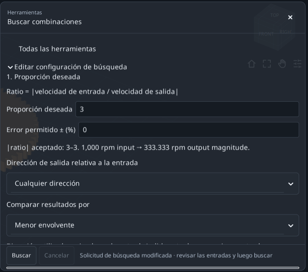

**Resultado esperado.** Objetivo definido. A continuación limita la búsqueda a cuatro candidatos.

**Si te atascas / interpretación.** Se necesita un conjunto con una relación única de entrada/salida. Un engranaje aislado o un diferencial no la proporciona.

## Definir exactamente qué puede variar

Usa intervalos finitos pequeños en **2. Parámetros a explorar**.

1. **Intervalo del piñón.** En **Dientes del piñón de entrada**, elige **variar** y **Rango**: **De** 18, **To** 20, **paso** 2. Se probarán 18 y 20.

2. **Intervalo de la rueda.** En **Dientes de la rueda conducida**: **variar**, **Rango**, **De** 54, **To** 60, **paso** 6. Se probarán 54 y 60.

3. **Bloquea el resto.** Deja las demás variables de **Más dimensiones** en **Mantenerse actualizado**. Dos valores por dos valores producen cuatro candidatos.

4. **Inicia la búsqueda.** En Advanced bastan 100 candidatos máximos y 60 segundos. Pulsa **Buscar** y espera.

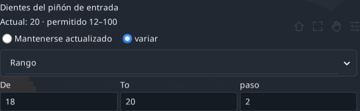

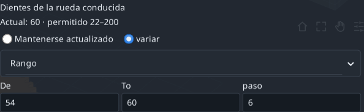

**Resultado esperado.** 18/54 y 20/60 cumplen exactamente 3:1; las otras dos combinaciones no.

**Si te atascas / interpretación.** Los intervalos se multiplican entre variables. Empieza con pocos valores y corrige cualquier error de campo antes de buscar.

## Comparar, aplicar y deshacer una propuesta

Una fila sigue siendo propuesta hasta que la aplicas expresamente.

1. **Lee la primera solución.** La menor envolvente sitúa 18/54 primero: piñón 20→18, rueda 60→54. Se conserva 3:1 y giro opuesto.

2. **Compara la geometría.** XYZ nominal≈147.933 × 111.990 × 26 mm; recubrimiento útil≈1.64876. Son resultados geométricos, no verificaciones de resistencia.

3. **Guarda antes de aplicar.** Selecciona 18/54. Si necesitas el registro, guarda el TXT con **Guardar informe…** antes de **Aplicar seleccionado**; aplicar invalida la búsqueda.

4. **Verifica y deshaz.** Los dientes pasan a 18 y 54. Un **Deshacer** restaura 20/60. El archivo 02 contiene el resultado compacto listo para abrir.

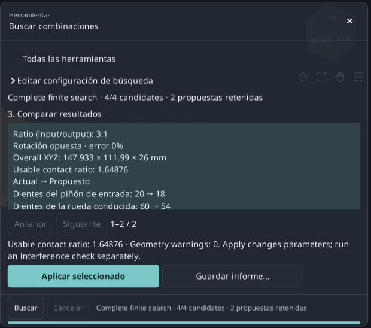

**Resultado esperado.** Pareja más compacta con la relación buscada y una edición reversible.

**Si te atascas / interpretación.** Apply se deshabilita para la fila 20/60 sin cambios. Si editas el modelo o los intervalos, vuelve a buscar.

## Comprobar el movimiento muestreado

Lee la cobertura antes de interpretar la lista de contactos.

1. **Vuelve al archivo 01.** Abre **Herramientas** → **Verifique la interferencia...**. No uses el resultado compacto del ejercicio anterior.

2. **Configura el muestreo.** En **comprobar la configuración**: paso 30°, tolerancia de frontera 0.01 mm y límite 120 s.

3. **Ejecuta la comprobación.** Pulsa **Comprobar ciclo** y espera. También se comprueban soportes y carcasa ocultos; ocultarlos no los excluye.

4. **Lee la cobertura.** El ejemplo completa 37/37 posiciones con paso≤30°. Si indica INCOMPLETE, concede más tiempo o un paso mayor y repite.

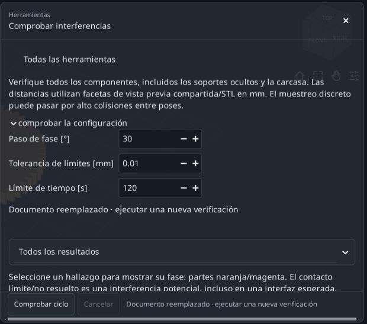

**Resultado esperado.** Cobertura discreta completa significa que se revisaron las 37 posiciones previstas.

**Si te atascas / interpretación.** El periodo cinemático de piezas identificadas puede superar 360°. Un paso menor cuesta más; el tiempo transcurrido no demuestra cobertura.

## Distinguir contacto e interferencia

El filtro cambia la lista, no la comprobación ni su cobertura.

1. **Muestra contactos sin resolver.** Elige **Contactos no resueltos**. La base señala interfaces piñón/eje de entrada y rueda/eje de salida.

2. **Inspecciona una fila.** Haz clic para mostrar fase y componentes naranja/magenta. **Restaurar vista previa** restaura la vista; sal antes del modo expandido si hace falta.

3. **Compara las clases.** **Posible interferencia** muestra Intersection/Containment; **Separados**, parejas separadas; **Todos los resultados**, todas las clases.

4. **Guarda y repite tras editar.** **Guardar informe…** guarda TXT mediante un diálogo. Cambiar ajustes o geometría invalida la comprobación anterior.

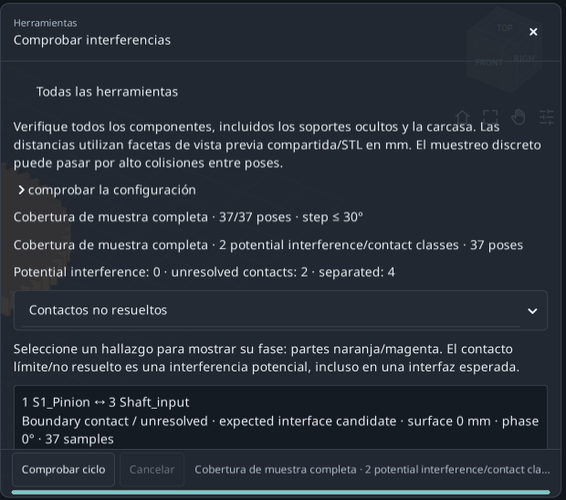

**Resultado esperado.** Base: 0 clases de interferencia potencial, 2 de contacto sin resolver y 4 separadas.

**Si te atascas / interpretación.** Boundary contact/unresolved no implica automáticamente un error del modelo. La cobertura discreta completa no prueba movimiento continuamente libre de colisiones.

## Calcular la cota teórica sobre bolas

Usa el engranaje correcto en vez de aproximar un diámetro con clics 3D.

1. **Selecciona el piñón.** Abre 01. En Components selecciona solo el primer piñón y **Metrología de engranajes…**. Comprueba 20 dientes, referencia 40 mm y S1_Pinion.

2. **Usa la bola propuesta.** Mantén **bolas**, pulsa **Utilice el diámetro de calibre teórico** y conserva el valor calculado≈3.534085 mm. No copies un valor redondeado de la imagen.

3. **Calcula.** Pulsa **calcular**. Debe resultar cota sobre bolas≈44.876412 mm y radio de contacto 20 mm; no es el diámetro de referencia 40 mm.

4. **Exporta la consulta.** **Informe de exportación · TXT + JSON** guarda datos y resultado en la carpeta indicada por **Exportar** → **Carpeta de destino**. Recalcula al cambiar bola o componente.

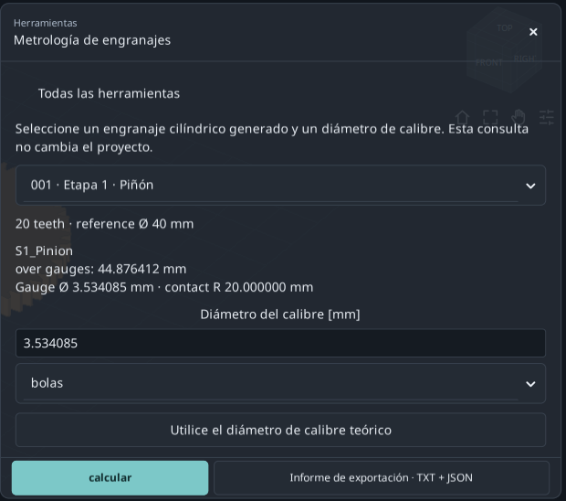

**Resultado esperado.** Medida teórica reproducible del piñón. Los rodillos axiales dan la misma cota transversal en este caso recto.

**Si te atascas / interpretación.** Solo componentes evolventes rectos exteriores/interiores compatibles. No cubre helicoidales, acceso físico del instrumento ni tolerancias reales.

## Leer la medida Wildhaber sobre dientes

Es una cota entre mordazas planas sobre una cantidad de dientes.

1. **Mantén el mismo piñón.** Continúa con S1_Pinion de 20 dientes; no pases a la rueda de 60.

2. **Abre la sección.** Desplázate a **Medición sobre varios dientes**. En **Wildhaber span · number of teeth**, elige 3.

3. **Lee W3.** W3≈15.250402 mm y radio de contacto≈20.281829 mm. El 3 es la cantidad de dientes medida, no la relación del reductor.

4. **Respeta las opciones disponibles.** La lista contiene contactos utilizables en el perfil generado. No fuerces un conteo ausente; ruedas internas o helicoidales no dan esta medida externa con mordazas planas.

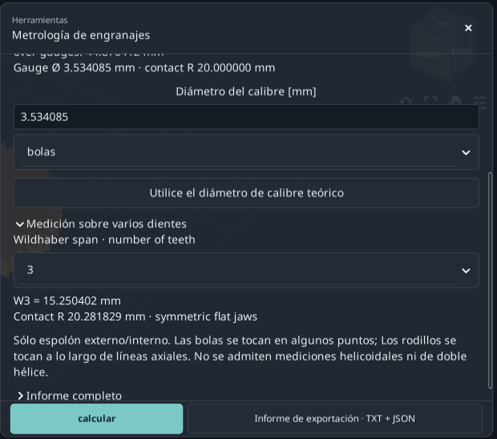

**Resultado esperado.** Cota sobre bolas y Wk son distintas; conserva componente y entradas de cada una.

**Si te atascas / interpretación.** Los decimales mostrados no definen tolerancia de fabricación, incertidumbre de medida, calidad del engranaje ni conformidad normativa completa.

## Cambiar el juego de 0.15 a 0.50 mm

Proponer otra distancia entre ejes para el juego tangencial transversal de funcionamiento.

1. **Parte del archivo 01.** Abre **Resolver la reacción de trabajo...**. Comprueba distancia actual 80 mm y juego 0.15 mm.

2. **Introduce el objetivo.** Escribe 0.5 en **Juego tangencial transversal de trabajo deseado [mm]**. No edites el campo Backlash de adelgazamiento de dientes del modelo.

3. **Comprueba el dominio.** Lee **Nominal target range**: 0.5 mm está dentro para esta base. Los límites dependen de la geometría actual.

4. **Calcula y previsualiza.** En **Configuraciones de interferencia discreta**: paso 30°, tiempo 120 s, máximo 721 posiciones. Pulsa **Calcular y obtener una vista previa**.

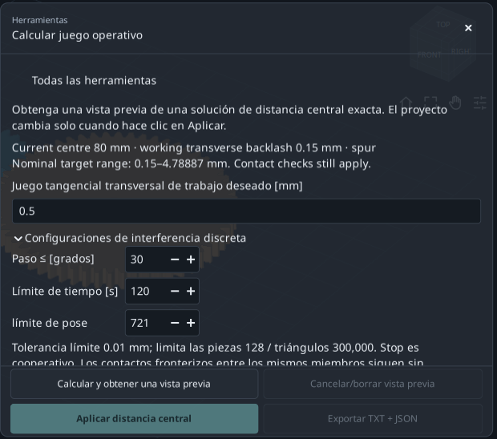

**Resultado esperado.** El solver propone y comprueba la geometría sin modificar aún el proyecto principal.

**Si te atascas / interpretación.** Solo una pareja paralela exterior recta/helicoidal/doble. No admite conjuntos multietapa, internos ni planetarios. El objetivo no es juego radial o normal.

## Aceptar la nueva distancia entre ejes

Lee juntos valores actuales/propuestos y mensaje de comprobación.

1. **Compara los resultados.** Distancia≈80.466750 mm, juego≈0.500000 mm y recubrimiento útil≈1.44449.

2. **Lee las interfaces pendientes.** La cobertura discreta es completa, pero dos interfaces con ejes del mismo miembro siguen sin resolver. No se declaran resueltas.

3. **Aplica la propuesta.** Pulsa **Aplicar distancia central**. En dimensiones avanzadas, **Aumento de la distancia central [mm]** pasa de 0 a≈0.466750. La referencia más ese incremento da la distancia nueva.

4. **Exporta antes de deshacer.** **Exportar TXT + JSON** conserva propuesta y estado aplicado en la carpeta actual. Después **Deshacer** vuelve a 80 mm. 03 es el resultado preparado.

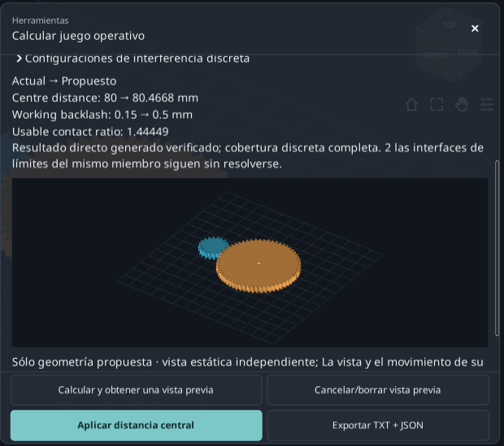

**Resultado esperado.** El objetivo se alcanza cambiando entrecentros, manteniendo 20/60 dientes y módulo 2 mm.

**Si te atascas / interpretación.** Si Apply está deshabilitado, lee la causa: objetivo inválido, cobertura incompleta, interferencia o cambios de proyecto requieren recalcular. Una vista previa no basta.

## Encontrar piezas, cálculos y notas

Consulta los informes para entender el modelo y localizar valores.

1. **Abre la lista de materiales.** Desde 01, elige **Herramientas** → **Lista de materiales**. Compara nombres, códigos y cantidades generados con Components.

2. **Abre los cálculos.** **Informe de cálculo** abre **Informe de cálculo nominal**: relación, geometría del engrane y cálculos nominales.

3. **Busca en el documento.** En **Buscar en este documento…**, prueba S1_Pinion. **Anterior**/**Siguiente** navegan entre coincidencias; **Copiar todo** copia el texto.

4. **Lee las notas.** **Notas del modelo** explica la construcción. La exportación del modelo o de cada Tool conserva sus salidas correspondientes.

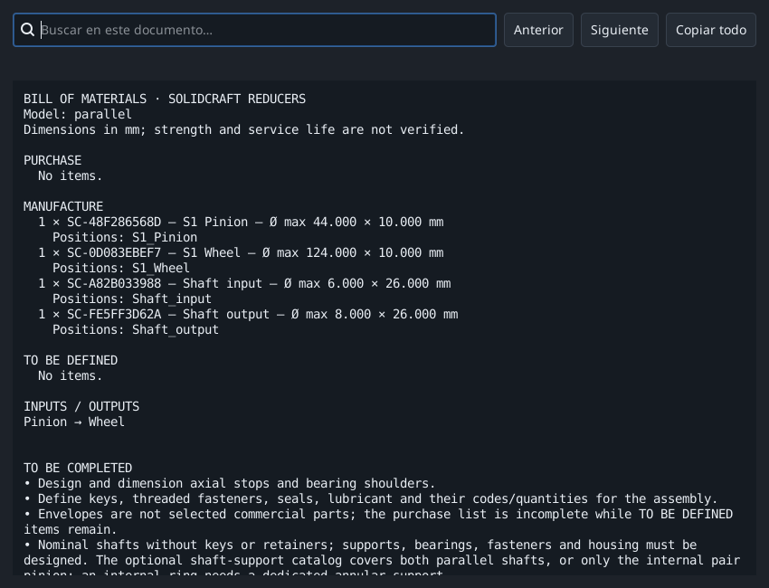

**Resultado esperado.** Sabes localizar lista de materiales, cálculos nominales, notas y consultas de cada Tool.

**Si te atascas / interpretación.** Una lista generada no es automáticamente una lista de compra completa; pueden faltar decisiones de empresa y detalles por completar en CAD.

## Si tu resultado es distinto

Comprueba una condición cada vez antes de cambiar muchos parámetros.

1. **Dimensiones distintas.** Reabre 01:20/60 dientes, módulo 2, ancho 10, dientes rectos y distancia 80 mm. 02 y 03 contienen otros resultados a propósito.

2. **Faltan controles.** Desplázate o usa **Ampliar herramienta**; revisa idioma y versión. Las imágenes muestran la revisión local de Tools sobre 0.2.2.

3. **Apply o Export deshabilitado.** Selecciona una propuesta que cambie algo o una pieza compatible, corrige errores y recalcula tras editar. Metrología necesita un resultado válido.

4. **Medida variable o prueba incompleta.** Los puntos no se ajustan automáticamente y varían. Simplifica la búsqueda o aumenta el tiempo; revisa cobertura, no solo segundos transcurridos.

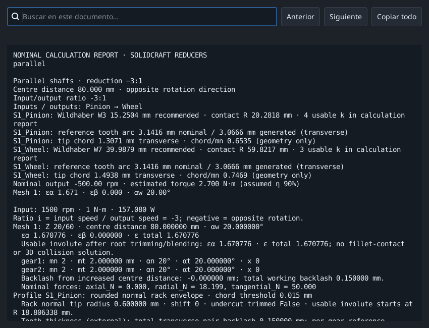

**Resultado esperado.** Repite un ejercicio cada vez y conserva su proyecto inicial e informe.

**Si te atascas / interpretación.** Guarda tu trabajo. Son ejercicios de geometría nominal y movimiento discreto, no de resistencia, vida útil o aprobación de fabricación.

## Referencias y alcance

La secuencia didáctica sigue los tutoriales oficiales de KISSsoft y las instrucciones por campos de GearTrax. La ayuda de GearTrax consultada es histórica (2009). Textos, ejemplos y capturas son de RatioLab; estas referencias no amplían sus cálculos.

- [KISSsoft, Tutorial 15 - Bevel gears (2022)](https://www.kisssoft.com/files/eu64So/KISSsoft-Tutorial-015-Bevelgear-en.pdf)
- [KISSsoft, índice oficial de tutoriales](https://development.startpage.services.kisssoft.com/)
- [Camnetics, GearTrax - Creating a Spur Gear (ayuda histórica, 2009)](https://camnetics.com/geartrax/FlashHelp/geartrax2009/creating_a_spur_gear.htm)
- [Camnetics, GearTrax - Between Pins Example (ayuda histórica, 2009)](https://camnetics.com/geartrax/FlashHelp/geartrax2009/between_pins_example.htm)

La geometría nominal, las medidas teóricas y las comprobaciones discretas no acreditan resistencia, vida a fatiga ni aptitud de fabricación.
