# Tools RatioLab : guides illustrés

Six exemples complets, des données initiales à un résultat identifiable.

Version bureau 0.2.2 avec la révision locale des Tools · 2026-11-10

Les captures utilisent cette langue d’interface. Les commandes restées en anglais gardent leur nom visible. Saisissez les décimales des exemples avec un point. Les noms de fichiers et identifiants restent inchangés.

Enregistrez votre travail avant d’ouvrir les projets JSON avec Fichier → Ouvrir. Chaque exercice commence par le fichier 01. Les fichiers 02 et 03 sont des résultats prêts à comparer, pas des requêtes enregistrées. Ils ne modifient pas les préférences.

[English](tools-en.md) · [Italiano](tools-it.md) · [Español](tools-es.md) · [Français](tools-fr.md) · [Deutsch](tools-de.md) · [Português (Portugal)](tools-pt.md) · [Русский](tools-ru.md) · [简体中文](tools-zh-CN.md) · [தமிழ்](tools-ta.md)

## Projets exemples

- [tools-01-base.config.json](../../examples/tools-01-base.config.json)
- [tools-02-rapporto3-compatto.config.json](../../examples/tools-02-rapporto3-compatto.config.json)
- [tools-03-backlash05.config.json](../../examples/tools-03-backlash05.config.json)

## Sommaire

- [Un modèle initial, six exercices](#inizio)
- [Quel outil ouvrir ?](#scegliere)
- [Sélectionner et isoler le pignon](#componenti)
- [Mesurer deux points de surface visibles](#misurare)
- [Exporter uniquement le pignon sélectionné](#esportare)
- [Rechercher une paire 3:1 plus compacte](#ricerca)
- [Définir exactement les paramètres variables](#intervalli)
- [Comparer, appliquer et annuler une proposition](#applicare-ricerca)
- [Contrôler le mouvement échantillonné](#interferenze)
- [Distinguer contact et interférence](#leggere-interferenze)
- [Calculer la cote théorique sur billes](#metrologia)
- [Lire la mesure Wildhaber sur plusieurs dents](#wildhaber)
- [Passer de 0.15 à 0.50 mm de jeu](#backlash)
- [Accepter le nouvel entraxe](#applicare-backlash)
- [Retrouver pièces, calculs et notes](#report)
- [Si votre résultat diffère](#problemi)

## Un modèle initial, six exercices

Partez de données connues plutôt que de deviner les paramètres.

1. **Ouvrir l’exemple.** Enregistrez votre projet. Choisissez **Fichier** → **Ouvrir…** et ouvrez tools-01-base.config.json.

2. **Vérifier le modèle.** Réducteur à axes parallèles, un étage, denture droite : pignon 20, roue 60, module 2 mm, largeur 10 mm, entraxe 80 mm. Rapport -3:1 ; entrée 1500 tr/min, sortie -500 tr/min.

3. **Repartir de la base.** Rouvrez 01 avant un autre outil. La recherche peut modifier les nombres de dents ; le réglage du jeu change l’entraxe. 02 et 03 montrent les résultats terminés.

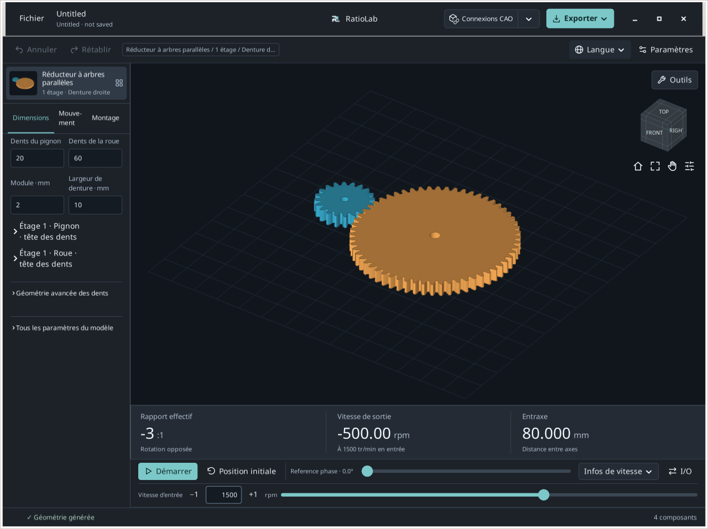

**Résultat attendu.** 20/60 dents et 80 mm d’entraxe identifient le bon modèle initial.

**En cas de blocage / interprétation.** Ces guides concernent les Tools locaux sur base 0.2.2. Les installateurs publics et le navigateur peuvent présenter d’autres commandes.

## Quel outil ouvrir ?

Ouvrez **Outils** au-dessus de la vue 3D et choisissez votre tâche.

1. **Sélectionner, mesurer ou exporter une pièce.** **Composants / mesure…** gère sélection, isolation, points de surface et export des composants sélectionnés.

2. **Chercher un rapport ou contrôler le mouvement.** **Trouver des combinaisons…** compare des grilles finies. **Vérifiez les interférences…** examine des positions échantillonnées et montre les pièces concernées.

3. **Obtenir une cote théorique.** **Métrologie des engrenages…** calcule les cotes sur billes/rouleaux et les mesures sur plusieurs dents pour les composants droits compatibles.

4. **Changer le jeu en fonctionnement.** **Résoudre le jeu de travail…** propose un entraxe pour une seule paire parallèle extérieure. Les rapports figurent en dessous.

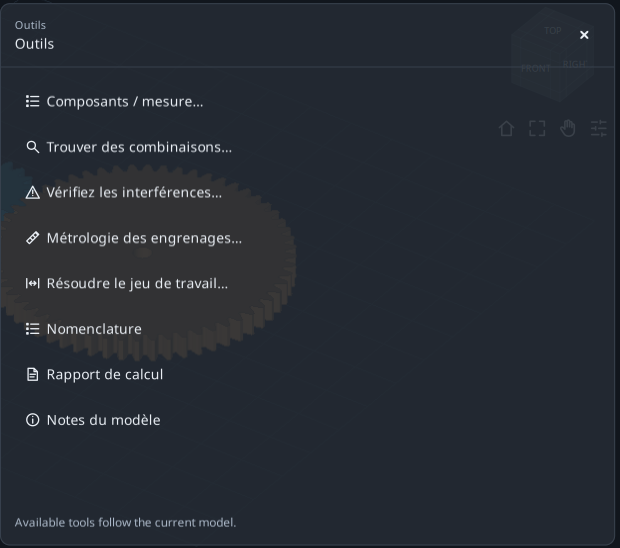

**Résultat attendu.** Consulter un résultat ne change pas le modèle. Recherche et réglage du jeu exigent une application explicite.

**En cas de blocage / interprétation.** **Développer l'outil** agrandit le formulaire ; **Restaurer l'espace de travail** revient au modèle. **Tous les outils** change de formulaire, × le ferme. Un brouillon de session n’est pas un projet enregistré.

## Sélectionner et isoler le pignon

Identifiez la bonne pièce sans modifier sa géométrie.

1. **Sélectionner une pièce.** Ouvrez 01 puis **Outils** → **Composants / mesure…**. Dans **Pièces**, sélectionnez la première ligne du pignon. Le résumé doit indiquer une seule pièce sélectionnée.

2. **Lire son identité.** Dépliez **Détails des composants · limites nominales dans mm**. Le nom source est S1_Pinion. Les limites XYZ sont les encombrements nominaux selon les axes globaux, pas trois diamètres.

3. **Isoler puis restaurer.** Cliquez sur **Isoler**, observez la pièce puis **Restaurer la vue**. Les filtres précédents reviennent. Ctrl/Maj ajoute des pièces à la sélection.

4. **Observer les dents.** Pour un engrenage compatible seul sélectionné, **Voir la denture** ouvre la vue des dents ; **Revenir au modèle** revient au modèle. Utilisez la métrologie pour les cotes théoriques.

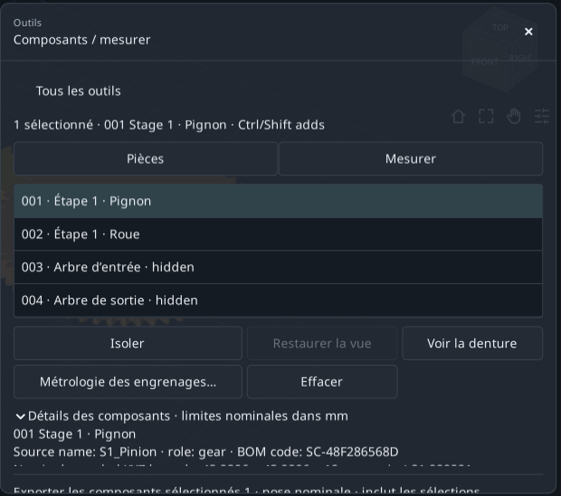

**Résultat attendu.** Pignon identifié sans changer dents, module ou entraxe.

**En cas de blocage / interprétation.** Une action dents/métrologie désactivée indique souvent qu’aucun engrenage compatible unique n’est sélectionné. Un arbre n’est pas un engrenage.

## Mesurer deux points de surface visibles

Obtenez la distance droite A-B et ses différences XYZ.

1. **Fixer une position immobile.** Dans Components, choisissez **Mesurer** puis **Utiliser une pose nominale**. Si le panneau couvre la roue, activez Pan, déplacez le modèle à gauche puis désactivez Pan.

2. **Choisir A et B.** Cliquez une zone pleine de la face supérieure du pignon, puis de la roue. Choisissez des surfaces hors du panneau, pas le vide d’un alésage.

3. **Lire les valeurs.** Lisez distance droite et B−A ΔXYZ. Pour deux faces planes supérieures à la même hauteur, ΔZ est environ nul.

4. **Recommencer volontairement.** **Des points clairs** remet la mesure à zéro. Vos clics donnent généralement une autre distance que l’image.

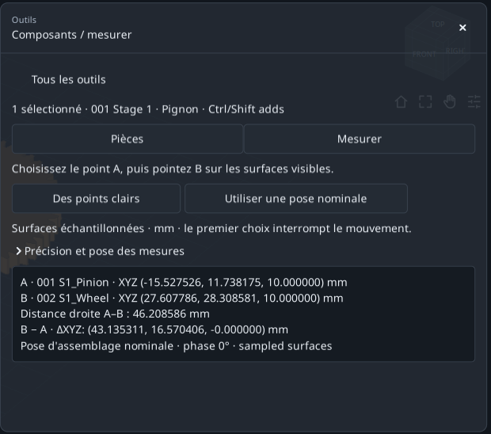

**Résultat attendu.** Deux points marqués, une distance en mm et trois écarts de coordonnées.

**En cas de blocage / interprétation.** Sans accrochage : distance entre points de surfaces échantillonnées, pas diamètre analytique, entraxe exact ou distance minimale entre surfaces entières.

## Exporter uniquement le pignon sélectionné

Distinguez l’export de la sélection de celui du réducteur complet.

1. **Vérifier la sélection.** Revenez à **Pièces**, sélectionnez seulement le pignon et descendez jusqu’au résumé d’export : un composant doit être sélectionné.

2. **Choisir d’abord la destination.** Dans le menu supérieur **Exporter**, utilisez **Changer de dossier…** pour choisir un dossier d’exercice puis revenez à l’outil.

3. **Exporter depuis l’outil.** STEP pour la CAO, STL pour le maillage, **DXF / SVG** pour les sections compatibles ou **Forfait**. Attendez la confirmation puis **Ouvrir le dossier**.

4. **Vérifier les fichiers.** Ils doivent contenir seulement le pignon en coordonnées nominales d’assemblage. Une pièce masquée mais sélectionnée reste exportée.

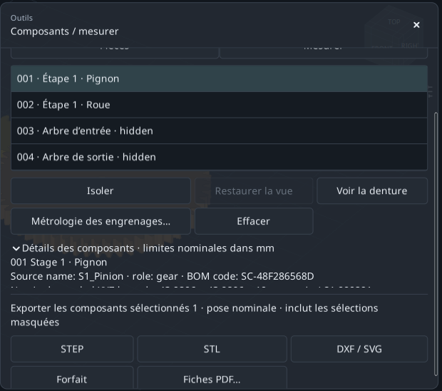

**Résultat attendu.** La sélection définit le contenu ; la visibilité ne remplace pas la sélection.

**En cas de blocage / interprétation.** **Fiches PDF…** demande un composant et ouvre les fiches d’entreprise. Les sections DXF/SVG ne sont pas automatiquement des gabarits d’usinage.

## Rechercher une paire 3:1 plus compacte

Comparez 18/54 et 20/60 en gardant module, largeur, variante et connexions fixes.

1. **Partir du fichier 01.** Ouvrez **Outils** → **Trouver des combinaisons…** et laissez **Modifier les paramètres de recherche** déplié.

2. **Définir l’objectif.** Saisissez 3 dans **Rapport souhaité** et 0 dans **Erreur autorisée ± (%)**. C’est la valeur absolue vitesse d’entrée/vitesse de sortie, pas 0.333.

3. **Choisir le classement.** Gardez **Dans les deux sens**, puis **Encombrement minimal** dans **Comparer les résultats selon**. La connexion actuelle produit une rotation opposée.

4. **Garder des limites larges.** Laissez X/Y/Z maximaux à 1000 mm. L’encombrement inclut tous les composants générés, même masqués.

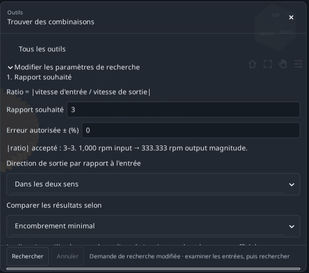

**Résultat attendu.** Objectif défini. Limitez maintenant la recherche à quatre candidats.

**En cas de blocage / interprétation.** Il faut un assemblage avec un rapport entrée/sortie unique. Une roue seule ou un différentiel ne le fournit pas.

## Définir exactement les paramètres variables

Utilisez de petites plages finies sous **2. Paramètres à explorer**.

1. **Plage du pignon.** Pour **Dents du pignon d’entrée**, choisissez **Varier** et **Gamme** : **De** 18, **To** 20, **Étape** 2. Les valeurs 18 et 20 seront testées.

2. **Plage de la roue.** Pour **Dents de la roue menée** : **Varier**, **Gamme**, **De** 54, **To** 60, **Étape** 6. Les valeurs 54 et 60 seront testées.

3. **Bloquer les autres dimensions.** Laissez les autres variables de **Autres dimensions** sur **Restez à jour**. Deux valeurs fois deux donnent quatre candidats.

4. **Lancer la recherche.** Dans Advanced, 100 candidats et 60 secondes suffisent. Cliquez sur **Rechercher** et attendez.

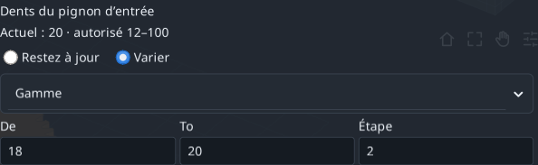

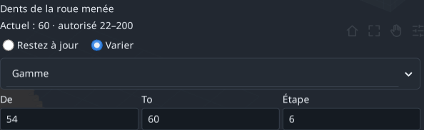

**Résultat attendu.** 18/54 et 20/60 respectent exactement 3:1 ; les deux autres combinaisons non.

**En cas de blocage / interprétation.** Les plages se multiplient entre variables. Commencez petit et corrigez les erreurs de champ avant de lancer.

## Comparer, appliquer et annuler une proposition

Une ligne de résultat reste une proposition jusqu’à son application explicite.

1. **Lire la première proposition.** Le plus petit encombrement classe 18/54 en tête : pignon 20→18, roue 60→54 ; rapport 3:1 et rotation opposée conservés.

2. **Comparer la géométrie.** XYZ nominal≈147.933 × 111.990 × 26 mm ; rapport de conduite utilisable≈1.64876. Ce sont des valeurs géométriques, pas des vérifications de résistance.

3. **Enregistrer avant d’appliquer.** Sélectionnez 18/54. Si nécessaire, sauvegardez le TXT avec **Enregistrer le rapport…** avant **Appliquer la sélection**. L’application invalide la recherche.

4. **Vérifier et annuler.** Le modèle passe à 18 et 54 dents. Un **Annuler** rétablit 20/60. Le fichier 02 est le résultat compact prêt à ouvrir.

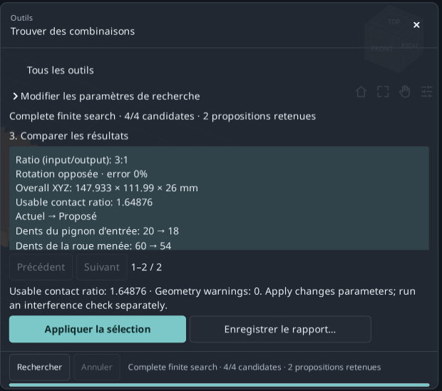

**Résultat attendu.** Paire plus compacte au rapport voulu et modification réversible.

**En cas de blocage / interprétation.** Apply reste désactivé pour la ligne 20/60 inchangée. Après modification du modèle ou des plages, relancez la recherche.

## Contrôler le mouvement échantillonné

Lisez la couverture avant d’interpréter la liste des contacts.

1. **Revenir au fichier 01.** Ouvrez **Outils** → **Vérifiez les interférences…**. N’utilisez pas le résultat compact de l’exercice précédent.

2. **Régler l’échantillonnage.** Dans **Vérifier les paramètres** : pas 30°, tolérance de frontière 0.01 mm et limite 120 s.

3. **Exécuter le contrôle.** Cliquez sur **Cycle de contrôle** et attendez. Supports et carter masqués sont inclus ; les masquer ne les exclut pas.

4. **Lire la couverture.** Cet exemple termine 37/37 positions, pas≤30°. Si INCOMPLETE apparaît, autorisez plus de temps ou un pas plus grand puis recommencez.

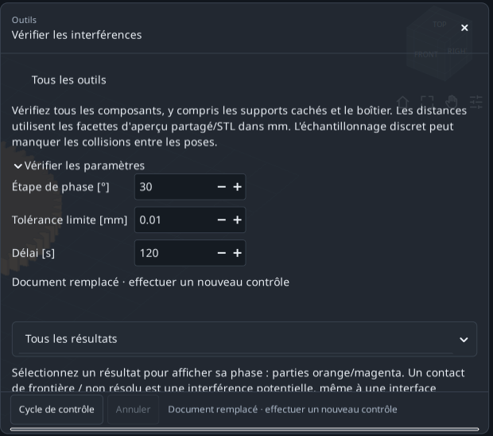

**Résultat attendu.** Couverture discrète complète : les 37 positions prévues ont toutes été contrôlées.

**En cas de blocage / interprétation.** La période cinématique des pièces identifiées peut dépasser 360°. Un pas plus petit demande plus de travail ; le temps seul ne prouve pas la couverture.

## Distinguer contact et interférence

Le filtre modifie la liste, pas le contrôle effectué ni sa couverture.

1. **Afficher les contacts non résolus.** Choisissez **Contacts non résolus**. La base signale les interfaces pignon/arbre d’entrée et roue/arbre de sortie.

2. **Examiner une ligne.** Cliquez un résultat pour voir phase et pièces orange/magenta. **Restaurer l'aperçu** rétablit la vue ; quittez d’abord le mode agrandi si nécessaire.

3. **Comparer les classes.** **Interférence potentielle** montre Intersection/Containment ; **Séparé**, les paires séparées ; **Tous les résultats**, toutes les classes.

4. **Enregistrer et recalculer après modification.** **Enregistrer le rapport…** enregistre un TXT via un dialogue. Modifier réglages ou géométrie invalide l’ancien contrôle.

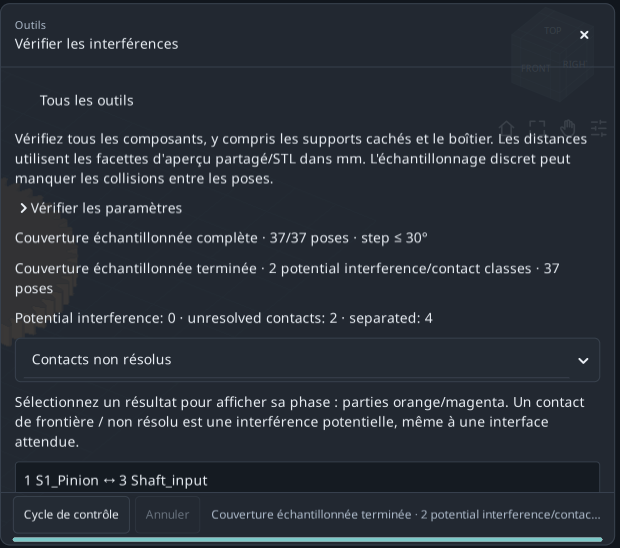

**Résultat attendu.** Base : 0 classe d’interférence potentielle, 2 classes de contacts non résolus et 4 classes séparées.

**En cas de blocage / interprétation.** Boundary contact/unresolved n’est pas automatiquement une erreur du modèle. Une couverture discrète complète ne prouve pas l’absence continue de collision.

## Calculer la cote théorique sur billes

Utilisez le bon engrenage généré plutôt qu’un diamètre approché par clics 3D.

1. **Sélectionner le pignon.** Ouvrez 01. Dans Components, sélectionnez seulement le premier pignon puis **Métrologie des engrenages…**. Vérifiez 20 dents, référence 40 mm et S1_Pinion.

2. **Utiliser la bille proposée.** Gardez **Balles**, cliquez **Utiliser le diamètre de jauge théorique** et conservez la valeur calculée≈3.534085 mm. Ne retapez pas une valeur arrondie de l’image.

3. **Calculer.** Cliquez **Calculer**. Cote sur billes attendue≈44.876412 mm et rayon de contact 20 mm ; ce n’est pas le diamètre de référence 40 mm.

4. **Exporter la requête.** **Rapport d'exportation · TXT + JSON** conserve données et résultat dans le dossier indiqué par **Exporter** → **Dossier de destination**. Recalculez après tout changement de bille/composant.

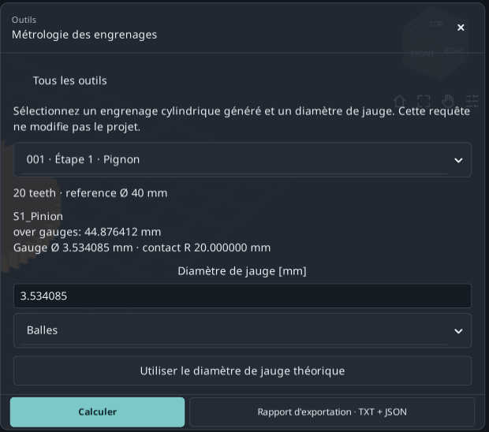

**Résultat attendu.** Mesure théorique reproductible du pignon. Les rouleaux axiaux donnent la même cote transversale dans ce cas droit.

**En cas de blocage / interprétation.** Seulement les composants cylindriques droits à développante compatibles, extérieurs/intérieurs. Dentures hélicoïdales, accès réel et tolérances ne sont pas couverts.

## Lire la mesure Wildhaber sur plusieurs dents

Une cote entre touches planes sur un nombre choisi de dents.

1. **Garder le même pignon.** Continuez avec S1_Pinion, 20 dents ; ne passez pas à la roue de 60 dents.

2. **Ouvrir les contrôles.** Descendez jusqu’à **Mesure sur plusieurs dents**. Dans **Wildhaber span · number of teeth**, choisissez 3.

3. **Lire W3.** W3≈15.250402 mm, rayon de contact≈20.281829 mm. 3 est le nombre de dents mesurées, pas le rapport du réducteur.

4. **Respecter la liste.** Elle contient les contacts utilisables sur le profil généré. Ne forcez pas un nombre absent ; les roues internes ou hélicoïdales ne donnent pas cette mesure extérieure à touches planes.

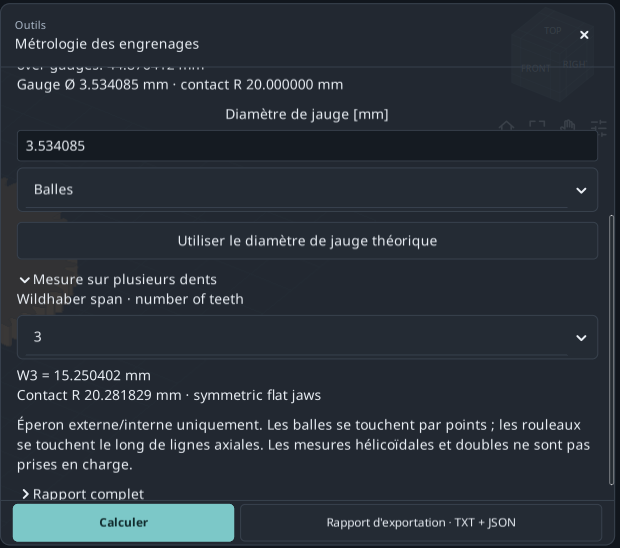

**Résultat attendu.** Cote sur billes et Wk sont distinctes ; conservez pour chacune composant et paramètres.

**En cas de blocage / interprétation.** Les décimales affichées ne définissent ni tolérance, ni incertitude de mesure, ni qualité d’engrenage, ni conformité normative complète.

## Passer de 0.15 à 0.50 mm de jeu

Proposer un nouvel entraxe pour le jeu tangentiel transversal de fonctionnement.

1. **Partir du fichier 01.** Ouvrez **Résoudre le jeu de travail…**. Vérifiez entraxe actuel 80 mm et jeu 0.15 mm.

2. **Saisir la cible.** Entrez 0.5 dans **Jeu tangentiel transversal de travail souhaité [mm]**. Ne modifiez pas le champ Backlash d’amincissement des dents du modèle.

3. **Vérifier le domaine.** Lisez **Nominal target range** : 0.5 mm est admis pour cette base. Les limites dépendent de la géométrie courante.

4. **Calculer et prévisualiser.** Dans **Paramètres d'interférence discrets** : pas 30°, temps 120 s, maximum 721 positions. Cliquez **Calculer et prévisualiser**.

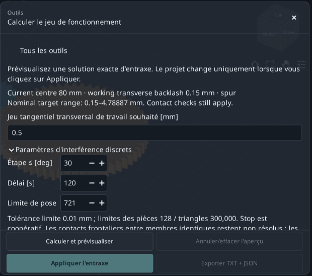

**Résultat attendu.** Le solveur propose et contrôle une géométrie sans modifier encore le projet principal.

**En cas de blocage / interprétation.** Une paire parallèle extérieure droite/hélicoïdale/double uniquement. Multiétages, internes et planétaires exclus ; la cible n’est pas un jeu radial ou normal.

## Accepter le nouvel entraxe

Lisez ensemble les valeurs actuelles/proposées et le message de contrôle.

1. **Comparer les valeurs.** Entraxe attendu≈80.466750 mm, jeu≈0.500000 mm et rapport de conduite utilisable≈1.44449.

2. **Lire les interfaces restantes.** La couverture discrète est complète mais conserve deux interfaces non résolues avec les arbres du même membre. Elles ne sont pas déclarées résolues.

3. **Appliquer la proposition.** Cliquez **Appliquer l'entraxe**. Dans les dimensions avancées, **Augmentation de l'entraxe [mm]** passe de 0 à≈0.466750. L’entraxe est la référence plus cet incrément.

4. **Exporter avant d’annuler.** **Exporter TXT + JSON** conserve proposition et état appliqué dans le dossier courant. Ensuite **Annuler** revient à 80 mm. 03 est le résultat préparé.

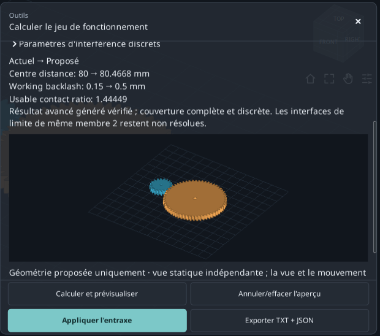

**Résultat attendu.** La cible est atteinte en changeant l’entraxe, en conservant 20/60 dents et module 2 mm.

**En cas de blocage / interprétation.** Si Apply est désactivé, lisez la cause : cible invalide, contrôle incomplet, interférence ou projet modifié peuvent exiger un nouveau calcul. Une prévisualisation ne suffit pas.

## Retrouver pièces, calculs et notes

Utilisez les rapports pour comprendre le modèle et retrouver une valeur.

1. **Ouvrir la nomenclature.** Depuis 01, choisissez **Outils** → **Nomenclature**. Comparez noms, codes et quantités générés avec Components.

2. **Ouvrir les calculs.** **Rapport de calcul** ouvre **Rapport de calcul nominal** : rapport, géométrie d’engrènement et calculs nominaux.

3. **Rechercher dans le document.** Dans **Rechercher ce document…**, essayez S1_Pinion. **Précédent**/**Suivant** parcourent les correspondances ; **Copier tout** copie le texte.

4. **Lire les notes.** **Notes du modèle** explique les détails de construction. L’export du modèle ou de chaque outil conserve les sorties correspondantes.

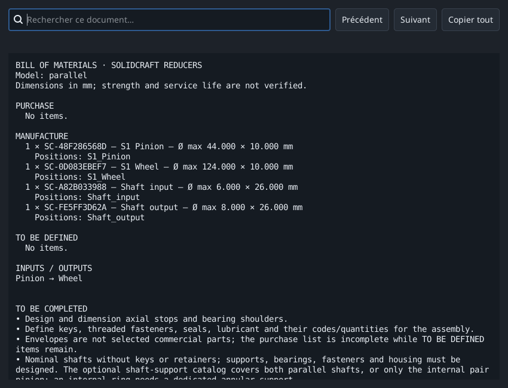

**Résultat attendu.** Vous retrouvez nomenclature d’ensemble, calculs nominaux, notes et requêtes propres aux Tools.

**En cas de blocage / interprétation.** Une nomenclature générée n’est pas automatiquement une liste d’achat complète ; des choix d’entreprise et compléments CAO peuvent rester nécessaires.

## Si votre résultat diffère

Vérifiez une condition à la fois avant de modifier beaucoup de paramètres.

1. **Dimensions différentes.** Rouvrez 01 : 20/60 dents, module 2, largeur 10, denture droite et entraxe 80 mm. 02 et 03 contiennent volontairement d’autres résultats.

2. **Commandes manquantes.** Faites défiler ou utilisez **Développer l'outil** ; comparez langue et version. Les images montrent les Tools locaux sur 0.2.2.

3. **Apply ou Export désactivé.** Sélectionnez une proposition qui modifie le modèle ou une pièce compatible, corrigez les erreurs et recalculez après modification. La métrologie exige un résultat valide.

4. **Mesure variable ou contrôle incomplet.** Les clics varient sans accrochage. Simplifiez la recherche ou augmentez le temps ; vérifiez la couverture, pas seulement les secondes écoulées.

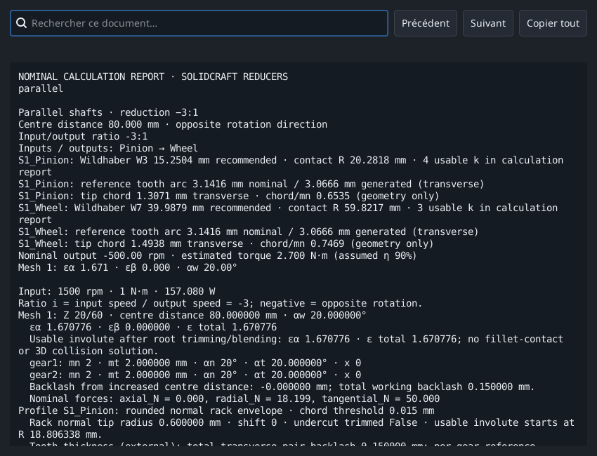

**Résultat attendu.** Refaites un exercice à la fois en conservant projet initial et rapport.

**En cas de blocage / interprétation.** Sauvegardez votre travail. Il s’agit de géométrie nominale et de mouvement discret, pas de résistance, durée de vie ou validation de fabrication.

## Références et portée

La progression s’inspire des tutoriels officiels KISSsoft et des instructions champ par champ de GearTrax. L’aide GearTrax consultée est historique (2009). Textes, exemples et captures sont propres à RatioLab ; les références n’étendent pas ses calculs.

- [KISSsoft, Tutorial 15 - Bevel gears (2022)](https://www.kisssoft.com/files/eu64So/KISSsoft-Tutorial-015-Bevelgear-en.pdf)
- [KISSsoft, index officiel des tutoriels](https://development.startpage.services.kisssoft.com/)
- [Camnetics, GearTrax - Creating a Spur Gear (aide historique, 2009)](https://camnetics.com/geartrax/FlashHelp/geartrax2009/creating_a_spur_gear.htm)
- [Camnetics, GearTrax - Between Pins Example (aide historique, 2009)](https://camnetics.com/geartrax/FlashHelp/geartrax2009/between_pins_example.htm)

La géométrie nominale, les cotes théoriques et les contrôles discrets ne prouvent ni résistance, ni durée de vie en fatigue, ni aptitude à la fabrication.
