# Tools di RatioLab: guide illustrate

Sei esempi completi, dai dati iniziali a un risultato riconoscibile.

Desktop 0.2.2 con la revisione locale dei Tools · 2026-11-10

Le immagini usano questa lingua dell’interfaccia. I comandi che nell’app restano inglesi mantengono il nome visibile. Inserisci i decimali degli esempi con il punto. Nomi di file e identificatori non si traducono.

Salva prima il tuo lavoro. Apri i progetti JSON dal menu File → Apri…. Ogni esercizio riparte dal file 01. I file 02 e 03 sono risultati pronti, non richieste salvate dei Tools. Non modificano le preferenze.

[English](tools-en.md) · [Italiano](tools-it.md) · [Español](tools-es.md) · [Français](tools-fr.md) · [Deutsch](tools-de.md) · [Português (Portugal)](tools-pt.md) · [Русский](tools-ru.md) · [简体中文](tools-zh-CN.md) · [தமிழ்](tools-ta.md)

## Progetti di esempio

- [tools-01-base.config.json](../../examples/tools-01-base.config.json)
- [tools-02-rapporto3-compatto.config.json](../../examples/tools-02-rapporto3-compatto.config.json)
- [tools-03-backlash05.config.json](../../examples/tools-03-backlash05.config.json)

## Indice

- [Un modello pronto, sei esercizi](#inizio)
- [Quale Tool mi serve?](#scegliere)
- [Selezionare e isolare il pignone](#componenti)
- [Misurare due punti visibili](#misurare)
- [Esportare soltanto il pignone](#esportare)
- [Cercare un rapporto 3:1 più compatto](#ricerca)
- [Definire esattamente cosa può cambiare](#intervalli)
- [Leggere, applicare e annullare la proposta](#applicare-ricerca)
- [Controllare il movimento campionato](#interferenze)
- [Distinguere contatto, separazione e interferenza](#leggere-interferenze)
- [Calcolare la quota teorica su sfere](#metrologia)
- [Leggere la misura su più denti](#wildhaber)
- [Passare da 0,15 a 0,50 mm di gioco](#backlash)
- [Confrontare il nuovo interasse e applicarlo](#applicare-backlash)
- [Trovare componenti, calcoli e note](#report)
- [Se il risultato non coincide](#problemi)

## Un modello pronto, sei esercizi

Obiettivo: capire quale Tool aprire e arrivare a un risultato riconoscibile, senza dover inventare i dati di partenza.

1. **Apri il progetto di esempio.** In RatioLab scegli **File → Apri…** e apri **tools-01-base.config.json**, fornito insieme alla guida. Se stai lavorando a un tuo progetto, salvalo prima con **File → Save as…**.

2. **Controlla i dati iniziali.** Riduttore ad assi paralleli · 1 stadio · denti dritti; pignone 20 denti, ruota 60, modulo 2 mm, fascia 10 mm. Interasse 80 mm. La barra dei risultati mostra rapporto -3:1 e, con ingresso 1500 rpm, uscita -500 rpm.

3. **Riparti sempre dalla stessa base.** Ogni esercizio è indipendente. Riapri il file base prima di passare al Tool successivo: una ricerca applicata cambia i denti, mentre il solver del backlash cambia l’interasse.

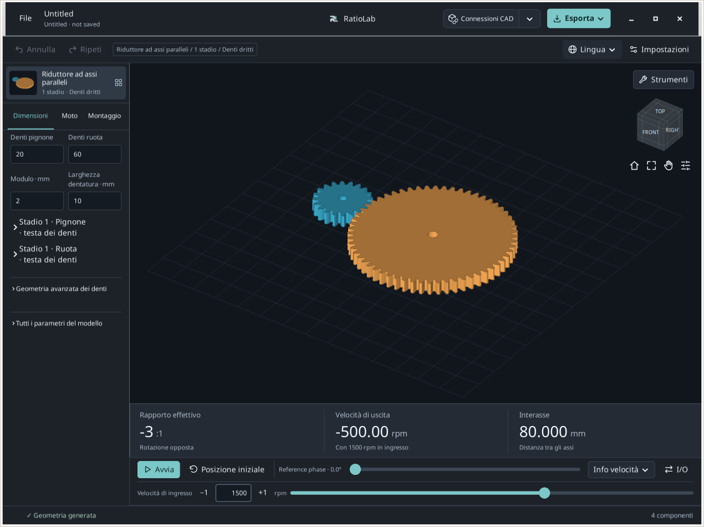

**Risultato atteso.** Se leggi 20 / 60 denti e 80 mm di interasse, sei pronto.

**Se ti blocchi / interpretazione.** Le schermate mostrano l’interfaccia italiana. La guida è per il desktop 0.2.2 con la revisione locale dei **Strumenti**; alcune funzioni possono mancare nella release pubblica o nel sito.

## Quale Tool mi serve?

Apri **Strumenti**, sopra la vista 3D. Scegli in base a ciò che vuoi ottenere.

1. **Voglio selezionare, misurare o esportare un pezzo.** **Componenti/misura...**: componenti, vista isolata, punti A e B ed esportazione della selezione.

2. **Voglio trovare una coppia con un certo rapporto.** **Trova combinazioni...**: scegli pochi valori da provare, confronta le proposte e applicane una.

3. **Voglio controllare contatti durante il movimento.** **Controlla l'interferenza...**: controlla pose campionate e mostra la coppia di componenti alla fase interessata.

4. **Voglio una quota teorica per un ingranaggio.** **Metrologia degli ingranaggi…**: dimensione su sfere/rulli e misura Wildhaber sui denti, per componenti cilindrici a denti dritti supportati.

5. **Voglio un gioco di funzionamento diverso.** **Risolvi il gioco di lavoro...**: propone un nuovo interasse per una singola coppia parallela esterna.

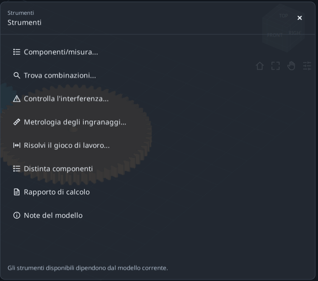

**Risultato atteso.** Un risultato di consultazione non cambia il modello. Nei due solver, la modifica arriva solo con Apply.

**Se ti blocchi / interpretazione.** Usa **Strumento Espandi** per dare spazio al modulo; **Ripristina l'area di lavoro** riporta il 3D. **Tutti gli strumenti** cambia strumento, la × chiude il modulo. Le bozze compatibili restano nella sessione, ma non sostituiscono un progetto salvato.

## Selezionare e isolare il pignone

Obiettivo: individuare il pignone, osservarlo da solo e distinguere la vista dai dati del progetto.

1. **Riparti dal progetto base.** Apri **tools-01-base.config.json**, poi **Strumenti → Componenti/misura...**.

2. **Seleziona il componente.** Nella scheda **Parti**, clicca **001 · Stadio 1 · Pignone**. Controlla che il riepilogo dica **1 selezionato**. Ctrl o Shift aggiungono componenti alla selezione.

3. **Leggi l’identità.** Apri **Dettagli dei componenti · limiti nominali in mm**. Il nome sorgente è **S1_Pinion**; le dimensioni XYZ sono gli ingombri del pezzo nella posa nominale, non tre diametri.

4. **Isola e torna indietro.** Clicca **Isolare**: resta visibile il componente selezionato. Orbita per osservarlo; poi clicca **Ripristina vista** per ritornare ai filtri di vista precedenti.

5. **Guarda i denti da vicino.** Con un solo ingranaggio selezionato, **Visualizza dentatura** apre la vista dei denti. **Torna al modello** torna al modello. Per le quote teoriche usa invece **Metrologia degli ingranaggi…**.

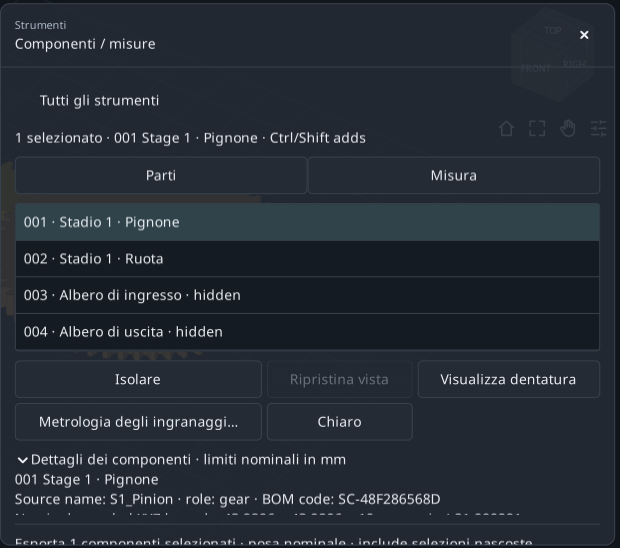

**Risultato atteso.** Hai identificato il pignone senza modificare denti, modulo o interasse.

**Se ti blocchi / interpretazione.** Se **Visualizza dentatura** o **Metrologia degli ingranaggi…** è disabilitato, controlla di avere selezionato un solo componente compatibile; un albero non è un ingranaggio.

## Misurare due punti visibili

Obiettivo: ottenere una distanza A-B e capire le sue tre componenti XYZ.

1. **Apri la misura.** Nel Tool **Componenti/misura...**, scegli la scheda **Misura**. La selezione dei punti sulle superfici è attiva.

2. **Usa una posa ferma.** Clicca **Usa la posa nominale**. Se il pannello copre la ruota, attiva **Pan** nella vista 3D e trascina il modello verso sinistra; disattiva Pan prima di scegliere i punti. Entrambe le facce devono essere visibili fuori dal pannello.

3. **Scegli il primo punto.** Clicca una zona piena della faccia superiore del pignone, lontano dal foro. Compare **A**. Si possono scegliere superfici visibili, non il vuoto al centro del foro.

4. **Scegli il secondo punto.** Clicca la faccia superiore della ruota. Compare **B**. Nel pannello leggi **A-B straight distance** e **B − A · ΔXYZ**.

5. **Interpreta e ripeti.** La distanza è il segmento nello spazio; ΔX, ΔY e ΔZ sono le differenze lungo gli assi. Se hai scelto entrambe le facce piane superiori, ΔZ è circa zero. **Punti chiari** riparte da A.

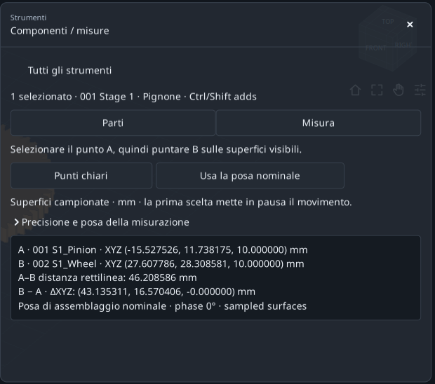

**Risultato atteso.** Nella schermata di esempio: 46,208586 mm e ΔZ circa zero. I tuoi clic daranno normalmente un valore diverso.

**Se ti blocchi / interpretazione.** La misura usa le facce campionate della preview, senza snapping. Non usarla come diametro analitico, interasse esatto o misura minima tra due intere superfici. Per quei dati consulta parametri, metrologia o report.

## Esportare soltanto il pignone

Obiettivo: ottenere un file del solo pezzo scelto, senza confonderlo con l’esportazione dell’intero riduttore.

1. **Torna alla scheda **Parti**.** Se necessario riapri il file base. Seleziona solo **001 · Stadio 1 · Pignone**; premi Ctrl/Shift solo quando vuoi aggiungere altri componenti.

2. **Scorri il pannello.** Sotto i dettagli trovi il riepilogo **1 componente selezionato** nella posa nominale. Se il conteggio è diverso da 1, correggi la selezione.

3. **Scegli il formato nel Tool.** Usa **STEP** per lo scambio CAD, **STL** per la mesh, **DXF / SVG** per i profili supportati, oppure **Pacchetto** per il pacchetto della selezione. L’export usa la cartella di destinazione corrente: attendi il messaggio di conferma e scegli **Apri cartella**.

4. **Rendi riconoscibile il risultato.** Per cambiare destinazione, apri il menu **Esporta** in alto e scegli **Cambia cartella...**, poi torna ai pulsanti del Tool. Puoi usare una cartella chiamata **esercizio-pignone**. Apri il risultato e controlla che contenga il solo pignone; la posa esportata è quella nominale, anche se prima hai esploso la vista.

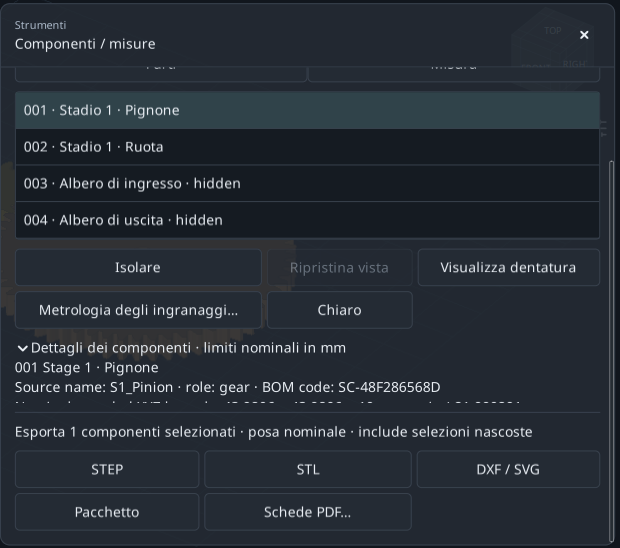

**Risultato atteso.** La selezione determina i componenti esportati. Nascondere un pezzo non lo rimuove automaticamente da una selezione già fatta.

**Se ti blocchi / interpretazione.** **Schede PDF…** richiede un solo componente e apre le schede aziendali. È un percorso distinto dall’export STEP/STL: vedi la guida alle schede componenti per campi e controlli.

## Cercare un rapporto 3:1 più compatto

Obiettivo: confrontare 18/54 e 20/60 mantenendo modulo, larghezza, variante e collegamenti del modello iniziale.

1. **Apri la base e il Tool.** **File → Apri… → tools-01-base.config.json**, poi **Strumenti → Trova combinazioni...**. Tieni aperto **Modifica le impostazioni di ricerca**.

2. **Inserisci il rapporto.** In **Rapporto desiderato** scrivi **3**. In **Errore consentito ± (%)** scrivi **0**. Il rapporto qui è il valore assoluto velocità ingresso / velocità uscita; non scrivere 0,333.

3. **Scegli come confrontare.** Lascia **In entrambe le direzioni** e seleziona **Ingombro minimo** in **Confronta i risultati per**. L’esempio mantiene la connessione attuale, quindi le proposte avranno rotazione opposta.

4. **Lascia ampi i limiti di ingombro.** Non restringere **Overall size limits**: per questo esercizio mantieni 1000 mm su X, Y e Z. L’ingombro comprende tutti i componenti generati, anche quelli nascosti.

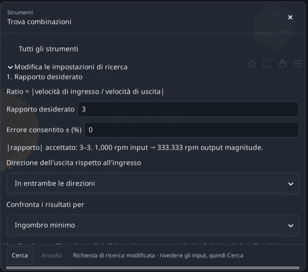

**Risultato atteso.** Ora hai fissato l’obiettivo. Nella pagina successiva definisci soltanto quattro combinazioni da provare.

**Se ti blocchi / interpretazione.** Questo Tool richiede un assieme con un solo rapporto ingresso/uscita. Un ingranaggio singolo o un differenziale non forniscono quel rapporto unico.

## Definire esattamente cosa può cambiare

Scorri fino a **2. Parametri da esplorare**. I campi **Da** / **To** / **Passo** generano una griglia finita.

1. **Intervallo del pignone.** Sotto **Denti del pignone di ingresso**, scegli **Variare** e modalità **Gamma**. Scrivi **Da 18**, **To 20**, **Passo 2**: l’app proverà 18 e 20.

2. **Intervallo della ruota.** Sotto **Denti della ruota condotta**, scegli **Variare**, **Gamma**, **Da 54**, **To 60**, **Passo 6**: l’app proverà 54 e 60.

3. **Mantieni fisse le altre dimensioni.** Lascia **Tieniti aggiornato** per le altre variabili in **Altre dimensioni**. Non serve espanderle per questo esercizio.

4. **Controlla il numero di prove.** Sono **2 × 2 = 4 candidati**: 18/54, 18/60, 20/54 e 20/60. In Advanced puoi impostare **Maximum candidates 100** e **Time limit 60 s**; poi clicca **Cerca**.

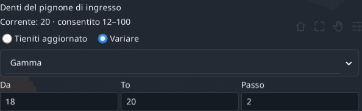

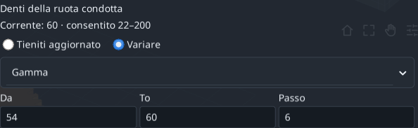

**Risultato atteso.** Due candidati rispettano il 3:1 esatto: 18/54 e 20/60. Gli altri due non rispettano l’obiettivo.

**Se ti blocchi / interpretazione.** Un intervallo ampio su molte variabili cresce per moltiplicazione. Parti con poche combinazioni e amplia una variabile alla volta. Se vedi un errore sotto un campo, correggilo prima di **Cerca**.

## Leggere, applicare e annullare la proposta

Una riga nell’elenco è una proposta. Il modello cambia soltanto quando premi **Applica selezionato**.

1. **Leggi la prima soluzione.** Con **Ingombro minimo**, la prima riga propone **Denti del pignone di ingresso 20 → 18** e **Denti della ruota condotta 60 → 54**. Il rapporto rimane 3:1, con rotazione opposta.

2. **Confronta ingombro e contatto.** L’ingombro XYZ della proposta è circa **147,933 × 111,990 × 26 mm**. Il rapporto di ricoprimento utilizzabile riportato è circa **1,64876**. Sono dati della geometria generata, non una verifica di resistenza.

3. **Seleziona e applica.** Clicca la riga 18/54 e controlla Current → Proposed. Se vuoi conservare la ricerca, premi prima **Salva rapporto...** e salva il TXT; poi premi **Applica selezionato**. Nei parametri del modello devono comparire 18 e 54.

4. **Salva o torna indietro.** **Annulla** ripristina 20 e 60 con un’unica operazione. Per confrontare il risultato già pronto puoi aprire **tools-02-rapporto3-compatto.config.json**. Dopo Apply la ricerca viene invalidata: salva il report prima di applicare.

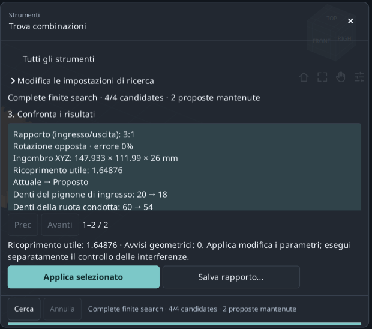

**Risultato atteso.** Hai ottenuto una coppia più compatta mantenendo il rapporto scelto, e sai tornare alla configurazione precedente.

**Se ti blocchi / interpretazione.** Se selezioni la riga 20/60, Apply resta disabilitato perché è già il modello corrente. Dopo modifiche al modello o agli intervalli, esegui una nuova ricerca.

## Controllare il movimento campionato

Obiettivo: capire se il controllo ha coperto le pose previste e dove esaminare i contatti, senza interpretare tutto come una collisione.

1. **Riapri la base.** Apri **tools-01-base.config.json**, poi **Strumenti → Controlla l'interferenza...**. L’esercizio non usa la coppia 18/54 del capitolo precedente.

2. **Imposta il campionamento.** In **Controlla le impostazioni** imposta **Phase step [°] = 30**, **Boundary tolerance [mm] = 0.01** e **Time limit [s] = 120**.

3. **Avvia e attendi.** Clicca **Controllare il ciclo**. Attendi la conclusione. Il controllo comprende anche supporti e componenti nascosti: nasconderli non li esclude dall’analisi.

4. **Leggi prima la copertura.** Nell’esempio completo leggi **Complete sampled coverage · 37/37 poses · step ≤ 30°**. Se leggi **INCOMPLETE**, il risultato non copre tutto il piano di campionamento: aumenta il tempo o usa un passo più ampio e rilancia.

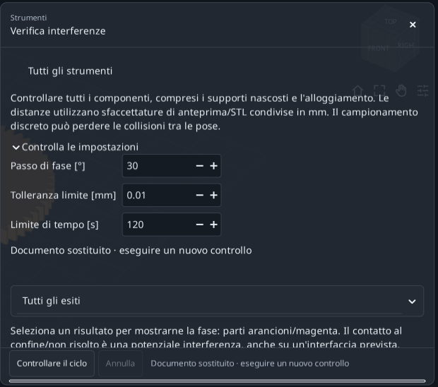

**Risultato atteso.** La configurazione base completa 37 pose. I tempi possono variare; per interpretare il risultato serve la copertura, non soltanto una barra di avanzamento piena.

**Se ti blocchi / interpretazione.** Il periodo considera le orientazioni dei componenti etichettati. Non aspettarti necessariamente 360° o una sola rotazione del pignone. Un passo più piccolo richiede più lavoro.

## Distinguere contatto, separazione e interferenza

Il filtro cambia ciò che leggi nell’elenco; non cancella controlli dal report né trasforma un’analisi incompleta in completa.

1. **Mostra i contatti irrisolti.** Nel filtro scegli **Contatti non risolti**. Nel modello base compaiono le interfacce pignone/albero di ingresso e ruota/albero di uscita.

2. **Guarda il punto del movimento.** Clicca una riga. RatioLab porta il 3D alla fase indicata e colora i due componenti in arancione e magenta. Usa **Ripristina l'anteprima** per tornare alla vista precedente; se il Tool è espanso, prima **Ripristina l'area di lavoro**.

3. **Cambia filtro con criterio.** **Possibili interferenze** mostra Intersection / Containment; **Separato** mostra le coppie separate; **Tutti gli esiti** ripristina l’elenco completo.

4. **Conserva il risultato.** **Salva rapporto...** salva un file TXT. Scegli nome e cartella nella finestra di salvataggio. Se cambi passo, tolleranza, tempo o geometria, rilancia **Controllare il ciclo**: il risultato precedente viene invalidato.

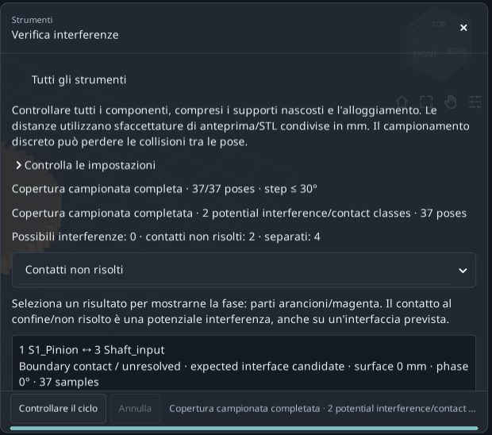

**Risultato atteso.** Boundary contact / unresolved indica contatto entro tolleranza o una situazione non risolta. Anche un’interfaccia attesa va interpretata; non è automaticamente un errore del modello.

**Se ti blocchi / interpretazione.** “Complete” significa tutte le pose previste controllate. Tra una posa e l’altra possono esistere contatti non campionati. Non equivale a una certificazione di assenza di collisioni continua.

## Calcolare la quota teorica su sfere

Obiettivo: ottenere una quota teorica del componente giusto, invece di tentare di misurarne un diametro con due clic nel 3D.

1. **Scegli il pignone nella base.** Apri **tools-01-base.config.json**. In **Strumenti → Componenti/misura... → Parti**, seleziona soltanto **001 · Stadio 1 · Pignone**.

2. **Apri la metrologia del componente.** Clicca **Metrologia degli ingranaggi…** nel pannello. Verifica in alto **001 · Stadio 1 · Pignone** e **20 teeth · reference Ø 40 mm**. Il nome sorgente è S1_Pinion.

3. **Usa la sfera proposta.** Lascia **Palle** e premi **Utilizzare il diametro teorico del calibro**. Il campo si aggiorna a circa **3.534085 mm**; lascia il valore calcolato invece di ricopiarlo dalla schermata.

4. **Calcola e leggi.** Clicca **Calcola**. Il risultato deve essere circa **over gauges: 44.876412 mm**, con raggio di contatto **20 mm**. È la quota esterna su sfere, non il diametro primitivo da 40 mm.

5. **Conserva la query.** **Rapporto di esportazione · TXT + JSON** salva input e risultato nella cartella corrente, visibile da **Esporta → Cartella di destinazione**. Se provi un altro diametro di sfera o cambi componente, premi nuovamente **Calcola**.

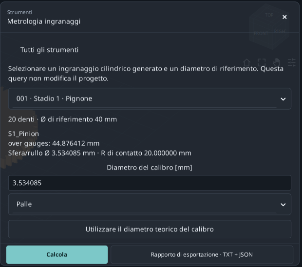

**Risultato atteso.** Hai una quota nominale verificabile per il pignone selezionato. Con Axial rollers la quota trasversale teorica coincide per questo caso a denti dritti.

**Se ti blocchi / interpretazione.** Servono profili cilindrici evolventi a denti dritti supportati, esterni o interni. Elicoidali e bielicoidali non sono coperti da questa misura. Accesso dello strumento e tolleranze reali richiedono valutazione separata.

## Leggere la misura su più denti

La misura Wildhaber è una quota fra ganasce piane su un numero selezionato di denti. L’app elenca i conteggi con contatto utilizzabile sul profilo generato.

1. **Mantieni lo stesso pignone.** Prosegui dal risultato precedente; verifica ancora **20 teeth**. Non selezionare la ruota da 60 denti.

2. **Apri la sezione.** Scorri il pannello fino a **Misura della tangente base** e aprila. Nel menu **Tangente base Wildhaber · numero di denti** seleziona **k = 3**, il conteggio consigliato per questo esempio.

3. **Leggi W3.** Il valore atteso è **W3 = 15.250402 mm**. Il raggio di contatto è circa **20.281829 mm**. Il numero 3 è il conteggio di denti della misura, non il rapporto del riduttore.

4. **Se non c’è una misura utilizzabile.** Controlla componente e tipo di dentatura. Una ruota interna o una dentatura elicoidale non forniscono questa stessa misura esterna a ganasce piane. Non forzare un conteggio assente dall’elenco.

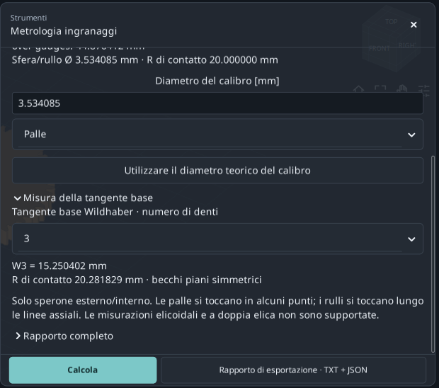

**Risultato atteso.** Quota su sfere e Wk sono due misure diverse: conserva entrambe con il nome del componente e i relativi input.

**Se ti blocchi / interpretazione.** Le sei cifre dopo la virgola sono una precisione di visualizzazione. Questi risultati non definiscono da soli tolleranze, classe di qualità, incertezza dello strumento o conformità completa a una norma.

## Passare da 0,15 a 0,50 mm di gioco

Obiettivo: proporre un nuovo interasse per il gioco tangenziale trasversale di funzionamento richiesto.

1. **Riparti dalla coppia base.** Apri **tools-01-base.config.json**, poi **Strumenti → Risolvi il gioco di lavoro...**. Il contesto deve mostrare interasse **80 mm** e gioco di funzionamento **0.15 mm**.

2. **Inserisci il risultato desiderato.** In **Gioco trasversale tangenziale di lavoro desiderato [mm]** scrivi **0.5**. Non modificare direttamente il campo Backlash del modello per eseguire questo esercizio.

3. **Verifica che il target sia ammesso.** Leggi **Intervallo obiettivo nominale**. Con questa base, 0,5 mm rientra nell’intervallo indicato. Il limite dipende dalla geometria corrente.

4. **Imposta il controllo e calcola.** Apri **Impostazioni di interferenza discrete**: **Passo ≤ [deg] 30**, **Time limit [s] 120**, **Pose limit 721**. Premi **Calcola e visualizza l'anteprima** e attendi.

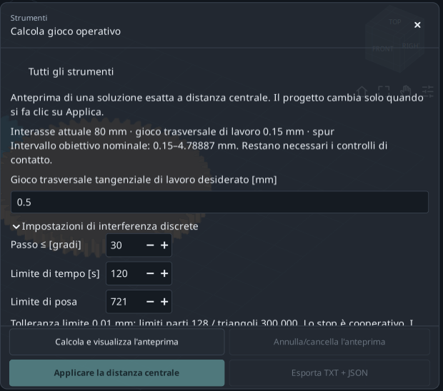

**Risultato atteso.** Il solver calcola e controlla una proposta. Il progetto principale resta invariato fino a **Applicare la distanza centrale**.

**Se ti blocchi / interpretazione.** Disponibile per una singola coppia parallela esterna spur/helical/double. Treni a più stadi, coppie interne e planetari non supportano questo aggiustamento. Il target non è un gioco radiale o normale.

## Confrontare il nuovo interasse e applicarlo

Leggi insieme valore corrente, proposta e messaggio di controllo prima di modificare il progetto.

1. **Controlla le due coppie di valori.** Il risultato atteso è interasse circa **80.466750 mm**, gioco **0.500000 mm** e ricoprimento utilizzabile circa **1.44449**.

2. **Leggi anche i limiti del controllo.** L’esempio riporta copertura discreta completa e **2 same-member boundary interfaces remain unresolved**. Si tratta delle due interfacce con gli alberi, che restano segnalate; non vengono dichiarate risolte.

3. **Applica deliberatamente.** Se la proposta è pronta, premi **Applicare la distanza centrale**. Nei parametri avanzati **Aumento dell'interasse [mm]** passa da 0 a circa **0.466750 mm**; la distanza tra gli assi è il valore di riferimento più questo incremento.

4. **Salva oppure annulla.** Prima di annullare premi **Esporta TXT + JSON**: conserva la proposta e il suo stato di applicazione nella cartella di export corrente. Poi prova **Annulla**: l’interasse torna a 80 mm. Il checkpoint pronto è **tools-03-backlash05.config.json**.

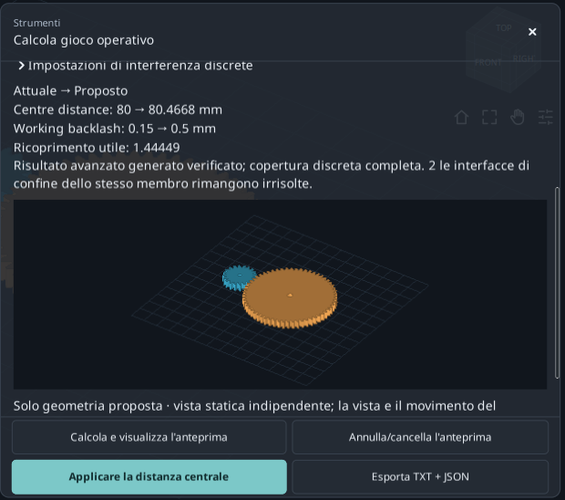

**Risultato atteso.** Hai cambiato l’interasse per ottenere il target, mantenendo i denti 20/60 e il modulo 2 mm.

**Se ti blocchi / interpretazione.** Se Apply resta disabilitato, leggi il messaggio: target fuori dominio, controllo incompleto, interferenze oppure progetto cambiato richiedono una nuova proposta valida. Non basta la presenza di una preview.

## Trovare componenti, calcoli e note

Obiettivo: conservare una spiegazione del modello e cercare un dato senza scorrere decine di campi.

1. **Apri la distinta.** Riapri la base, poi **Strumenti → Distinta componenti**. Trovi i componenti generati, ruoli, codici e quantità. Confronta i nomi con l’elenco Components.

2. **Apri i calcoli.** **Strumenti → Rapporto di calcolo** apre la finestra **Rapporto di calcolo nominale**. Consulta qui rapporto, geometria della coppia e calcoli nominali.

3. **Cerca nel documento.** Nel campo **Cerca questo documento…** cerca un nome o una parola presente nel report, ad esempio **S1_Pinion**. Le frecce **Precedente** / **Avanti** permettono di passare tra le corrispondenze; selezione e copia restano disponibili.

4. **Leggi le note del modello.** **Strumenti → Note del modello** mostra le note relative alla costruzione corrente. Per conservare tutti gli output usa l’esportazione del modello o gli export specifici dei **Strumenti**.

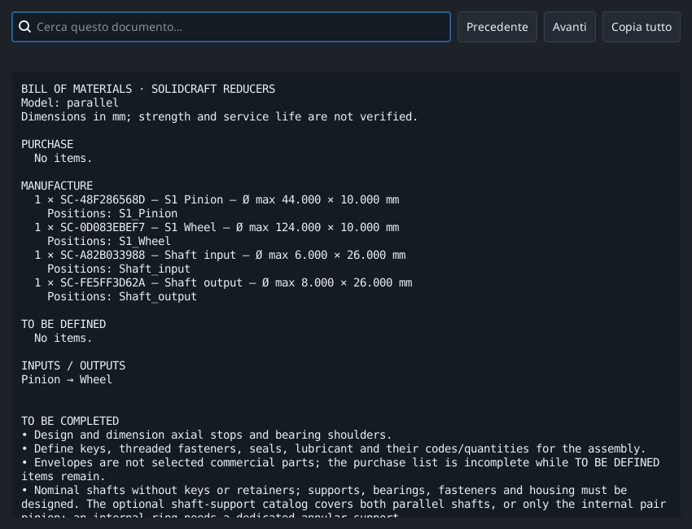

**Risultato atteso.** Sai dove trovare la distinta dell’assieme, il report nominale e le note, oltre alle query specifiche dei singoli **Strumenti**.

**Se ti blocchi / interpretazione.** La distinta descrive ciò che RatioLab genera. Componenti da completare in CAD, fissaggi o scelte aziendali non diventano automaticamente un elenco di acquisto completo.

## Se il risultato non coincide

Prima di cambiare molti parametri, controlla queste condizioni una alla volta.

1. **Ho numeri diversi nelle quote o nell’interasse.** Riapri **tools-01-base.config.json**. Verifica 20/60 denti, modulo 2, larghezza 10, denti dritti e interasse 80 mm. I checkpoint 02 e 03 contengono intenzionalmente risultati diversi.

2. **Non trovo il controllo mostrato.** Scorri il pannello, apri l’espansore indicato oppure usa **Strumento Espandi**. Se il nome è tradotto, confronta la funzione e la posizione. Controlla inoltre la versione: le immagini mostrano la revisione locale dei **Strumenti** su base 0.2.2.

3. **Apply o Export è disabilitato.** Seleziona una proposta che cambia il modello, correggi gli input segnalati e ricalcola dopo le modifiche. In metrologia devi avere un risultato valido; in Components serve una selezione.

4. **La misura A-B è diversa dalla figura.** È normale: i punti non si agganciano a centri o spigoli esatti. Cerca due facce visibili nella stessa posa; usa le quote analitiche del modello per i confronti esatti.

5. **Il controllo si ferma o è incompleto.** Salva prima il progetto. Riduci il numero di variabili della ricerca oppure aumenta il tempo del controllo. Leggi la copertura ottenuta: il tempo trascorso non prova che tutte le pose siano state verificate.

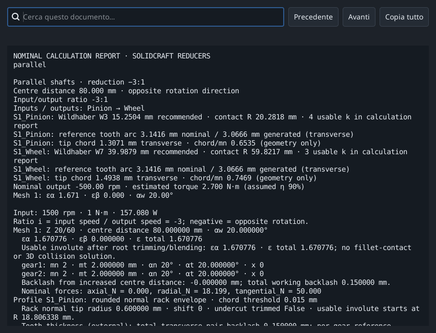

**Risultato atteso.** Ripeti un solo esercizio alla volta; conserva il progetto di partenza e il report del risultato.

**Se ti blocchi / interpretazione.** Questa guida riguarda geometria nominale, cinematica e controlli campionati. Non introduce verifiche di resistenza, fatica, durata o idoneità alla produzione.

## Riferimenti e ambito

La struttura segue tutorial ufficiali KISSsoft e istruzioni campo per campo GearTrax. La guida GearTrax consultata è storica (2009). Testi, esempi e immagini sono di RatioLab; i riferimenti non estendono le sue funzioni di calcolo.

- [KISSsoft, Tutorial 15 - Bevel gears (2022)](https://www.kisssoft.com/files/eu64So/KISSsoft-Tutorial-015-Bevelgear-en.pdf)
- [KISSsoft, indice ufficiale dei tutorial](https://development.startpage.services.kisssoft.com/)
- [Camnetics, GearTrax - Creating a Spur Gear (guida storica, 2009)](https://camnetics.com/geartrax/FlashHelp/geartrax2009/creating_a_spur_gear.htm)
- [Camnetics, GearTrax - Between Pins Example (guida storica, 2009)](https://camnetics.com/geartrax/FlashHelp/geartrax2009/between_pins_example.htm)

Geometria nominale, misure teoriche e controlli discreti non dimostrano resistenza, vita a fatica o idoneità alla produzione.
