# Tools do RatioLab: guias ilustrados

Seis exemplos completos, dos dados iniciais a um resultado reconhecível.

Aplicação desktop 0.2.2 com a revisão local dos Tools · 2026-11-10

As imagens usam este idioma da interface. Os comandos que continuam em inglês mantêm o nome visível. Introduza os decimais dos exemplos com ponto. Nomes de ficheiros e identificadores não são traduzidos.

Guarde o trabalho atual antes de abrir os projetos JSON em Ficheiro → Abrir. Cada exercício começa no ficheiro 01.02 e 03 são resultados preparados, não pedidos guardados dos Tools. Não alteram as preferências.

[English](tools-en.md) · [Italiano](tools-it.md) · [Español](tools-es.md) · [Français](tools-fr.md) · [Deutsch](tools-de.md) · [Português (Portugal)](tools-pt.md) · [Русский](tools-ru.md) · [简体中文](tools-zh-CN.md) · [தமிழ்](tools-ta.md)

## Projetos de exemplo

- [tools-01-base.config.json](../../examples/tools-01-base.config.json)
- [tools-02-rapporto3-compatto.config.json](../../examples/tools-02-rapporto3-compatto.config.json)
- [tools-03-backlash05.config.json](../../examples/tools-03-backlash05.config.json)

## Índice

- [Um modelo inicial, seis exercícios](#inizio)
- [Que Tool devo abrir?](#scegliere)
- [Selecionar e isolar o pinhão](#componenti)
- [Medir dois pontos visíveis](#misurare)
- [Exportar apenas o pinhão selecionado](#esportare)
- [Procurar um par 3:1 mais compacto](#ricerca)
- [Definir exatamente o que pode variar](#intervalli)
- [Comparar, aplicar e anular uma proposta](#applicare-ricerca)
- [Verificar o movimento amostrado](#interferenze)
- [Distinguir contacto e interferência](#leggere-interferenze)
- [Calcular a cota teórica sobre esferas](#metrologia)
- [Ler a medida Wildhaber sobre dentes](#wildhaber)
- [Alterar a folga de 0.15 para 0.50 mm](#backlash)
- [Aceitar o novo entre-eixos](#applicare-backlash)
- [Encontrar componentes, cálculos e notas](#report)
- [Se o resultado não coincidir](#problemi)

## Um modelo inicial, seis exercícios

Comece com dados conhecidos em vez de adivinhar parâmetros.

1. **Abrir o exemplo.** Guarde primeiro o seu projeto. Escolha **Ficheiro** → **Abrir…** e abra tools-01-base.config.json.

2. **Confirmar o modelo.** Redutor de eixos paralelos, um estágio, dentes direitos: pinhão 20, roda 60, módulo 2 mm, largura 10 mm, entre-eixos 80 mm. Relação -3:1; entrada 1500 rpm, saída -500 rpm.

3. **Recomeçar cada exercício.** Volte a abrir 01 antes de outro Tool. A pesquisa pode mudar dentes; o ajuste da folga muda o entre-eixos. 02 e 03 mostram os resultados finais.

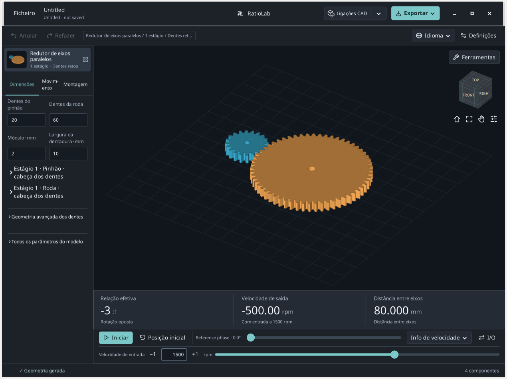

**Resultado esperado.** 20/60 dentes e 80 mm entre eixos identificam a base correta.

**Se tiver dificuldades / interpretação.** Os guias descrevem a revisão local dos Tools sobre 0.2.2. Os instaladores públicos e o navegador podem apresentar comandos diferentes.

## Que Tool devo abrir?

Abra **Ferramentas** acima da vista 3D e escolha a tarefa.

1. **Selecionar, medir ou exportar uma peça.** **Componentes/medida…** permite selecionar, isolar, marcar pontos nas superfícies e exportar a seleção.

2. **Procurar uma relação ou verificar o movimento.** **Encontre combinações…** compara grelhas finitas. **Verifique a interferência…** analisa posições amostradas e mostra as peças envolvidas.

3. **Obter uma cota teórica.** **Metrologia de engrenagens…** calcula medidas com esferas/rolos e sobre dentes para componentes direitos suportados.

4. **Alterar a folga de funcionamento.** **Resolva a reação de trabalho…** propõe o entre-eixos de um único par paralelo exterior. Os relatórios surgem abaixo.

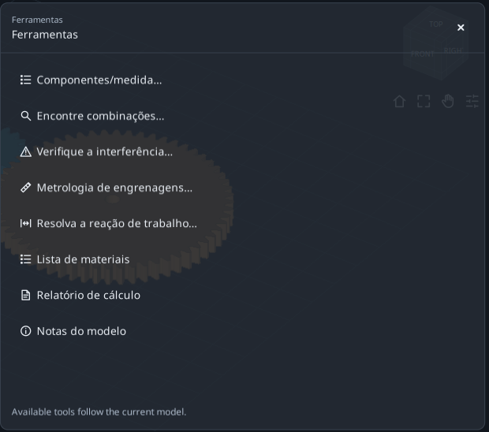

**Resultado esperado.** Consultar resultados não altera o modelo. Pesquisa e ajuste da folga exigem aplicação explícita.

**Se tiver dificuldades / interpretação.** **Ferramenta de expansão** amplia o formulário; **Restaurar espaço de trabalho** recupera o modelo. **Todas as ferramentas** muda de formulário e × fecha-o. Rascunhos de sessão não substituem projetos guardados.

## Selecionar e isolar o pinhão

Identifique a peça sem editar a geometria.

1. **Selecionar uma peça.** Abra 01 e **Ferramentas** → **Componentes/medida…**. Em **Peças**, selecione a primeira linha do pinhão. O resumo deve indicar uma peça selecionada.

2. **Ler a identidade.** Expanda **Detalhes do componente · limites nominais em mm**. O nome de origem é S1_Pinion. Os limites XYZ são dimensões nominais nos eixos globais, não três diâmetros.

3. **Isolar e restaurar.** Clique em **Isolar**, observe e depois **Restaurar visualização**. Regressam os filtros anteriores. Ctrl/Shift adiciona peças à seleção.

4. **Observar os dentes.** Com uma engrenagem compatível selecionada, **Ver dentado** abre a vista dos dentes; **Voltar ao modelo** regressa ao modelo. Use metrologia para cotas teóricas.

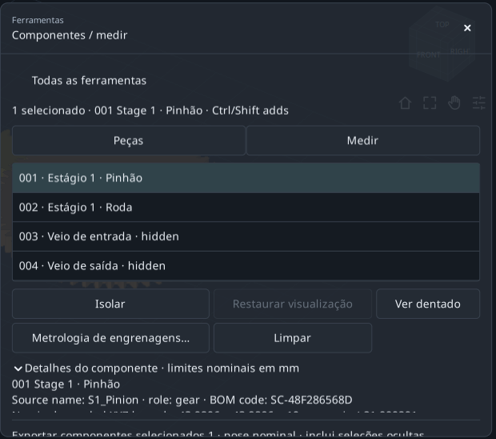

**Resultado esperado.** Pinhão identificado sem alterar dentes, módulo ou entre-eixos.

**Se tiver dificuldades / interpretação.** Comandos dos dentes/metrologia desativados indicam frequentemente falta de uma única engrenagem compatível selecionada. Um veio não é uma engrenagem.

## Medir dois pontos visíveis

Obtenha a distância reta A-B e as suas diferenças XYZ.

1. **Fixar uma posição parada.** Em Components escolha **Medir** e **Use pose nominal**. Se o painel tapar a roda, ative Pan, desloque o modelo para a esquerda e desative Pan.

2. **Escolher A e B.** Clique numa zona maciça da face superior do pinhão e depois da roda. Escolha superfícies fora do painel, não o espaço vazio do furo.

3. **Ler os valores.** Leia distância reta e B−A ΔXYZ. Em duas faces superiores planas à mesma altura, ΔZ é aproximadamente zero.

4. **Repetir conscientemente.** **Limpar pontos** reinicia a medição. Os seus cliques produzem normalmente uma distância diferente da imagem.

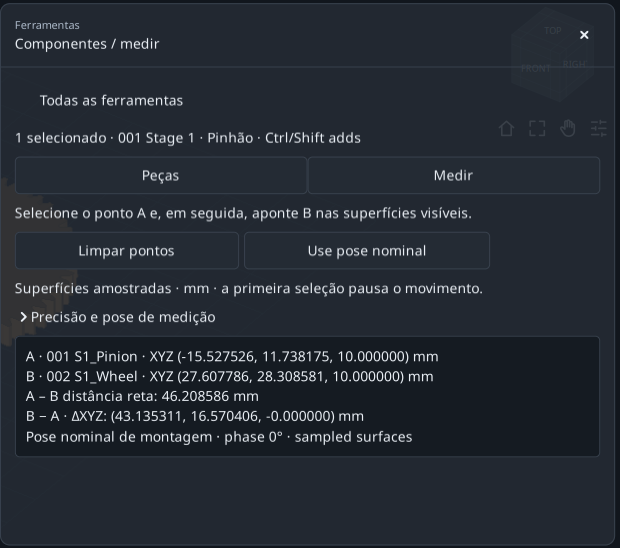

**Resultado esperado.** Dois pontos marcados, uma distância em mm e três diferenças de coordenadas.

**Se tiver dificuldades / interpretação.** Não existe ajuste automático a centros/arestas. É uma distância entre pontos de superfícies amostradas, não diâmetro analítico, entre-eixos exato ou distância mínima entre superfícies.

## Exportar apenas o pinhão selecionado

Distinga a exportação da seleção da exportação do redutor completo.

1. **Verificar a seleção.** Regresse a **Peças**, selecione apenas o pinhão e desloque-se até ao resumo de exportação: deve indicar um componente.

2. **Escolher primeiro o destino.** No menu superior **Exportar**, use **Alterar pasta…** para escolher uma pasta de exercício e regresse ao Tool.

3. **Exportar pelo Tool.** STEP para CAD, STL para a malha, **DXF / SVG** para secções suportadas ou **Pacote**. Aguarde a confirmação e escolha **Abrir pasta**.

4. **Conferir os ficheiros.** Devem conter só o pinhão em coordenadas nominais de montagem. Uma peça oculta mas selecionada continua a ser exportada.

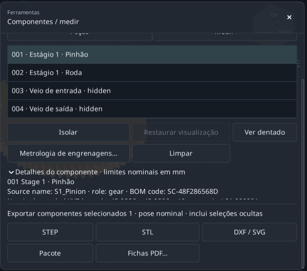

**Resultado esperado.** A seleção determina o conteúdo; a visibilidade não substitui a seleção.

**Se tiver dificuldades / interpretação.** **Fichas PDF…** requer um componente e abre fichas da empresa. Secções DXF/SVG não são automaticamente modelos de fabrico.

## Procurar um par 3:1 mais compacto

Compare 18/54 e 20/60 mantendo módulo, largura, variante e ligação fixos.

1. **Partir do ficheiro 01.** Abra **Ferramentas** → **Encontre combinações…** e mantenha **Editar configurações de pesquisa** expandido.

2. **Definir o objetivo.** Introduza 3 em **Proporção desejada** e 0 em **Erro permitido ± (%)**. É o valor absoluto velocidade de entrada/saída, não 0.333.

3. **Escolher a comparação.** Mantenha **Qualquer direção** e escolha **Menor espaço ocupado** em **Comparar resultados por**. A ligação atual produz rotação oposta.

4. **Manter limites amplos.** Deixe máximos X/Y/Z em 1000 mm. O envelope inclui todos os componentes gerados, mesmo ocultos.

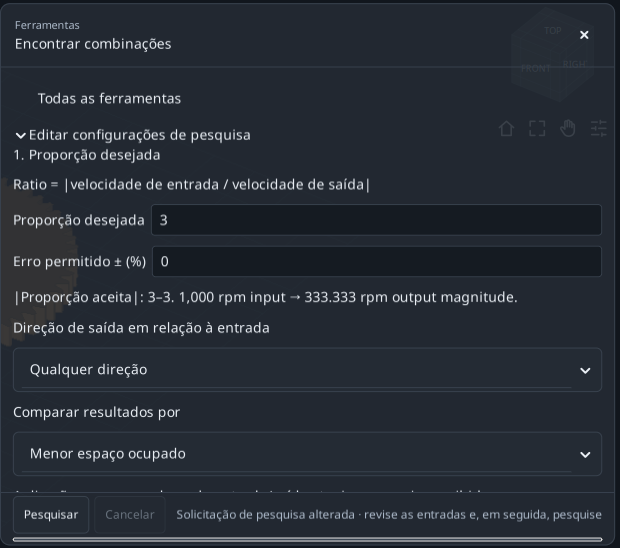

**Resultado esperado.** Objetivo definido. A seguir limite a pesquisa a quatro candidatos.

**Se tiver dificuldades / interpretação.** A pesquisa requer um conjunto com uma relação única de entrada/saída. Uma roda isolada ou um diferencial não a fornece.

## Definir exatamente o que pode variar

Use pequenos intervalos finitos em **2. Parâmetros a explorar**.

1. **Intervalo do pinhão.** Em **Dentes do pinhão de entrada**, escolha **Variar** e **Alcance**: **De** 18, **To** 20, **Passo** 2. Testa 18 e 20.

2. **Intervalo da roda.** Em **Dentes da roda movida**: **Variar**, **Alcance**, **De** 54, **To** 60, **Passo** 6. Testa 54 e 60.

3. **Fixar os restantes valores.** Deixe as outras variáveis de **Mais dimensões** em **Mantenha-se atualizado**. Dois valores vezes dois dão quatro candidatos.

4. **Executar a pesquisa.** Em Advanced, 100 candidatos máximos e 60 segundos bastam. Clique em **Pesquisar** e aguarde.

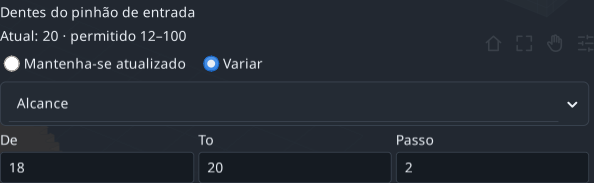

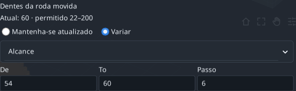

**Resultado esperado.** 18/54 e 20/60 cumprem exatamente 3:1; as outras duas combinações não.

**Se tiver dificuldades / interpretação.** Os intervalos multiplicam-se entre variáveis. Comece com poucos valores e corrija erros dos campos antes de pesquisar.

## Comparar, aplicar e anular uma proposta

Uma linha é apenas proposta até ser aplicada explicitamente.

1. **Ler a primeira solução.** O menor envelope ordena 18/54 primeiro: pinhão 20→18, roda 60→54. Mantém 3:1 e rotação oposta.

2. **Comparar a geometria.** XYZ nominal≈147.933 × 111.990 × 26 mm; recobrimento útil≈1.64876. São resultados geométricos, não verificações de resistência.

3. **Guardar antes de aplicar.** Selecione 18/54. Se precisar do registo, guarde o TXT com **Salvar relatório…** antes de **Aplicar selecionado**; aplicar invalida a pesquisa.

4. **Verificar e anular.** O modelo passa para 18 e 54 dentes. Um **Anular** restaura 20/60.02 é o resultado compacto pronto a abrir.

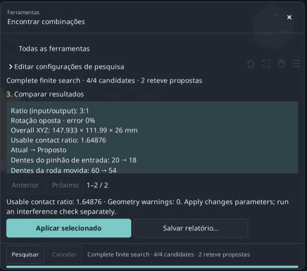

**Resultado esperado.** Par mais compacto com a relação pretendida e uma alteração reversível.

**Se tiver dificuldades / interpretação.** Apply fica desativado na linha 20/60 sem alterações. Após editar modelo ou intervalos, execute nova pesquisa.

## Verificar o movimento amostrado

Leia a cobertura antes de interpretar a lista de contactos.

1. **Voltar ao ficheiro 01.** Abra **Ferramentas** → **Verifique a interferência…**. Não use o resultado compacto anterior.

2. **Definir a amostragem.** Em **Verifique as configurações**: passo 30°, tolerância de fronteira 0.01 mm e limite 120 s.

3. **Executar a verificação.** Clique em **Ciclo de verificação** e aguarde. Suportes e caixa ocultos também entram; ocultar não os exclui.

4. **Ler a cobertura.** Este exemplo termina 37/37 posições com passo≤30°. Se indicar INCOMPLETE, permita mais tempo ou passo maior e repita.

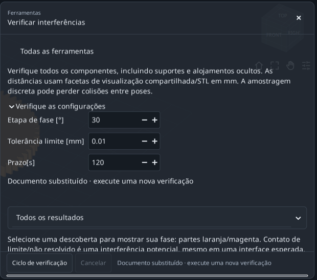

**Resultado esperado.** Cobertura discreta completa significa verificar todas as 37 posições planeadas.

**Se tiver dificuldades / interpretação.** O período cinemático das peças identificadas pode exceder 360°. Passos menores exigem mais trabalho; o tempo decorrido não demonstra cobertura.

## Distinguir contacto e interferência

O filtro altera a lista, não a análise efetuada nem a cobertura.

1. **Mostrar contactos por resolver.** Escolha **Contactos não resolvidos**. A base assinala interfaces pinhão/veio de entrada e roda/veio de saída.

2. **Inspecionar uma linha.** Clique no resultado para mostrar fase e peças laranja/magenta. **Visualização da restauração** repõe a vista; saia primeiro do modo expandido, se necessário.

3. **Comparar classes.** **Possível interferência** mostra Intersection/Containment; **Separado**, pares separados; **Todos os resultados**, todas as classes.

4. **Guardar e repetir após editar.** **Salvar relatório…** guarda TXT através de um diálogo. Alterações de parâmetros ou geometria invalidam a verificação anterior.

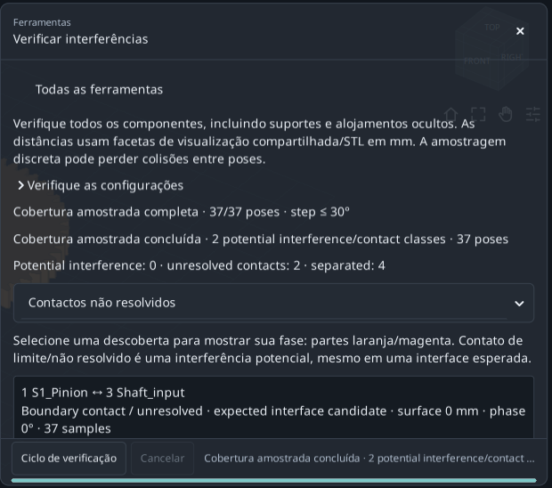

**Resultado esperado.** Base: 0 classes de interferência potencial, 2 de contacto por resolver e 4 separadas.

**Se tiver dificuldades / interpretação.** Boundary contact/unresolved não é automaticamente erro do modelo. Cobertura discreta completa não prova movimento continuamente sem colisões.

## Calcular a cota teórica sobre esferas

Use a engrenagem certa, não um diâmetro aproximado por cliques 3D.

1. **Selecionar o pinhão.** Abra 01. Em Components selecione só o primeiro pinhão e **Metrologia de engrenagens…**. Confirme 20 dentes, referência 40 mm e S1_Pinion.

2. **Usar a esfera proposta.** Mantenha **Bolas**, clique em **Use o diâmetro do medidor teórico** e conserve≈3.534085 mm calculados. Não transcreva um valor arredondado da imagem.

3. **Calcular.** Clique em **Calcular**. Cota sobre esferas esperada≈44.876412 mm e raio de contacto 20 mm; não é o diâmetro de referência 40 mm.

4. **Exportar a consulta.** **Relatório de exportação · TXT + JSON** guarda dados e resultado na pasta indicada em **Exportar** → **Pasta de destino**. Recalcule após mudar esfera/componente.

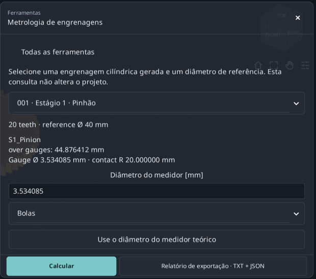

**Resultado esperado.** Cota teórica reproduzível do pinhão. Rolos axiais dão a mesma medida transversal neste exemplo direito.

**Se tiver dificuldades / interpretação.** Só componentes evolventes direitos exteriores/interiores suportados. Não cobre helicoidais, acesso físico do instrumento nem tolerâncias reais.

## Ler a medida Wildhaber sobre dentes

É uma medida entre faces planas sobre um número escolhido de dentes.

1. **Manter o mesmo pinhão.** Continue com S1_Pinion de 20 dentes; não mude para a roda de 60.

2. **Abrir a secção.** Desloque-se até **Medição sobre vários dentes**. Em **Wildhaber span · number of teeth**, escolha 3.

3. **Ler W3.** W3≈15.250402 mm, raio de contacto≈20.281829 mm. 3 é a quantidade de dentes abrangidos, não a relação do redutor.

4. **Respeitar as opções.** A lista inclui contactos utilizáveis no perfil gerado. Não force um valor ausente; engrenagens internas ou helicoidais não dão esta medida exterior entre faces planas.

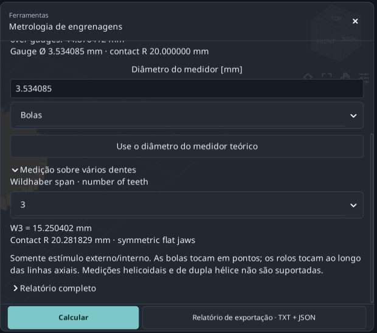

**Resultado esperado.** Cota sobre esferas e Wk são medidas diferentes; guarde componente e entradas de ambas.

**Se tiver dificuldades / interpretação.** As casas decimais não definem tolerância de fabrico, incerteza, qualidade da engrenagem ou conformidade normativa completa.

## Alterar a folga de 0.15 para 0.50 mm

Propor novo entre-eixos para folga tangencial transversal de funcionamento.

1. **Partir do ficheiro 01.** Abra **Resolva a reação de trabalho…**. Confirme entre-eixos 80 mm e folga atual 0.15 mm.

2. **Definir o alvo.** Introduza 0.5 em **Folga tangencial transversal de trabalho desejada [mm]**. Não altere o campo Backlash de redução da espessura dos dentes do modelo.

3. **Verificar o domínio.** Leia **Nominal target range**: 0.5 mm está no intervalo desta base. Os limites dependem da geometria atual.

4. **Calcular e visualizar.** Em **Configurações de interferência discreta**: passo 30°, tempo 120 s, máximo 721 posições. Clique em **Calcular e visualizar**.

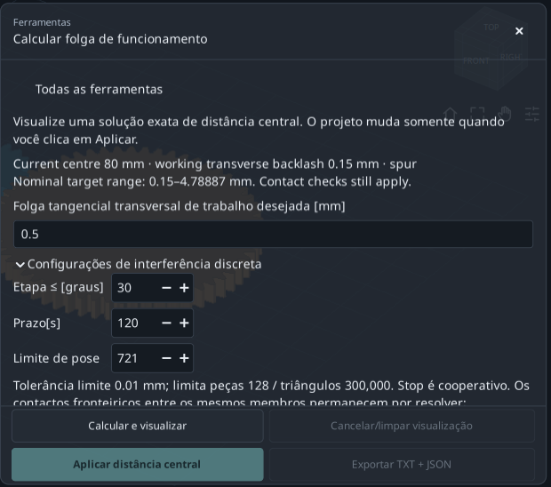

**Resultado esperado.** O solver propõe e verifica a geometria sem alterar ainda o projeto principal.

**Se tiver dificuldades / interpretação.** Só um par paralelo exterior direito/helicoidal/duplo. Exclui vários estágios, engrenagens internas e planetárias; o alvo não é folga radial ou normal.

## Aceitar o novo entre-eixos

Leia em conjunto valores atuais/propostos e mensagem de verificação.

1. **Comparar resultados.** Entre-eixos≈80.466750 mm, folga≈0.500000 mm e recobrimento útil≈1.44449.

2. **Ler interfaces pendentes.** A cobertura discreta é completa, mas conserva duas interfaces não resolvidas com veios do mesmo membro. Não foram declaradas resolvidas.

3. **Aplicar a proposta.** Clique em **Aplicar distância central**. Nas dimensões avançadas, **Aumento da distância central [mm]** passa de 0 para≈0.466750. A referência mais esse incremento dá a nova distância.

4. **Exportar antes de anular.** **Exportar TXT + JSON** guarda proposta e estado aplicado na pasta atual. Depois **Anular** regressa a 80 mm. 03 é o resultado preparado.

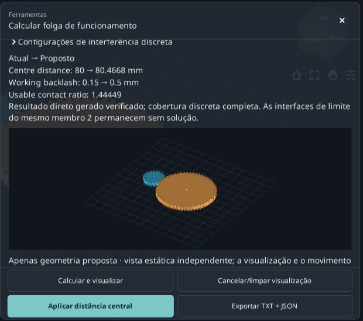

**Resultado esperado.** Alvo atingido alterando entre-eixos, mantendo 20/60 dentes e módulo 2 mm.

**Se tiver dificuldades / interpretação.** Com Apply desativado, leia a causa: alvo inválido, verificação incompleta, interferência ou projeto alterado podem exigir recálculo. A pré-visualização não basta.

## Encontrar componentes, cálculos e notas

Use os relatórios para compreender o modelo e localizar valores.

1. **Abrir a lista de materiais.** Desde 01, escolha **Ferramentas** → **Lista de materiais**. Compare nomes, códigos e quantidades gerados com Components.

2. **Abrir cálculos.** **Relatório de cálculo** abre **Relatório de cálculo nominal**: relação, geometria do engrenamento e cálculos nominais.

3. **Pesquisar no documento.** Em **Pesquisar este documento…**, experimente S1_Pinion. **Anterior**/**Próximo** percorrem ocorrências; **Copiar tudo** copia o texto.

4. **Ler notas do modelo.** **Notas do modelo** explica a construção. O exportar do modelo ou de cada Tool conserva as saídas respetivas.

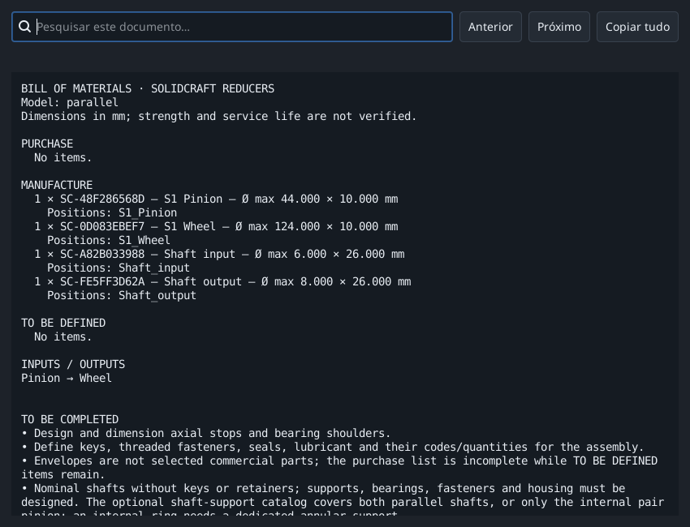

**Resultado esperado.** Sabe localizar lista de materiais, cálculos nominais, notas e consultas individuais.

**Se tiver dificuldades / interpretação.** Uma lista gerada não é automaticamente uma lista de compras completa; decisões da empresa e detalhes CAD podem faltar.

## Se o resultado não coincidir

Verifique uma condição de cada vez antes de mudar muitos parâmetros.

1. **Dimensões diferentes.** Reabra 01:20/60 dentes, módulo 2, largura 10, dentes direitos e 80 mm entre eixos. 02 e 03 têm intencionalmente outros resultados.

2. **Comandos em falta.** Desloque-se ou use **Ferramenta de expansão**; confirme idioma e versão. As imagens mostram a revisão local sobre 0.2.2.

3. **Apply ou Export desativado.** Escolha uma proposta que altere o modelo ou uma peça compatível, corrija erros e recalcule após editar. A metrologia precisa de resultado válido.

4. **Medição variável ou análise incompleta.** Os pontos variam, sem ajuste automático. Simplifique a pesquisa ou permita mais tempo; verifique a cobertura, não só segundos decorridos.

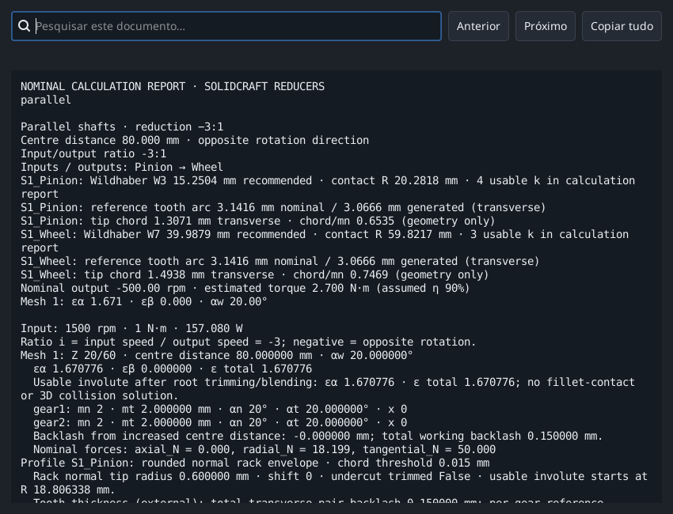

**Resultado esperado.** Repita um exercício de cada vez e conserve projeto inicial e relatório.

**Se tiver dificuldades / interpretação.** Guarde o seu trabalho. Estes exercícios tratam geometria nominal e movimento discreto, não resistência, vida útil ou aprovação de fabrico.

## Referências e âmbito

A sequência segue tutoriais oficiais KISSsoft e instruções campo a campo GearTrax. A ajuda GearTrax consultada é histórica (2009). Textos, exemplos e imagens pertencem ao RatioLab; as referências não alargam os seus cálculos.

- [KISSsoft, Tutorial 15 - Bevel gears (2022)](https://www.kisssoft.com/files/eu64So/KISSsoft-Tutorial-015-Bevelgear-en.pdf)
- [KISSsoft, índice oficial de tutoriais](https://development.startpage.services.kisssoft.com/)
- [Camnetics, GearTrax - Creating a Spur Gear (ajuda histórica, 2009)](https://camnetics.com/geartrax/FlashHelp/geartrax2009/creating_a_spur_gear.htm)
- [Camnetics, GearTrax - Between Pins Example (ajuda histórica, 2009)](https://camnetics.com/geartrax/FlashHelp/geartrax2009/between_pins_example.htm)

Geometria nominal, medidas teóricas e verificações discretas não demonstram resistência, vida à fadiga ou aptidão para fabrico.
