# Инструменты RatioLab: пошаговые руководства

Шесть законченных примеров: от исходных данных к проверяемому результату.

Настольная версия 0.2.2 с локальным обновлением инструментов · 2026-11-10

Снимки показывают интерфейс на этом языке. Команды, оставшиеся в приложении на английском, сохраняют видимое название. В примерах вводите дробные числа с точкой. Имена файлов и идентификаторы модели не переводятся.

Сначала сохраните свою работу. Откройте проекты JSON через Файл → Открыть. Каждый пример начинается с файла 01. Файлы 02 и 03 содержат готовые результаты, а не сохранённые запросы инструментов. Настройки приложения не изменяются.

[English](tools-en.md) · [Italiano](tools-it.md) · [Español](tools-es.md) · [Français](tools-fr.md) · [Deutsch](tools-de.md) · [Português (Portugal)](tools-pt.md) · [Русский](tools-ru.md) · [简体中文](tools-zh-CN.md) · [தமிழ்](tools-ta.md)

## Примеры проектов

- [tools-01-base.config.json](../../examples/tools-01-base.config.json)
- [tools-02-rapporto3-compatto.config.json](../../examples/tools-02-rapporto3-compatto.config.json)
- [tools-03-backlash05.config.json](../../examples/tools-03-backlash05.config.json)

## Содержание

- [Одна исходная модель, шесть упражнений](#inizio)
- [Какой инструмент открыть?](#scegliere)
- [Выбрать и изолировать шестерню](#componenti)
- [Измерить две видимые точки](#misurare)
- [Экспортировать только выбранную шестерню](#esportare)
- [Найти более компактную пару 3:1](#ricerca)
- [Точно задать изменяемые параметры](#intervalli)
- [Сравнить, применить и отменить предложение](#applicare-ricerca)
- [Проверить дискретное движение](#interferenze)
- [Отличить контакт от пересечения](#leggere-interferenze)
- [Вычислить теоретический размер по шарикам](#metrologia)
- [Прочитать размер общей нормали Wildhaber](#wildhaber)
- [Изменить рабочий зазор с 0.15 до 0.50 мм](#backlash)
- [Применить новое межосевое расстояние](#applicare-backlash)
- [Найти детали, расчёты и примечания](#report)
- [Если результат отличается](#problemi)

## Одна исходная модель, шесть упражнений

Используйте известные данные вместо подбора параметров наугад.

1. **Откройте пример.** Сохраните свой проект. Выберите **Файл** → **Открыть…** и откройте tools-01-base.config.json.

2. **Проверьте модель.** Параллельные валы, одна ступень, прямые зубья: шестерня 20, колесо 60, модуль 2 мм, ширина 10 мм, межосевое расстояние 80 мм. Отношение -3:1; вход 1500 об/мин, выход -500 об/мин.

3. **Начинайте заново с базы.** Перед следующим инструментом снова откройте 01. Поиск меняет числа зубьев, настройка зазора — межосевое расстояние. 02 и 03 содержат готовые результаты.

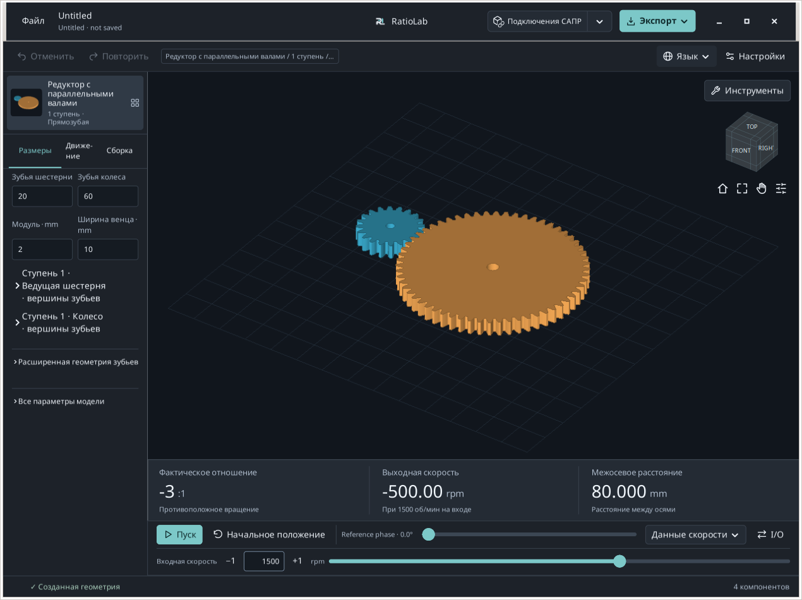

**Ожидаемый результат.** 20/60 зубьев и 80 мм между осями — правильная исходная конфигурация.

**Если возникли затруднения / пояснение.** Руководства описывают локальное обновление инструментов на базе 0.2.2. В публичном установщике и браузере набор элементов может отличаться.

## Какой инструмент открыть?

Откройте **Инструменты** над видом 3D и выберите задачу.

1. **Выбрать, измерить или экспортировать деталь.** **Компоненты/мера…**: выбор и изоляция деталей, точки на поверхностях, экспорт выбранных компонентов.

2. **Найти отношение или проверить движение.** **Найдите комбинации…** сравнивает конечные наборы параметров. **Проверьте помехи…** проверяет дискретные положения и показывает участвующие детали.

3. **Получить теоретический размер.** **Метрология зубчатых передач…** рассчитывает размеры по шарикам/роликам и общую нормаль для поддерживаемых прямозубых компонентов.

4. **Изменить рабочий боковой зазор.** **Устранить рабочий люфт…** предлагает межосевое расстояние для одной внешней пары на параллельных валах. Ниже расположены отчёты.

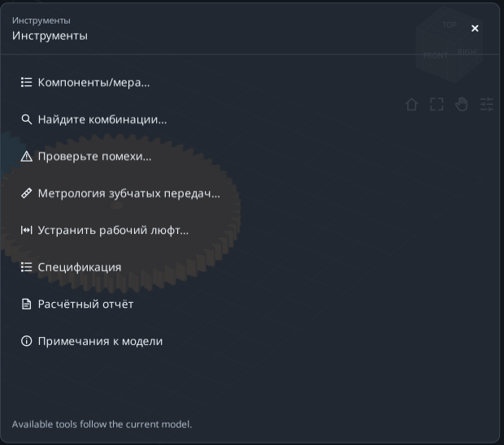

**Ожидаемый результат.** Просмотр результата не изменяет модель. Поиск и настройка зазора требуют явного применения.

**Если возникли затруднения / пояснение.** **Развернуть инструмент** увеличивает форму; **Восстановить рабочую область** возвращает модель. **Все инструменты** переключает форму, × закрывает её. Черновик сеанса не заменяет сохранённый проект.

## Выбрать и изолировать шестерню

Найдите нужную деталь, не меняя её геометрию.

1. **Выберите одну деталь.** Откройте 01 и **Инструменты** → **Компоненты/мера…**. В **Части** выберите первую строку шестерни. Сводка должна показывать один выбранный компонент.

2. **Прочитайте идентификатор.** Раскройте **Сведения о компоненте · номинальные границы в mm**. Исходное имя — S1_Pinion. Габариты XYZ измеряются по мировым осям; это не три диаметра.

3. **Изолируйте и восстановите.** Нажмите **Изолировать**, осмотрите деталь, затем **Восстановить вид**. Вернутся прежние фильтры вида. Ctrl/Shift добавляет детали к выбору.

4. **Осмотрите зубья.** Для одного подходящего колеса **Показать зубья** открывает вид зубьев, **Вернуться к модели** возвращает модель. Теоретические размеры ищите в метрологии.

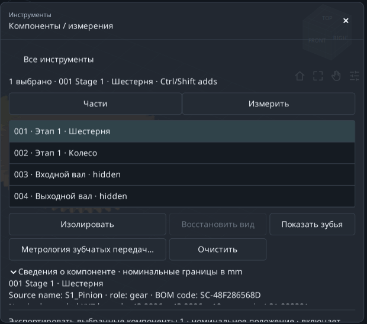

**Ожидаемый результат.** Шестерня найдена без изменения зубьев, модуля и межосевого расстояния.

**Если возникли затруднения / пояснение.** Недоступные действия обычно означают, что не выбрано одно подходящее зубчатое колесо. Вал не является зубчатым колесом.

## Измерить две видимые точки

Получите прямое расстояние A-Bи разности координат XYZ.

1. **Зафиксируйте положение.** В Components выберите **Измерить** и **Используйте номинальную позу**. Если панель закрывает колесо, включите Pan, сдвиньте модель влево и выключите Pan.

2. **Укажите AиB.** Щёлкните сплошную область верхней поверхности шестерни, затем колеса. Выбирайте видимые поверхности вне панели, а не пустоту отверстия.

3. **Прочитайте значения.** Показаны длина прямого отрезка и B−A ΔXYZ. Для верхних плоских поверхностей на одной высоте ΔZ примерно равно нулю.

4. **Повторите измерение.** **Четкие точки** начинает выбор заново. Ваши щелчки обычно дадут другое расстояние, чем на снимке.

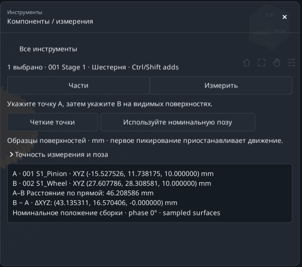

**Ожидаемый результат.** Две отмеченные точки, расстояние в мм и три разности координат.

**Если возникли затруднения / пояснение.** Привязки нет. Это расстояние между точками дискретных поверхностей, не аналитический диаметр, точное межосевое расстояние или минимальный зазор между поверхностями.

## Экспортировать только выбранную шестерню

Отличайте экспорт выбранных деталей от экспорта всего редуктора.

1. **Проверьте выбор.** Вернитесь в **Части**, выберите только шестерню и прокрутите к сводке экспорта: должен быть выбран один компонент.

2. **Сначала задайте папку.** В верхнем меню **Экспорт** выберите **Сменить папку…**, задайте папку упражнения и вернитесь к инструменту.

3. **Экспортируйте из инструмента.** STEP — для CAD, STL — для сетки, **DXF / SVG** — для поддерживаемых сечений, **Пакет** — для пакета. Дождитесь подтверждения и нажмите **Открыть папку**.

4. **Проверьте файлы.** Должна присутствовать только шестерня в номинальных сборочных координатах. Скрытая, но выбранная деталь тоже экспортируется.

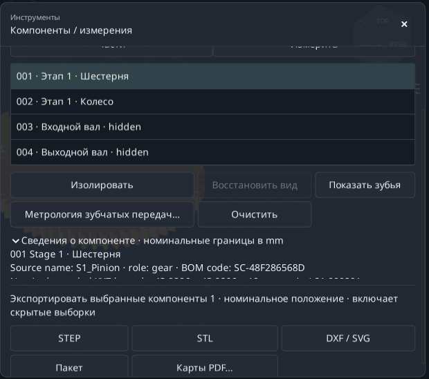

**Ожидаемый результат.** Состав экспорта задаёт выбор; видимость его не заменяет.

**Если возникли затруднения / пояснение.** **Карты PDF…** требует одну деталь и открывает производственные формы предприятия. Сечения DXF/SVG не становятся автоматически шаблонами для изготовления.

## Найти более компактную пару 3:1

Сравните 18/54 и 20/60 при фиксированных модуле, ширине, варианте и подключении.

1. **Начните с файла 01.** Откройте **Инструменты** → **Найдите комбинации…**; оставьте **Изменить настройки поиска** раскрытым.

2. **Задайте цель.** Введите 3 в **Желаемое соотношение** и 0 в **Допустимая ошибка ± (%)**. Это модуль отношения входной скорости к выходной, не 0.333.

3. **Выберите сравнение.** Оставьте **В любом направлении**; в **Сравнивать результаты по** выберите **Наименьший габарит**. При текущем подключении вращение противоположное.

4. **Не сужайте габаритные ограничения.** Оставьте максимумы X/Y/Z по 1000 мм. Учитываются все созданные компоненты, включая скрытые.

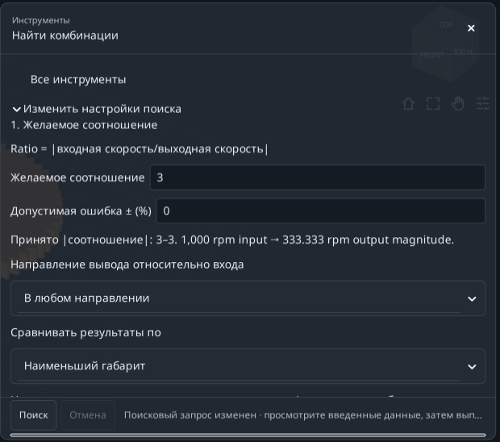

**Ожидаемый результат.** Цель задана. Теперь ограничьте поиск четырьмя кандидатами.

**Если возникли затруднения / пояснение.** Нужна сборка с единственным определённым отношением вход/выход. Отдельное колесо и дифференциал такого отношения не дают.

## Точно задать изменяемые параметры

Используйте небольшие конечные диапазоны в **2. Параметры для изучения**.

1. **Диапазон шестерни.** Для **Число зубьев входной шестерни** выберите **Варьироваться** и **Диапазон**: **От** 18, **To** 20, **Шаг** 2. Проверяются 18 и 20.

2. **Диапазон колеса.** Для **Число зубьев ведомого колеса**: **Варьироваться**, **Диапазон**, **От** 54, **To** 60, **Шаг** 6. Проверяются 54 и 60.

3. **Остальное зафиксируйте.** Другие переменные в **Другие размеры** оставьте на **Будьте в курсе**. Два значения на два дают четыре кандидата.

4. **Запустите поиск.** В Advanced достаточно 100 максимальных кандидатов и 60 секунд. Нажмите **Поиск** и подождите.

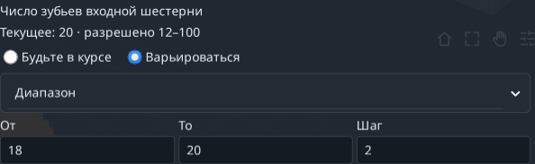

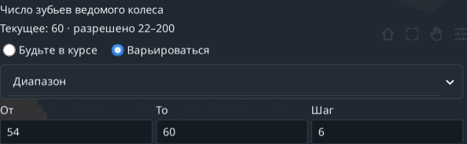

**Ожидаемый результат.** 18/54 и 20/60 дают ровно 3:1; две другие комбинации — нет.

**Если возникли затруднения / пояснение.** Размеры диапазонов перемножаются. Начинайте с малого и исправляйте ошибки полей до запуска.

## Сравнить, применить и отменить предложение

Строка результата остаётся предложением до явного применения.

1. **Прочитайте первое решение.** По минимальному габариту первой будет 18/54: шестерня 20→18, колесо 60→54. Сохраняются 3:1 и противоположное вращение.

2. **Сравните геометрию.** Номинальные XYZ≈147.933 × 111.990 × 26 мм; используемый коэффициент перекрытия≈1.64876. Это геометрические результаты, не расчёт прочности.

3. **Сохраните до применения.** Выберите 18/54. При необходимости сохраните TXTчерез **Сохранить отчет…** перед **Применить выбранное**: применение делает поиск неактуальным.

4. **Проверьте и отмените.** В модели станут 18 и 54 зуба. Один **Отменить** вернёт 20/60. Файл 02— готовый компактный вариант.

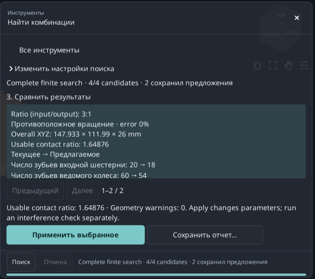

**Ожидаемый результат.** Более компактная пара с нужным отношением и обратимым изменением модели.

**Если возникли затруднения / пояснение.** Apply недоступен для неизменённой строки 20/60. После изменения модели или диапазонов выполните новый поиск.

## Проверить дискретное движение

Сначала прочитайте полноту проверки, затем список контактов.

1. **Вернитесь к файлу 01.** Откройте **Инструменты** → **Проверьте помехи…**. Не используйте компактный результат предыдущего упражнения.

2. **Задайте дискретизацию.** В **Проверьте настройки**: шаг 30°, допуск границы 0.01 мм, лимит 120 с.

3. **Выполните проверку.** Нажмите **Проверить цикл** и подождите. Учитываются скрытые опоры и корпус; скрытие не исключает их.

4. **Прочитайте покрытие.** В примере завершаются 37/37 положений при шаге≤30°. Если INCOMPLETE, увеличьте время или шаг и повторите.

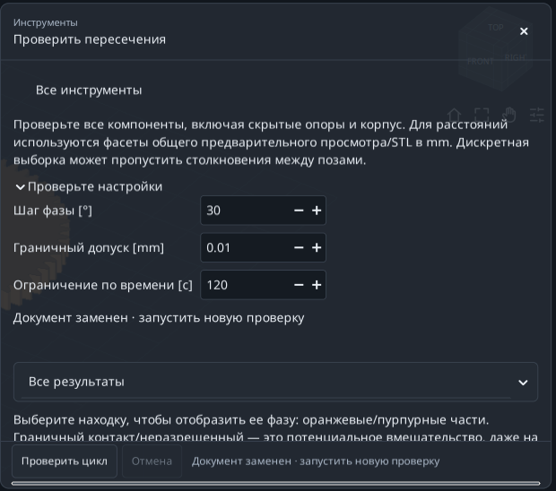

**Ожидаемый результат.** Полная дискретная проверка означает обработку всех 37 запланированных положений.

**Если возникли затруднения / пояснение.** Кинематический период обозначенных деталей может превышать 360°. Меньший шаг требует больше работы; одно прошедшее время не доказывает полноту.

## Отличить контакт от пересечения

Фильтр меняет список, а не анализ или его полноту.

1. **Покажите неразрешённые контакты.** Выберите **Неразрешённые контакты**. В базе отмечены шестерня/входной вал и колесо/выходной вал.

2. **Осмотрите строку.** Щёлкните результат: появятся его фаза и оранжевая/пурпурная детали. **Восстановить предварительный просмотр** вернёт вид; при необходимости сначала выйдите из расширенного режима.

3. **Сравните классы.** **Возможная интерференция** показывает Intersection/Containment; **Отдельный** — раздельные пары; **Все результаты** — все классы.

4. **Сохраните и пересчитайте после правок.** **Сохранить отчет…** сохраняет TXTчерез диалог. Изменение настроек или геометрии делает старую проверку неактуальной.

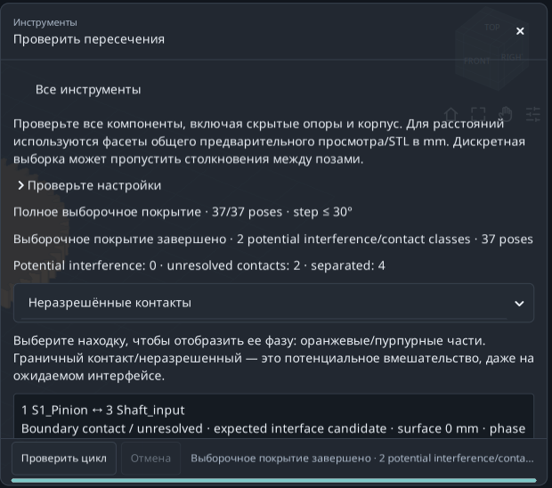

**Ожидаемый результат.** База: 0 классов потенциального пересечения, 2 класса неразрешённых контактов и 4 раздельных.

**Если возникли затруднения / пояснение.** Boundary contact/unresolved не обязательно означает ошибку модели. Полная дискретная проверка не доказывает непрерывное движение без столкновений.

## Вычислить теоретический размер по шарикам

Используйте нужное колесо вместо приближённого диаметра по 3D-щелчкам.

1. **Выберите шестерню.** Откройте 01. В Components выберите только первую шестерню и **Метрология зубчатых передач…**. Проверьте 20 зубьев, опорный диаметр 40 мм и S1_Pinion.

2. **Используйте предложенный шарик.** Оставьте **Шары**, нажмите **Используйте теоретический расчетный диаметр**, сохраните рассчитанные≈3.534085 мм. Не перепечатывайте округлённое значение со снимка.

3. **Вычислите.** Нажмите **Рассчитать**. Ожидается размер по шарикам≈44.876412 мм, радиус контакта 20 мм; это не опорный диаметр 40 мм.

4. **Экспортируйте запрос.** **Отчет об экспорте · TXT + JSON** сохраняет данные и результат в папку **Экспорт** → **Папка назначения**. После смены шарика/детали пересчитайте.

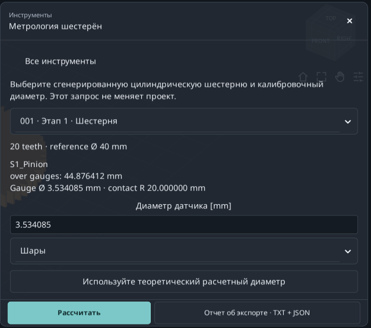

**Ожидаемый результат.** Воспроизводимое теоретическое измерение шестерни. Осевые ролики дают тот же поперечный размер для этого прямозубого примера.

**Если возникли затруднения / пояснение.** Только поддерживаемые прямозубые внешние/внутренние эвольвентные компоненты. Косозубые измерения, доступ инструмента и реальные допуски не охвачены.

## Прочитать размер общей нормали Wildhaber

Размер между плоскими губками по выбранному числу зубьев.

1. **Оставьте ту же шестерню.** Продолжайте с S1_Pinion, 20 зубьев; не переходите на колесо 60.

2. **Откройте раздел.** Прокрутите к **Измерение общей нормали**. В **Wildhaber span · number of teeth** выберите 3.

3. **Прочитайте W3.** W3≈15.250402 мм, радиус контакта≈20.281829 мм. 3— число охватываемых зубьев, не передаточное отношение.

4. **Учитывайте доступные варианты.** Список содержит допустимые контакты созданного профиля. Не задавайте отсутствующее число; внутренние и косозубые колёса не дают этого внешнего размера между плоскими губками.

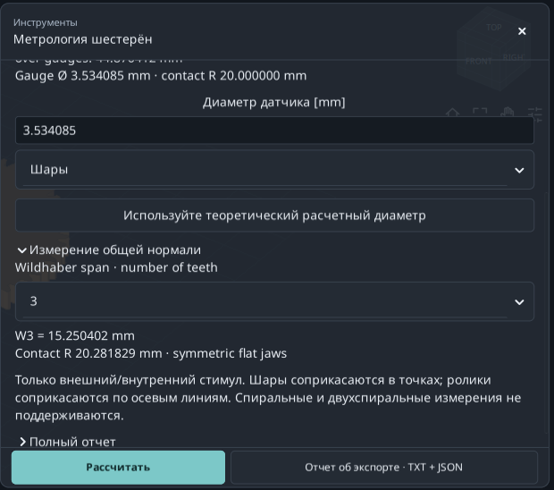

**Ожидаемый результат.** Размер по шарикам и Wk различаются; сохраняйте деталь и входные данные обоих.

**Если возникли затруднения / пояснение.** Число отображаемых знаков не задаёт производственный допуск, неопределённость измерения, точность передачи или полное соответствие стандарту.

## Изменить рабочий зазор с 0.15 до 0.50 мм

Предложить новое межосевое расстояние для тангенциального зазора в поперечном сечении.

1. **Начните с файла 01.** Откройте **Устранить рабочий люфт…**. Проверьте текущие 80 мм между осями и зазор 0.15 мм.

2. **Задайте цель.** Введите 0.5 в **Желаемый рабочий поперечный тангенциальный зазор [mm]**. Не меняйте поле Backlash для утонения зубьев в модели.

3. **Проверьте область.** Прочитайте **Nominal target range**: для базы 0.5 мм находится внутри. Пределы зависят от текущей геометрии.

4. **Рассчитайте и просмотрите.** В **Дискретные настройки помех**: шаг 30°, время 120 с, максимум 721 положение. Нажмите **Рассчитать и просмотреть**.

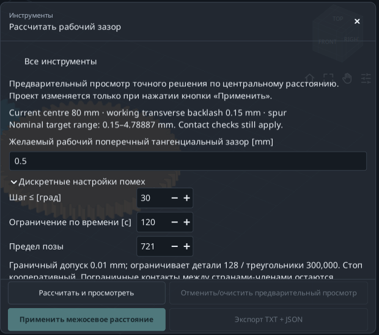

**Ожидаемый результат.** Решатель предлагает и проверяет геометрию, пока не меняя основной проект.

**Если возникли затруднения / пояснение.** Только одна внешняя пара на параллельных валах: прямая/косая/двойная. Многоступенчатые, внутренние и планетарные передачи исключены; цель не радиальный и не нормальный зазор.

## Применить новое межосевое расстояние

Читайте текущие/предлагаемые значения вместе с сообщением проверки.

1. **Сравните результаты.** Расстояние≈80.466750 мм, зазор≈0.500000 мм, используемый коэффициент перекрытия≈1.44449.

2. **Прочитайте оставшиеся контакты.** Дискретная проверка полная, но сохраняет два неразрешённых сопряжения с валами того же звена. Они не объявлены разрешёнными.

3. **Примените предложение.** Нажмите **Применить межосевое расстояние**. В расширенных размерах **Увеличение межосевого расстояния [mm]** меняется с 0 до≈0.466750. Новое расстояние равно опорному плюс это увеличение.

4. **Экспортируйте перед отменой.** **Экспорт TXT + JSON** сохраняет предложение и статус применения в текущей папке. Затем **Отменить** вернёт 80 мм. 03— готовый вариант.

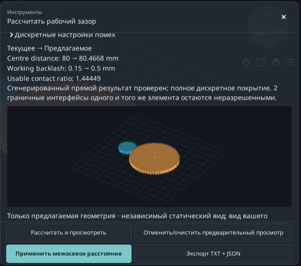

**Ожидаемый результат.** Цель достигнута изменением расстояния; 20/60 зубьев и модуль 2 мм остаются.

**Если возникли затруднения / пояснение.** Если Apply недоступен, прочитайте причину: недопустимая цель, неполная проверка, пересечение или изменение проекта требуют пересчёта. Одного предпросмотра недостаточно.

## Найти детали, расчёты и примечания

Отчёты помогают понять исходную модель и найти значение.

1. **Откройте спецификацию.** Из 01 выберите **Инструменты** → **Спецификация**. Сравните имена, коды и количества созданных деталей с Components.

2. **Откройте расчёты.** **Расчётный отчёт** открывает **Отчет о номинальном расчете**: отношение, геометрию зацепления и номинальные расчёты.

3. **Выполните поиск.** В **Искать этот документ…** попробуйте S1_Pinion. **Предыдущий**/**Далее** переходят по совпадениям; **Скопировать все** копирует текст.

4. **Прочитайте примечания.** **Примечания к модели** объясняет особенности конструкции. Экспорт модели или конкретного инструмента сохраняет соответствующие результаты.

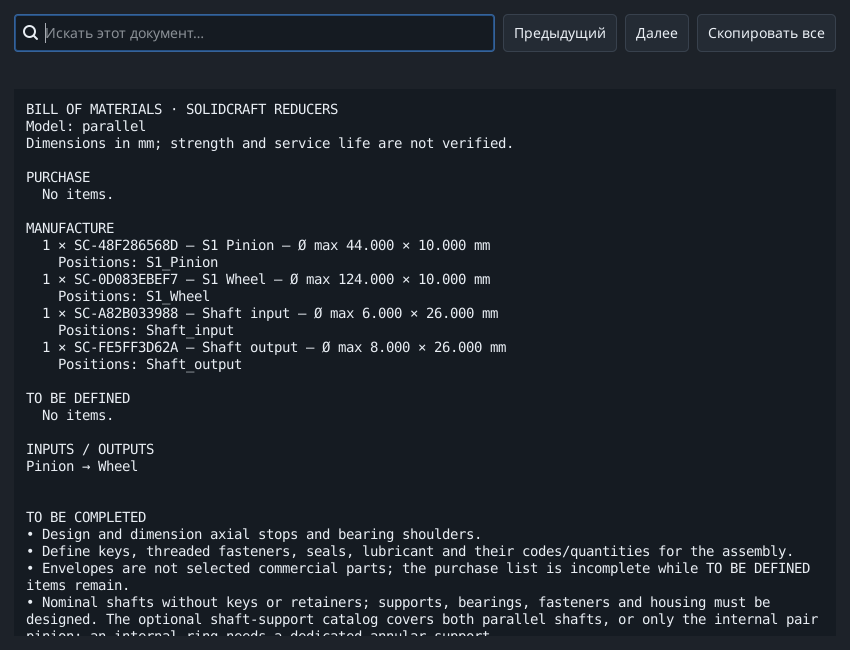

**Ожидаемый результат.** Вы находите спецификацию сборки, номинальные расчёты, примечания и отдельные запросы.

**Если возникли затруднения / пояснение.** Созданная спецификация не обязательно является полным закупочным списком: могут требоваться решения предприятия и доработка в CAD.

## Если результат отличается

Проверяйте по одному условию, прежде чем менять много параметров.

1. **Отличаются размеры.** Снова откройте 01:20/60 зубьев, модуль 2, ширина 10, прямые зубья, расстояние 80 мм. 02 и 03 намеренно содержат другие результаты.

2. **Нет нужного элемента.** Прокрутите или используйте **Развернуть инструмент**; сравните язык и версию. Снимки относятся к локальным Tools на 0.2.2.

3. **Apply или Export недоступен.** Выберите изменяющее модель предложение или подходящую деталь, исправьте ошибки и пересчитайте после правок. Метрологии нужен действительный результат.

4. **Меняется измерение / проверка неполна.** Щелчки различаются, привязки нет. Упростите поиск или увеличьте время; смотрите полноту, а не только секунды.

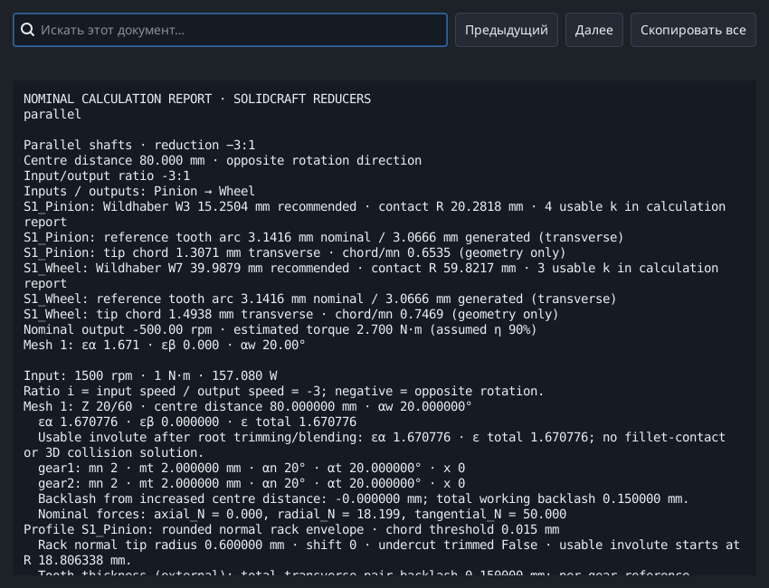

**Ожидаемый результат.** Повторяйте по одному упражнению, сохраняя исходный проект и отчёт.

**Если возникли затруднения / пояснение.** Сохраните свою работу. Примеры относятся к номинальной геометрии и дискретному движению, не к прочности, ресурсу или допуску к производству.

## Источники и область применения

Структура основана на официальных уроках KISSsoft и пошаговых инструкциях по полям GearTrax. Использована историческая справка GearTrax 2009 года. Тексты, примеры и снимки относятся к RatioLab; ссылки не расширяют его расчётные возможности.

- [KISSsoft, Tutorial 15 - Bevel gears (2022)](https://www.kisssoft.com/files/eu64So/KISSsoft-Tutorial-015-Bevelgear-en.pdf)
- [KISSsoft, официальный указатель учебных руководств](https://development.startpage.services.kisssoft.com/)
- [Camnetics, GearTrax - Creating a Spur Gear (архивная справка, 2009)](https://camnetics.com/geartrax/FlashHelp/geartrax2009/creating_a_spur_gear.htm)
- [Camnetics, GearTrax - Between Pins Example (архивная справка, 2009)](https://camnetics.com/geartrax/FlashHelp/geartrax2009/between_pins_example.htm)

Номинальная геометрия, теоретические измерения и дискретные проверки не подтверждают прочность, усталостный ресурс или пригодность к изготовлению.
