# RatioLab Tools: படங்களுடன் படிப்படியான வழிகாட்டி

உள்ளீட்டிலிருந்து சரிபார்க்கக்கூடிய முடிவு வரை ஆறு முழுமையான பயிற்சிகள்.

உள்ளூர் Tools மேம்பாட்டுடன் கூடிய desktop 0.2.2 · 2026-11-10

படங்கள் இந்த இடைமுக மொழியில் உள்ளன. பயன்பாட்டில் ஆங்கிலத்தில் இருக்கும் கட்டளைகள் அதே பெயருடன் காட்டப்படும். எடுத்துக்காட்டு தசம எண்களுக்குப் புள்ளியைப் பயன்படுத்தவும். கோப்புப் பெயர்களும் மாதிரி அடையாளங்களும் மாறாது.

முதலில் உங்கள் வேலையைச் சேமிக்கவும். கோப்பு → திற வழியாக JSON திட்டங்களைத் திறக்கவும். ஒவ்வொரு பயிற்சியும் 01 கோப்பிலிருந்து தொடங்கும். 02 மற்றும் 03 முடிவுகளுக்கான எடுத்துக்காட்டுகள்; சேமித்த கருவிக் கோரிக்கைகள் அல்ல. பயன்பாட்டு விருப்பங்கள் மாறாது.

[English](tools-en.md) · [Italiano](tools-it.md) · [Español](tools-es.md) · [Français](tools-fr.md) · [Deutsch](tools-de.md) · [Português (Portugal)](tools-pt.md) · [Русский](tools-ru.md) · [简体中文](tools-zh-CN.md) · [தமிழ்](tools-ta.md)

## எடுத்துக்காட்டு திட்டங்கள்

- [tools-01-base.config.json](../../examples/tools-01-base.config.json)
- [tools-02-rapporto3-compatto.config.json](../../examples/tools-02-rapporto3-compatto.config.json)
- [tools-03-backlash05.config.json](../../examples/tools-03-backlash05.config.json)

## உள்ளடக்கம்

- [ஒரு தொடக்க மாதிரி, ஆறு பயிற்சிகள்](#inizio)
- [எந்தக் கருவியைத் திறப்பது?](#scegliere)
- [சிறு பற்சக்கரத்தைத் தேர்ந்து தனித்துக் காட்டுதல்](#componenti)
- [தெரியும் இரண்டு மேற்பரப்புப் புள்ளிகளை அளத்தல்](#misurare)
- [தேர்ந்த சிறு சக்கரத்தை மட்டும் ஏற்றுமதி செய்தல்](#esportare)
- [சிறிய 3:1 சக்கர இணையைத் தேடுதல்](#ricerca)
- [எதை மாற்றலாம் என்பதைத் துல்லியமாக அமைத்தல்](#intervalli)
- [தீர்வை ஒப்பிட்டு, பயன்படுத்தி, மீளச் செய்தல்](#applicare-ricerca)
- [மாதிரி நிலைகளில் இயக்கத்தைச் சோதித்தல்](#interferenze)
- [தொடர்பையும் குறுக்கீட்டையும் வேறுபடுத்துதல்](#leggere-interferenze)
- [உருண்டைகளின் மேல் கோட்பாட்டு அளவைக் கணக்கிடுதல்](#metrologia)
- [Wildhaber பல்பல் அளவைப் படித்தல்](#wildhaber)
- [இயக்க இடைவெளியை 0.15 இலிருந்து 0.50 mm ஆக மாற்றுதல்](#backlash)
- [புதிய அச்சுத் தூரத்தை ஏற்றல்](#applicare-backlash)
- [பாகங்கள், கணக்குகள், குறிப்புகளைக் கண்டறிதல்](#report)
- [முடிவு மாறுபட்டால்](#problemi)

## ஒரு தொடக்க மாதிரி, ஆறு பயிற்சிகள்

ஊகிக்காமல், தெரிந்த தரவுகளுடன் தொடங்குங்கள்.

1. **எடுத்துக்காட்டைத் திறக்கவும்.** உங்கள் திட்டத்தை முதலில் சேமிக்கவும். **கோப்பு** → **திற…** மூலம் tools-01-base.config.json ஐத் திறக்கவும்.

2. **மாதிரியைச் சரிபார்க்கவும்.** இணை அச்சு குறைப்பான், ஒரு நிலை, நேர்ப் பற்கள்: சிறு சக்கரம் 20 பற்கள், பெரியது 60; மாட்யூல் 2 mm, அகலம் 10 mm, அச்சுத் தூரம் 80 mm. விகிதம் -3:1; உள்ளீடு 1500 rpm, வெளியீடு -500 rpm.

3. **ஒவ்வொரு பயிற்சியையும் புதிதாகத் தொடங்கவும்.** அடுத்த கருவிக்கு முன் 01 ஐ மீண்டும் திறக்கவும். தேடல் பற்களின் எண்ணிக்கையையும், பக்க இடைவெளி சரிசெய்தல் அச்சுத் தூரத்தையும் மாற்றும். 02,03 முடிந்த முடிவுகளைக் காட்டும்.

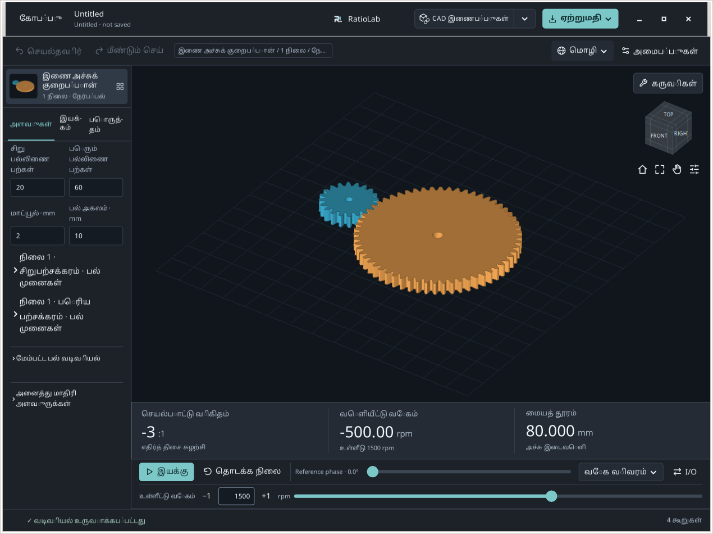

**எதிர்பார்க்கப்படும் முடிவு.** 20/60 பற்களும் 80 mm அச்சுத் தூரமும் சரியான தொடக்கம்.

**சிக்கல் ஏற்பட்டால் / விளக்கம்.** இந்த வழிகாட்டிகள் 0.2.2 அடிப்படையிலான உள்ளூர் Tools மேம்பாட்டுக்கானவை. பொதுப் பதிப்பிலும் உலாவியிலும் கட்டுப்பாடுகள் வேறுபடலாம்.

## எந்தக் கருவியைத் திறப்பது?

3D காட்சிக்கு மேலுள்ள**கருவிகள்** ஐத் திறந்து, உங்கள் பணியைத் தேர்ந்தெடுக்கவும்.

1. **பாகத்தைத் தேர்வு, அளவீடு அல்லது ஏற்றுமதி.** **கூறுகள் / அளவீடுகள்…** பாகங்களைத் தேர்ந்தெடுக்க, தனித்துக் காட்ட, மேற்பரப்புப் புள்ளிகளை அளக்க, தேர்வை ஏற்றுமதி செய்ய உதவும்.

2. **விகிதத் தேடல் அல்லது இயக்கச் சோதனை.** **சேர்க்கைகளைக் கண்டறியவும்...** வரையறுக்கப்பட்ட சேர்க்கைகளை ஒப்பிடும். **குறுக்கீடு சரிபார்க்கவும்…** மாதிரி நிலைகளைச் சோதித்து தொடர்புடைய பாகங்களைக் காட்டும்.

3. **கோட்பாட்டு ஆய்வு அளவு.** **கியர் அளவியல்…** ஆதரிக்கப்படும் நேர்ப் பல் பாகங்களின் உருண்டை/உருளை அளவுகளையும் பல்பல் விரிப்பு அளவுகளையும் கணக்கிடும்.

4. **இயக்கப் பக்க இடைவெளியை மாற்றுதல்.** **வேலை செய்யும் பின்னடைவை தீர்க்க...** ஒரு வெளிப்புற இணை அச்சுச் சக்கர இணைக்கு அச்சுத் தூரத்தை முன்மொழியும். கீழே மாதிரி அறிக்கைகள் உள்ளன.

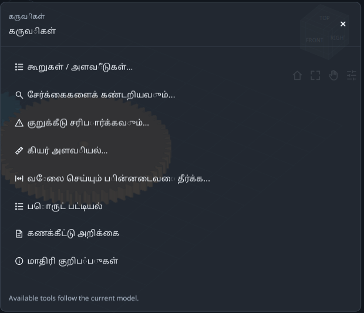

**எதிர்பார்க்கப்படும் முடிவு.** முடிவைப் பார்ப்பதால் மாதிரி மாறாது. தேடல், இடைவெளி தீர்வு ஆகியவற்றைத் தெளிவாகப் பயன்படுத்த வேண்டும்.

**சிக்கல் ஏற்பட்டால் / விளக்கம்.** **கருவியை விரிவாக்கு** படிவத்தை விரிவாக்கும்; **பணியிடத்தை மீட்டெடுக்கவும்** மாதிரியை மீட்டெடுக்கும். **அனைத்து கருவிகள்** கருவியை மாற்றும்; × மூடும். அமர்வு வரைவுகள் சேமித்த திட்டங்களுக்கு மாற்றல்ல.

## சிறு பற்சக்கரத்தைத் தேர்ந்து தனித்துக் காட்டுதல்

வடிவியலை மாற்றாமல் சரியான பாகத்தை அடையாளம் காணுங்கள்.

1. **ஒரு பாகத்தைத் தேர்ந்தெடுக்கவும்.** 01 ஐத் திறந்து **கருவிகள்** → **கூறுகள் / அளவீடுகள்…** செல்லவும். **பாகங்கள்** இல் முதல் சிறு சக்கர வரியைத் தேர்ந்தெடுக்கவும். ஒரு பாகம் மட்டும் தேர்வாகியிருக்க வேண்டும்.

2. **அடையாளத்தைப் படிக்கவும்.** **கூறு விவரங்கள் · mm இல் பெயரளவு வரம்புகள்** ஐ விரிக்கவும். மூலப் பெயர் S1_Pinion. XYZ என்பவை உலக அச்சுகளிலான பெயரளவு வெளி அளவுகள்; மூன்று விட்டங்கள் அல்ல.

3. **தனித்துக் காட்டி மீட்டெடுக்கவும்.** **தனிமைப்படுத்து** அழுத்தி ஆராயவும்; பின்னர் **பார்வையை மீட்டமை**. முந்தைய காட்சி வடிகட்டிகள் திரும்பும். Ctrl/Shift மேலும் பாகங்களைச் சேர்க்கும்.

4. **பற்களைப் பார்க்கவும்.** ஒரு பொருத்தமான சக்கரத்தைத் தேர்ந்தெடுத்து **பற்களைக் காட்டு**; மீள **மாதிரிக்குத் திரும்பு**. கோட்பாட்டு அளவுகளுக்கு அளவியல் கருவியைப் பயன்படுத்தவும்.

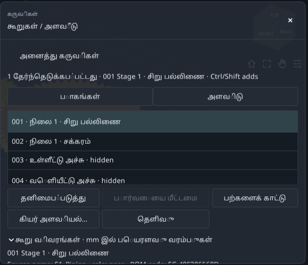

**எதிர்பார்க்கப்படும் முடிவு.** பற்களின் எண்ணிக்கை, மாட்யூல், அச்சுத் தூரம் மாறாமல் சிறு சக்கரத்தை அடையாளம் கண்டுள்ளீர்கள்.

**சிக்கல் ஏற்பட்டால் / விளக்கம்.** பல்/அளவியல் கட்டளைகள் செயலற்றிருந்தால் ஒரே பொருத்தமான சக்கரம் தேர்வாகியுள்ளதா பார்க்கவும். தண்டு ஒரு பற்சக்கரம் அல்ல.

## தெரியும் இரண்டு மேற்பரப்புப் புள்ளிகளை அளத்தல்

A-B நேர்க்கோட்டுத் தூரத்தையும் XYZ வேறுபாடுகளையும் பெறுங்கள்.

1. **நிலையான நிலையைத் தேர்வு செய்யவும்.** Components இல் **அளவிடு**, பின்னர் **பெயரளவு போஸ் பயன்படுத்தவும்**. பெரிய சக்கரம் மறைந்தால் Pan ஐ இயக்கி மாதிரியை இடப்புறம் நகர்த்தி, Pan ஐ நிறுத்தவும்.

2. **A,B புள்ளிகளைத் தேர்வு செய்யவும்.** சிறு சக்கரத்தின் மேல் திடப் பகுதியையும் பிறகு பெரிய சக்கரத்தின் மேல் பகுதியையும் சொடுக்கவும். பலகைக்கு வெளியே தெரியும் மேற்பரப்பைத் தேர்வு செய்யவும்; துளையின் வெற்றிடத்தை அல்ல.

3. **மதிப்புகளைப் படிக்கவும்.** நேர்த் தூரம், B−A ΔXYZ காட்டப்படும். ஒரே உயரமுள்ள மேல்தளங்களில் ΔZ சுமார் பூஜ்ஜியம்.

4. **மீண்டும் முயலவும்.** **தெளிவான புள்ளிகள்** மீண்டும் தொடங்கும். உங்கள் சொடுக்குப் புள்ளிகள் வேறுபடுவதால் படத்திலுள்ள தூரம் பொதுவாக வராது.

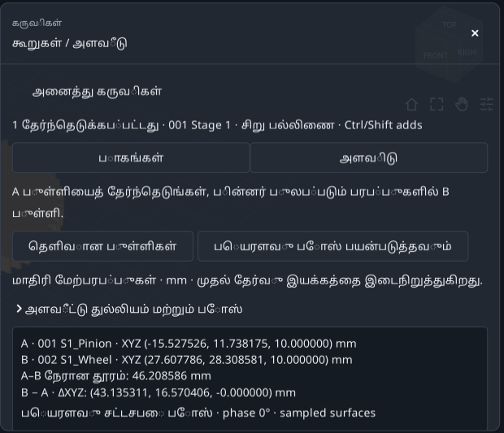

**எதிர்பார்க்கப்படும் முடிவு.** இரண்டு குறித்த புள்ளிகள், mm இல் தூரம், மூன்று ஆய வேறுபாடுகள்.

**சிக்கல் ஏற்பட்டால் / விளக்கம்.** தானியங்கி ஒட்டிப்பிடித்தல் இல்லை. இது மாதிரி மேற்பரப்பின் இரு புள்ளிகளுக்கிடையிலான தூரம்; பகுப்பாய்வு விட்டமோ துல்லிய அச்சுத் தூரமோ குறைந்தபட்ச மேற்பரப்பு இடைவெளியோ அல்ல.

## தேர்ந்த சிறு சக்கரத்தை மட்டும் ஏற்றுமதி செய்தல்

தேர்வு ஏற்றுமதியையும் முழுக் குறைப்பான் ஏற்றுமதியையும் பிரித்தறியுங்கள்.

1. **தேர்வைச் சரிபார்க்கவும்.** **பாகங்கள்** க்கு மீளவும். சிறு சக்கரத்தை மட்டும் தேர்ந்து கீழே செல்லவும்; ஏற்றுமதிச் சுருக்கத்தில் ஒரு பாகம் இருக்க வேண்டும்.

2. **இலக்குக் கோப்புறையை முதலில் தேர்வு செய்யவும்.** மேல் **ஏற்றுமதி** பட்டியில் **கோப்புறையை மாற்று…** மூலம் பயிற்சிக் கோப்புறையைத் தேர்ந்து கருவிக்குத் திரும்பவும்.

3. **கருவியிலிருந்து ஏற்றுமதி செய்யவும்.** CAD க்கு STEP, வலைக்கு STL, ஆதரிக்கும் வெட்டுத் தோற்றங்களுக்கு **DXF / SVG**, அல்லது **தொகுப்பு**. உறுதிப்படுத்தலுக்குப் பின் **கோப்புறையைத் திற**.

4. **கோப்புகளைச் சரிபார்க்கவும்.** பெயரளவு தொகுப்பு ஆயங்களில் சிறு சக்கரம் மட்டும் இருக்க வேண்டும். மறைக்கப்பட்டாலும் தேர்ந்த பாகம் ஏற்றுமதியாகும்.

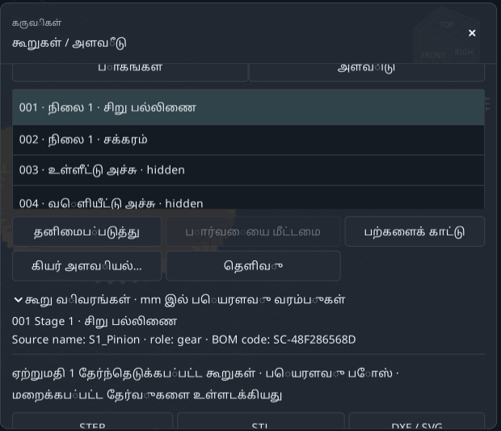

**எதிர்பார்க்கப்படும் முடிவு.** தேர்வே ஏற்றுமதிப் பாகங்களை முடிவு செய்கிறது; காட்சி மறைத்தல் தேர்வுக்கு மாற்றல்ல.

**சிக்கல் ஏற்பட்டால் / விளக்கம்.** **PDF தாள்கள்…** க்கு ஒரு பாகம் வேண்டும்; அது நிறுவனத் தாள்களைத் திறக்கும். DXF/SVG வெட்டுத் தோற்றங்கள் தாமாகவே உற்பத்தி வார்ப்புருக்கள் ஆகாது.

## சிறிய 3:1 சக்கர இணையைத் தேடுதல்

மாட்யூல், அகலம், வகை, இணைப்பு மாறாமல் 18/54 மற்றும் 20/60 ஐ ஒப்பிடுங்கள்.

1. **01 கோப்பிலிருந்து தொடங்கவும்.** **கருவிகள்** → **சேர்க்கைகளைக் கண்டறியவும்...** திறந்து **தேடல் அமைப்புகளைத் திருத்தவும்** விரிந்திருக்க விடவும்.

2. **இலக்கை அமைக்கவும்.** **விரும்பிய விகிதம்** இல் 3; **அனுமதிக்கப்பட்ட பிழை ± (%)** இல் 0. இது உள்ளீட்டு வேகம்/வெளியீட்டு வேகத்தின் தனிமதிப்பு;0.333 அல்ல.

3. **ஒப்பீட்டைத் தேர்வு செய்யவும்.** **எந்த திசையிலும்** தொடரட்டும். **முடிவுகளை ஒப்பிடும் அளவுகோல்** இல் **மிகச் சிறிய வெளிப்புற அளவு**. தற்போதைய இணைப்பில் எதிர்த்திசை சுழற்சி கிடைக்கும்.

4. **வெளி அளவு வரம்புகளைத் தளர்வாக விடவும்.** X/Y/Z அதிகபட்சம் 1000 mm ஆக விடவும். மறைந்தவை உட்பட உருவான அனைத்து பாகங்களும் வெளி அளவில் அடங்கும்.

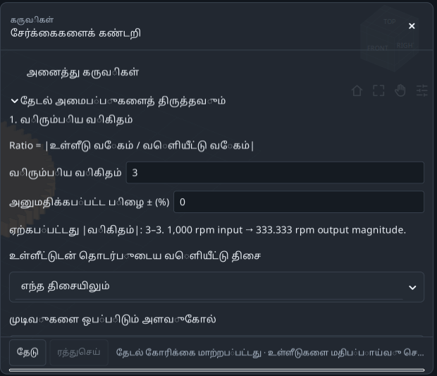

**எதிர்பார்க்கப்படும் முடிவு.** இலக்கு அமைந்தது; அடுத்து நான்கு சேர்க்கைகளை மட்டும் வரையறுக்கவும்.

**சிக்கல் ஏற்பட்டால் / விளக்கம்.** ஒரே உள்ளீடு/வெளியீட்டு விகிதமுள்ள தொகுப்பு தேவை. தனி சக்கரமும் வேறுபாட்டுப் பெட்டியும் அத்தகைய ஒரே விகிதத்தைத் தராது.

## எதை மாற்றலாம் என்பதைத் துல்லியமாக அமைத்தல்

**2. ஆராய்வதற்கான அளவுருக்கள்** இல் சிறிய வரையறுக்கப்பட்ட வரம்புகளைப் பயன்படுத்தவும்.

1. **சிறு சக்கர வரம்பு.** **உள்ளீட்டுச் சிறு பல்லிணையின் பற்கள்** இல் **மாறுபடும்**, **வரம்பு**: **இருந்து** 18, **To** 20, **படி** 2.18,20 சோதிக்கப்படும்.

2. **பெரிய சக்கர வரம்பு.** **இயக்கப்படும் சக்கரத்தின் பற்கள்** இல் **மாறுபடும்**, **வரம்பு**: **இருந்து** 54, **To** 60, **படி** 6.54,60 சோதிக்கப்படும்.

3. **மற்றவற்றை நிலையாக விடவும்.** **கூடுதல் பரிமாணங்கள்** இல் மற்ற மாறிகளை **தற்போதைய நிலையில் வைத்திருங்கள்** ஆக விடவும். இரண்டு மதிப்புகள் × இரண்டு = நான்கு சேர்க்கைகள்.

4. **தேடவும்.** Advanced இல் அதிகபட்சம் 100 சேர்க்கைகள்,60 வினாடிகள் போதும். **தேடு** அழுத்திக் காத்திருக்கவும்.

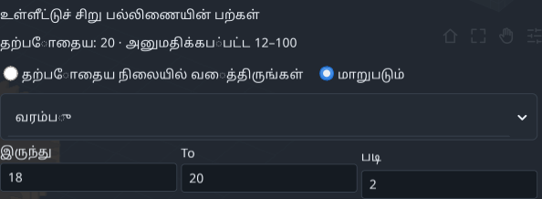

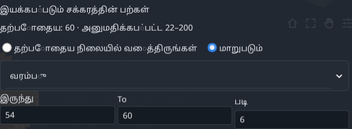

**எதிர்பார்க்கப்படும் முடிவு.** 18/54,20/60 துல்லியமாக 3:1 தரும்; மற்ற இரண்டும் தராது.

**சிக்கல் ஏற்பட்டால் / விளக்கம்.** மாறிகளின் வரம்புகள் பெருக்கப்படுகின்றன. குறைவாகத் தொடங்கி, புலப் பிழைகளை முதலில் சரிசெய்யவும்.

## தீர்வை ஒப்பிட்டு, பயன்படுத்தி, மீளச் செய்தல்

தெளிவாகப் பயன்படுத்தும் வரை முடிவு வரி ஒரு முன்மொழிவு மட்டுமே.

1. **முதல் தீர்வைப் படிக்கவும்.** குறைந்த வெளி அளவில் 18/54 முதலில்: சிறு சக்கரம் 20→18, பெரியது 60→54.3:1 மற்றும் எதிர்ச் சுழற்சி மாறாது.

2. **வடிவியலை ஒப்பிடவும்.** பெயரளவு XYZ≈147.933 × 111.990 × 26 mm; பயன்படுத்தக்கூடிய தொடர் தொடர்பு விகிதம்≈1.64876. இவை வடிவியல் முடிவுகள்; வலிமைக் கணக்கல்ல.

3. **பயன்படுத்தும் முன் சேமிக்கவும்.** 18/54 ஐத் தேர்வு செய்யவும். தேவைப்பட்டால் **அறிக்கையைச் சேமிக்கவும்…** மூலம் TXT சேமித்து, பிறகு **தேர்ந்தெடுக்கப்பட்ட விண்ணப்பிக்கவும்**. பயன்படுத்தியதும் பழைய தேடல் செல்லாது.

4. **சரிபார்த்து மீளவும்.** மாதிரியில் 18,54 பற்கள் வரும். ஒரு **செயல்தவிர்** 20/60 ஐ மீட்டெடுக்கும். 02 முடிந்த சிறிய மாதிரி.

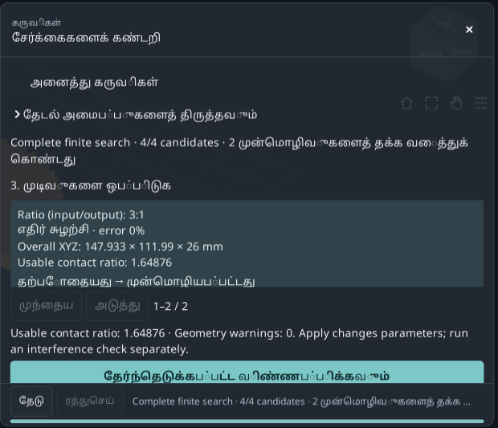

**எதிர்பார்க்கப்படும் முடிவு.** தேவையான விகிதத்துடன் சிறிய இணையும் மீளக்கூடிய மாற்றமும் கிடைக்கும்.

**சிக்கல் ஏற்பட்டால் / விளக்கம்.** மாறாத 20/60 வரிக்கு Apply செயல்படாது. மாதிரி அல்லது வரம்புகள் மாறினால் மீண்டும் தேடவும்.

## மாதிரி நிலைகளில் இயக்கத்தைச் சோதித்தல்

தொடர்புப் பட்டியலை விளக்கும் முன் சோதனை முழுமையைப் படிக்கவும்.

1. **01 க்கு மீளவும்.** **கருவிகள்** → **குறுக்கீடு சரிபார்க்கவும்…** திறக்கவும். முந்தைய சிறிய மாதிரியைப் பயன்படுத்த வேண்டாம்.

2. **மாதிரி எடுப்பை அமைக்கவும்.** **அமைப்புகளைச் சரிபார்க்கவும்**: படி 30°, எல்லைத் தாங்கல் 0.01 mm, நேர வரம்பு 120 s.

3. **சோதிக்கவும்.** **சுழற்சியை சரிபார்க்கவும்** அழுத்திக் காத்திருக்கவும். மறைந்த ஆதரவுகள், உறை பாகங்களும் சோதிக்கப்படும்; மறைத்தல் அவற்றை நீக்காது.

4. **முழுமையைப் படிக்கவும்.** இங்கே 37/37 நிலைகள், படி≤30°. INCOMPLETE என்றால் நேரத்தை அதிகரிக்கவும் அல்லது படியைப் பெரிதாக்கி மீண்டும் சோதிக்கவும்.

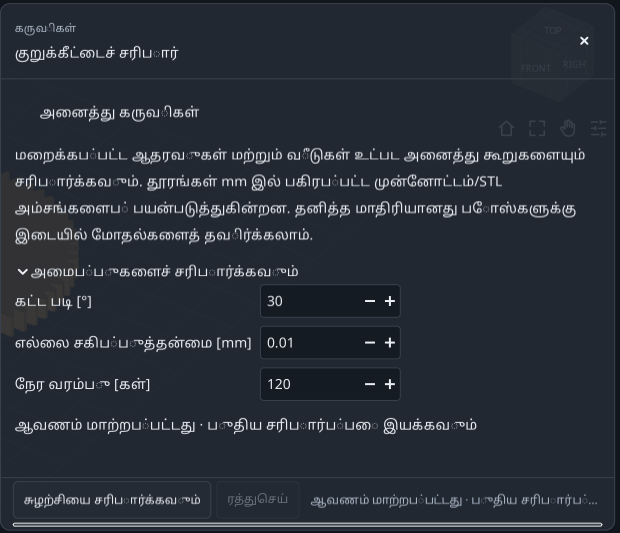

**எதிர்பார்க்கப்படும் முடிவு.** முழுமையான தனித்த நிலைச் சோதனை என்பது திட்டமிட்ட 37 நிலைகளும் சோதிக்கப்பட்டதைக் குறிக்கும்.

**சிக்கல் ஏற்பட்டால் / விளக்கம்.** அடையாளப்படுத்தப்பட்ட பாகங்களின் இயக்கச் சுழற்சி 360°ஐத் தாண்டலாம். சிறு படிக்கு அதிக வேலை தேவை; நேரம் மட்டும் முழுமையை நிரூபிக்காது.

## தொடர்பையும் குறுக்கீட்டையும் வேறுபடுத்துதல்

வடிகட்டி பட்டியலை மாற்றும்; பகுப்பாய்வையோ முழுமையையோ அல்ல.

1. **தீர்க்கப்படாத தொடர்புகளைக் காட்டவும்.** **தீர்மானிக்கப்படாத தொடுகைகள்** தேர்வு செய்யவும். அடிப்படையில் சிறு சக்கரம்/உள்ளீட்டுத் தண்டு, பெரிய சக்கரம்/வெளியீட்டுத் தண்டு தெரியும்.

2. **ஒரு வரியை ஆராயவும்.** முடிவைச் சொடுக்கினால் அதன் நிலையும் ஆரஞ்சு/மெஜந்தா பாகங்களும் காட்டப்படும். **முன்னோட்டத்தை மீட்டமை** மீட்டெடுக்கும்; தேவைப்பட்டால் விரிவாக்க முறையிலிருந்து வெளியேறவும்.

3. **வகைகளை ஒப்பிடவும்.** **சாத்தியமான குறுக்கீடு**: Intersection/Containment; **பிரிக்கப்பட்டது**: பிரிந்த இணைகள்; **அனைத்து முடிவுகள்**: அனைத்து வகைகளும்.

4. **சேமித்து, மாற்றியபின் மீண்டும் சோதிக்கவும்.** **அறிக்கையைச் சேமிக்கவும்…** கோப்புத் தேர்வின் மூலம் TXT சேமிக்கும். அமைப்பு/வடிவியல் மாற்றம் பழைய சோதனையைச் செல்லாததாக்கும்.

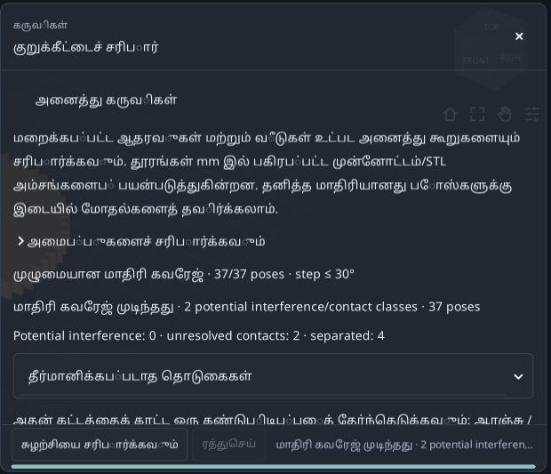

**எதிர்பார்க்கப்படும் முடிவு.** அடிப்படை:0 சாத்தியக் குறுக்கீட்டு வகைகள்,2 தீர்க்கப்படாத தொடர்பு வகைகள்,4 பிரிந்த வகைகள்.

**சிக்கல் ஏற்பட்டால் / விளக்கம்.** Boundary contact/unresolved என்பது கட்டாயமாக மாதிரிப் பிழை அல்ல. எல்லா தனித்த நிலைகளையும் சோதித்தது தொடர்ச்சியான மோதலின்மையை நிரூபிக்காது.

## உருண்டைகளின் மேல் கோட்பாட்டு அளவைக் கணக்கிடுதல்

3D சொடுக்குகளால் விட்டத்தை ஊகிப்பதற்குப் பதிலாக சரியான சக்கரத்தைப் பயன்படுத்தவும்.

1. **சிறு சக்கரத்தைத் தேர்ந்தெடுக்கவும்.** 01 ஐத் திறந்து Components இல் முதல் சிறு சக்கரத்தை மட்டும் தேர்வு செய்து **கியர் அளவியல்…**.20 பற்கள், குறிப்பு விட்டம் 40 mm, S1_Pinion என்பதைச் சரிபார்க்கவும்.

2. **பரிந்துரைத்த உருண்டையைப் பயன்படுத்தவும்.** **பந்துகள்** தொடரட்டும். **கோட்பாட்டு அளவீட்டு விட்டம் பயன்படுத்தவும்** அழுத்தி≈3.534085 mm என்ற கணக்கிட்ட மதிப்பை வைத்திருக்கவும். படத்திலிருந்து வட்டமிட்ட எண்ணை மீண்டும் தட்டச்சிட வேண்டாம்.

3. **கணக்கிடவும்.** **கணக்கிடு** அழுத்தவும். உருண்டைகளின் மேல் அளவு≈44.876412 mm, தொடர்பு ஆரம் 20 mm. இது 40 mm குறிப்பு விட்டம் அல்ல.

4. **கோரிக்கையை ஏற்றுமதி செய்யவும்.** **ஏற்றுமதி அறிக்கை · TXT + JSON** உள்ளீடு/முடிவை **ஏற்றுமதி** → **இலக்கு கோப்புறை** காட்டும் கோப்புறையில் சேமிக்கும். உருண்டை/பாகம் மாறினால் மீண்டும் கணக்கிடவும்.

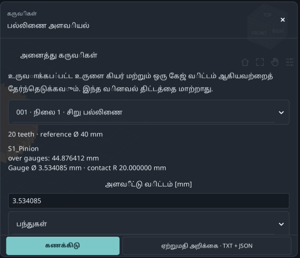

**எதிர்பார்க்கப்படும் முடிவு.** சிறு சக்கரத்துக்கான மீண்டும் பெறக்கூடிய கோட்பாட்டு அளவு. இந்த நேர்ப் பல் எடுத்துக்காட்டில் அச்சு உருளைகளுக்கும் குறுக்கு அளவு ஒன்றே.

**சிக்கல் ஏற்பட்டால் / விளக்கம்.** ஆதரிக்கும் உள்/வெளி நேர்ப் பல் இன்வல்யூட் பாகங்களுக்கு மட்டும். சாய்வுப் பற்கள், கருவி அணுகல், உண்மைத் தாங்கல்கள் இதில் இல்லை.

## Wildhaber பல்பல் அளவைப் படித்தல்

தேர்ந்த எண்ணிக்கையிலான பற்களின் மீது தட்டையான தாடைகளுக்கிடையிலான அளவு.

1. **அதே சிறு சக்கரத்தை வைத்திருக்கவும்.** S1_Pinion,20 பற்களுடன் தொடரவும்;60 பல் பெரிய சக்கரத்துக்கு மாற வேண்டாம்.

2. **பகுதியைத் திறக்கவும்.** **பல பற்களுக்கு இடையிலான அளவீடு** வரை நகர்த்தவும். **Wildhaber span · number of teeth** இல் 3 தேர்வு செய்யவும்.

3. **W3 ஐப் படிக்கவும்.** W3≈15.250402 mm; தொடர்பு ஆரம்≈20.281829 mm. 3 என்பது அளவிடும் பற்களின் எண்ணிக்கை; குறைப்பான் விகிதம் அல்ல.

4. **பட்டியலை மதிக்கவும்.** உருவான வடிவத்தில் பயன்படும் தொடர்புகளே பட்டியலில் உள்ளன. இல்லாத எண்ணிக்கையை வற்புறுத்த வேண்டாம்; உள்/சாய்வுப் பற்களுக்கு இந்த வெளிப்புறத் தட்டைத் தாடை அளவு கிடையாது.

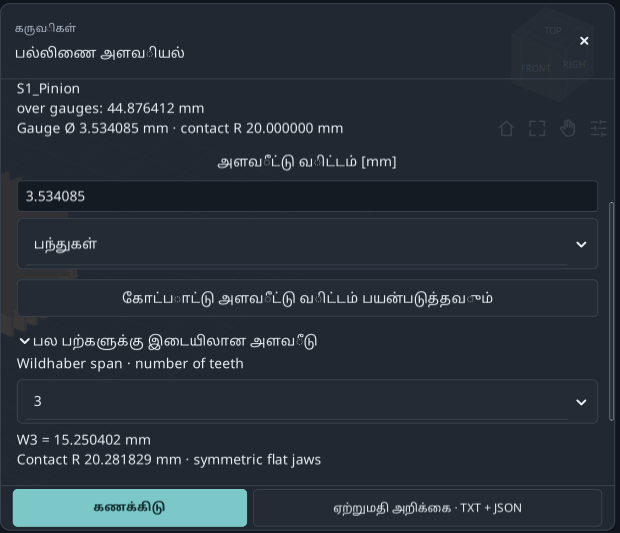

**எதிர்பார்க்கப்படும் முடிவு.** உருண்டை அளவும் Wk உம் வேறுபட்டவை; இரண்டுக்கும் பாகம், உள்ளீடுகளைச் சேமிக்கவும்.

**சிக்கல் ஏற்பட்டால் / விளக்கம்.** காட்டும் தசம இடங்கள் உற்பத்தித் தாங்கல், அளவீட்டு நிச்சயமின்மை, சக்கரத் தரம் அல்லது முழுத் தரநிலை இணக்கத்தை வரையறுக்காது.

## இயக்க இடைவெளியை 0.15 இலிருந்து 0.50 mm ஆக மாற்றுதல்

குறுக்குவெட்டுத் தொடுகோட்டு இயக்க இடைவெளிக்காக புதிய அச்சுத் தூரத்தை முன்மொழிதல்.

1. **01 கோப்பிலிருந்து தொடங்கவும்.** **வேலை செய்யும் பின்னடைவை தீர்க்க...** திறக்கவும். தற்போதைய தூரம் 80 mm, இடைவெளி 0.15 mm என்பதை உறுதிசெய்யவும்.

2. **இலக்கை உள்ளிடவும்.** **விரும்பிய வேலை குறுக்கு தொடு பின்னடைவு [mm]** இல் 0.5. இந்தப் பயிற்சியில் மாதிரியின் பல் மெலிதாக்கும் Backlash புலத்தை மாற்ற வேண்டாம்.

3. **அனுமதிக்கப்பட்ட வரம்பைப் பார்க்கவும்.** **Nominal target range** ஐப் படிக்கவும். இந்த அடிப்படைக்கு 0.5 mm உள்ளே உள்ளது. வரம்பு தற்போதைய வடிவியலைச் சார்ந்தது.

4. **கணக்கிட்டு முன்காட்சி பார்க்கவும்.** **தனித்த குறுக்கீடு அமைப்புகள்**: படி 30°, நேரம் 120 s, அதிகபட்ச நிலைகள் 721. **கணக்கீடு & முன்னோட்டம்** அழுத்தவும்.

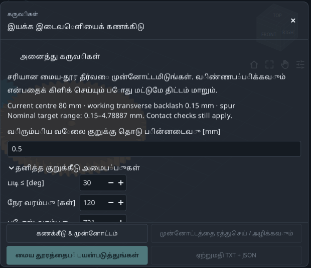

**எதிர்பார்க்கப்படும் முடிவு.** முதன்மைத் திட்டத்தை இன்னும் மாற்றாமல் தீர்வி வடிவியலை முன்மொழிந்து சோதிக்கிறது.

**சிக்கல் ஏற்பட்டால் / விளக்கம்.** ஒரே வெளிப்புற இணை அச்சு நேர்/சாய்வு/இரட்டைச் சாய்வு இணைக்கு மட்டும். பல்நிலை, உள், கோள்தொகுப்பு இயக்கங்கள் இல்லை. இலக்கு ஆர அல்லது செங்குத்து இடைவெளி அல்ல.

## புதிய அச்சுத் தூரத்தை ஏற்றல்

தற்போதைய/புதிய மதிப்புகளுடன் சோதனைச் செய்தியையும் படிக்கவும்.

1. **முடிவுகளை ஒப்பிடவும்.** தூரம்≈80.466750 mm, இயக்க இடைவெளி≈0.500000 mm, பயன்படும் தொடர்பு விகிதம்≈1.44449.

2. **மீதமுள்ள இடைமுகங்களைப் படிக்கவும்.** தனித்த நிலைச் சோதனை முழுமை; ஆனால் ஒரே இயக்க உறுப்பின் தண்டுகளுடன் இரண்டு தீர்க்கப்படாத இடைமுகங்கள் உள்ளன. அவை தீர்ந்ததாக அறிவிக்கப்படவில்லை.

3. **முன்மொழிவைப் பயன்படுத்தவும்.** **மைய தூரத்தைப் பயன்படுத்துங்கள்** அழுத்தவும். மேம்பட்ட பரிமாணங்களில் **மைய தூரம் அதிகரிப்பு [mm]** 0 இலிருந்து≈0.466750 ஆகும். குறிப்பு தூரம் + இந்த உயர்வு = புதிய தூரம்.

4. **மீளச் செய்வதற்கு முன் ஏற்றுமதி.** **ஏற்றுமதி TXT + JSON** முன்மொழிவையும் பயன்படுத்திய நிலையையும் தற்போதைய கோப்புறையில் சேமிக்கும். பின்னர் **செயல்தவிர்** 80 mm க்கு மீட்டெடுக்கும். 03 முடிந்த எடுத்துக்காட்டு.

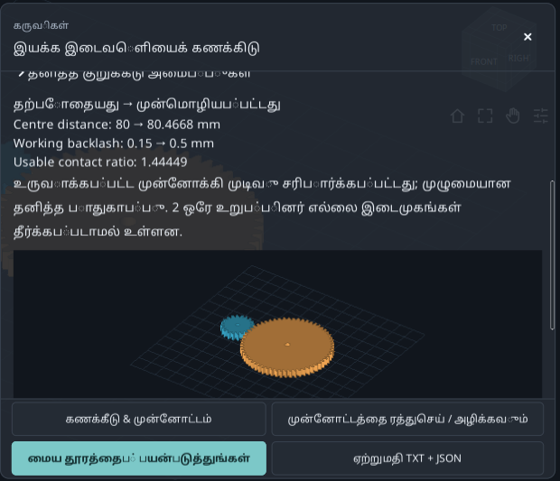

**எதிர்பார்க்கப்படும் முடிவு.** 20/60 பற்களும் 2 mm மாட்யூலும் மாறாமல், அச்சுத் தூர மாற்றத்தால் இலக்கு கிடைக்கும்.

**சிக்கல் ஏற்பட்டால் / விளக்கம்.** Apply செயலற்றால் காரணத்தைப் படிக்கவும்: தவறான இலக்கு, முழுமையற்ற சோதனை, குறுக்கீடு, திட்ட மாற்றம் ஆகியவற்றுக்கு மறுகணக்கீடு தேவைப்படலாம். முன்காட்சி மட்டும் போதாது.

## பாகங்கள், கணக்குகள், குறிப்புகளைக் கண்டறிதல்

மூல மாதிரியைப் புரியவும் மதிப்பைக் காணவும் அறிக்கைகளைப் பயன்படுத்தவும்.

1. **பொருட்பட்டியலைத் திறக்கவும்.** 01 இலிருந்து **கருவிகள்** → **பொருட் பட்டியல்**. உருவான பெயர்கள், குறியீடுகள், எண்ணிக்கைகளை Components உடன் ஒப்பிடவும்.

2. **கணக்குகளைத் திறக்கவும்.** **கணக்கீட்டு அறிக்கை** என்பது **பெயரளவு கணக்கீடு அறிக்கை** ஐத் திறக்கும்: விகிதம், பல் இணைவு வடிவியல், பெயரளவு கணக்குகள்.

3. **ஆவணத்தில் தேடவும்.** **இந்த ஆவணத்தைத் தேடு…** இல் S1_Pinion முயலவும். **முந்தைய**/**அடுத்து** பொருத்தங்களுக்குச் செல்லும்; **அனைத்தையும் நகலெடுக்கவும்** உரையை நகலெடுக்கும்.

4. **குறிப்புகளைப் படிக்கவும்.** **மாதிரி குறிப்புகள்** கட்டுமான விவரங்களை விளக்கும். மாதிரி அல்லது ஒவ்வொரு கருவியின் ஏற்றுமதி அதன் வெளியீடுகளைச் சேமிக்கும்.

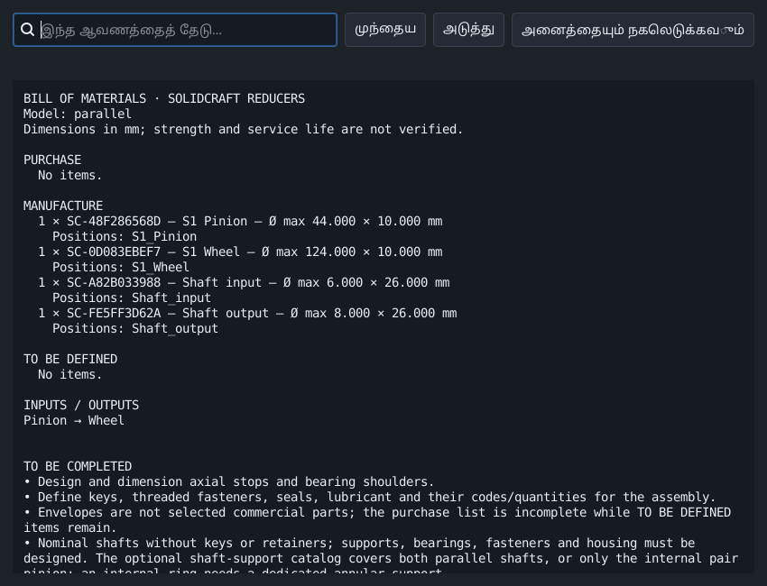

**எதிர்பார்க்கப்படும் முடிவு.** தொகுப்புப் பொருட்பட்டியல், பெயரளவு கணக்குகள், குறிப்புகள், தனிப்பட்ட கோரிக்கைகளைப் பெற முடியும்.

**சிக்கல் ஏற்பட்டால் / விளக்கம்.** உருவான பட்டியல் தானாக முழுமையான கொள்முதல் பட்டியல் ஆகாது; நிறுவன முடிவுகளும் CAD நிறைவுகளும் தேவைப்படலாம்.

## முடிவு மாறுபட்டால்

பல அளவுகளை மாற்றுவதற்கு முன் ஒவ்வொரு நிபந்தனையாகச் சரிபார்க்கவும்.

1. **பரிமாணங்கள் வேறுபடுகின்றன.** 01 ஐ மீண்டும் திறக்கவும்:20/60 பற்கள், மாட்யூல் 2, அகலம் 10, நேர்ப் பற்கள்,80 mm தூரம். 02,03 வேறு முடிவுகளை நோக்கத்துடன் கொண்டுள்ளன.

2. **கட்டுப்பாடு கிடைக்கவில்லை.** நகர்த்தவும் அல்லது **கருவியை விரிவாக்கு**; மொழி, பதிப்பைச் சரிபார்க்கவும். படங்கள் 0.2.2 அடிப்படையிலான உள்ளூர் Tools மேம்பாட்டைக் காட்டும்.

3. **Apply அல்லது Export செயலற்றுள்ளது.** மாற்றமுள்ள தீர்வையோ பொருத்தமான பாகத்தையோ தேர்ந்தெடுத்து, புலப் பிழைகளைத் திருத்தி மறுகணக்கிடவும். அளவியலுக்கு செல்லுபடியான முடிவு தேவை.

4. **அளவீடு மாறுகிறது / சோதனை முடியவில்லை.** ஒட்டிப்பிடித்தல் இல்லாததால் சொடுக்குகள் வேறுபடும். தேடலை எளிதாக்கவும் அல்லது நேரத்தை அதிகரிக்கவும்; வினாடிகளை மட்டும் அல்ல, முழுமையைப் பார்க்கவும்.

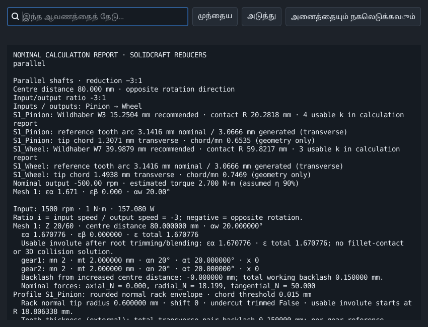

**எதிர்பார்க்கப்படும் முடிவு.** ஒவ்வொரு பயிற்சியாக மீளச் செய்து தொடக்கத் திட்டத்தையும் முடிவு அறிக்கையையும் வைத்திருக்கவும்.

**சிக்கல் ஏற்பட்டால் / விளக்கம்.** உங்கள் வேலையைச் சேமிக்கவும். இவை பெயரளவு வடிவியல், தனித்த நிலை இயக்கம் பற்றிய பயிற்சிகள்; வலிமை, ஆயுள் அல்லது உற்பத்தி ஒப்புதல் அல்ல.

## மேற்கோள்களும் வரம்பும்

அதிகாரப்பூர்வ KISSsoft பயிற்சிகளும் GearTrax இன் புலவாரியான வழிமுறைகளும் கற்பித்தல் அமைப்புக்கு முன்னுதாரணங்கள். பயன்படுத்திய GearTrax உதவி 2009 ஆண்டைச் சேர்ந்தது. உரை, எடுத்துக்காட்டுகள், படங்கள் RatioLab இற்குரியவை; மேற்கோள்கள் அதன் கணக்கீட்டுத் திறனை விரிவாக்காது.

- [KISSsoft, Tutorial 15 - Bevel gears (2022)](https://www.kisssoft.com/files/eu64So/KISSsoft-Tutorial-015-Bevelgear-en.pdf)
- [KISSsoft, அதிகாரப்பூர்வப் பயிற்சிப் பட்டியல்](https://development.startpage.services.kisssoft.com/)
- [Camnetics, GearTrax - Creating a Spur Gear (வரலாற்று உதவி, 2009)](https://camnetics.com/geartrax/FlashHelp/geartrax2009/creating_a_spur_gear.htm)
- [Camnetics, GearTrax - Between Pins Example (வரலாற்று உதவி, 2009)](https://camnetics.com/geartrax/FlashHelp/geartrax2009/between_pins_example.htm)

பெயரளவு வடிவியல், கோட்பாட்டு அளவுகள் மற்றும் தனித்த நிலைச் சோதனைகள் வலிமை, சோர்வு ஆயுள் அல்லது உற்பத்தித் தகுதியை நிரூபிப்பதில்லை.
