# RatioLab 工具：图文操作指南

六个完整实例：从输入参数到可核对的结果。

桌面版0.2.2及本地工具更新 · 2026-11-10

截图使用当前语言界面。应用中仍显示英文的命令保留其实际名称。示例小数使用英文句点输入。文件名和模型标识符保持不变。

请先保存当前工作，再通过文件 → 打开加载JSON项目。每个练习都从文件01开始。02和03是完成后的结果检查点，不是保存的工具查询；它们不会更改应用偏好设置。

[English](tools-en.md) · [Italiano](tools-it.md) · [Español](tools-es.md) · [Français](tools-fr.md) · [Deutsch](tools-de.md) · [Português (Portugal)](tools-pt.md) · [Русский](tools-ru.md) · [简体中文](tools-zh-CN.md) · [தமிழ்](tools-ta.md)

## 示例项目

- [tools-01-base.config.json](../../examples/tools-01-base.config.json)
- [tools-02-rapporto3-compatto.config.json](../../examples/tools-02-rapporto3-compatto.config.json)
- [tools-03-backlash05.config.json](../../examples/tools-03-backlash05.config.json)

## 目录

- [一个初始模型，六个练习](#inizio)
- [应该打开哪个工具？](#scegliere)
- [选择并隔离小齿轮](#componenti)
- [测量两个可见表面点](#misurare)
- [只导出所选小齿轮](#esportare)
- [寻找更紧凑的3:1齿轮副](#ricerca)
- [明确哪些参数允许变化](#intervalli)
- [比较、应用并撤销方案](#applicare-ricerca)
- [检查采样运动](#interferenze)
- [区分接触与干涉](#leggere-interferenze)
- [计算理论跨球尺寸](#metrologia)
- [读取Wildhaber跨齿公法线长度](#wildhaber)
- [把工作侧隙从0.15改为0.50 mm](#backlash)
- [接受新的中心距](#applicare-backlash)
- [查找零件、计算和注释](#report)
- [结果不一致时](#problemi)

## 一个初始模型，六个练习

使用已知参数开始，避免猜测每个字段的含义。

1. **打开示例.** 先保存自己的项目。选择**文件** → **打开…**，打开tools-01-base.config.json。

2. **核对模型.** 平行轴减速器，单级，直齿：小齿轮20齿、大齿轮60齿，模数2 mm、齿宽10 mm、中心距80 mm。传动比-3:1；输入1500 rpm，输出-500 rpm。

3. **每次重新开始.** 使用另一个工具前重新打开01。组合搜索可能改变齿数，侧隙求解会改变中心距。02和03提供完成后的结果。

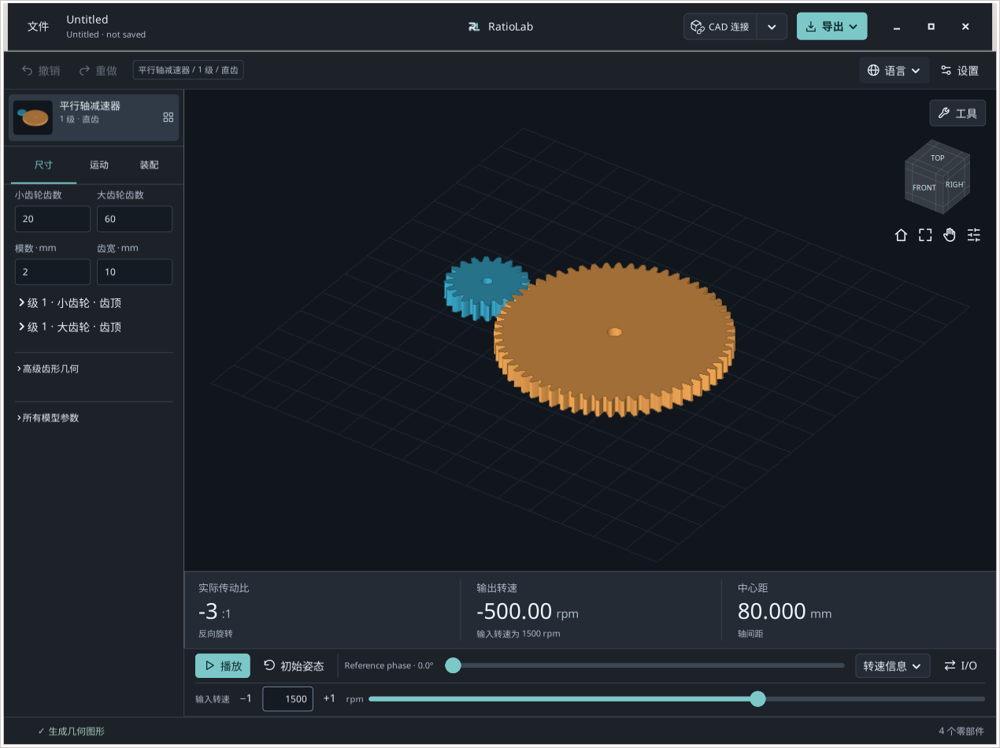

**预期结果.** 20/60齿和80 mm中心距表明初始模型正确。

**遇到问题时 / 结果解释.** 本指南针对基于0.2.2的本地工具更新；公开安装包及网页版可能有不同控件。

## 应该打开哪个工具？

点击3D视图上方的**工具**，按目标选择工具。

1. **选择、测量或导出零件.** **组件/测量...**用于选择零件、隔离显示、拾取表面点及导出所选组件。

2. **搜索传动比或检查运动.** **寻找组合...**比较有限参数组合；**检查干扰...**检查采样姿态并显示相关零件。

3. **获得理论检验尺寸.** **齿轮计量...**计算受支持直齿组件的跨球/滚子尺寸与跨齿公法线尺寸。

4. **改变工作侧隙.** **解决工作间隙...**为单个外啮合平行轴齿轮副建议中心距。下方还有模型报告。

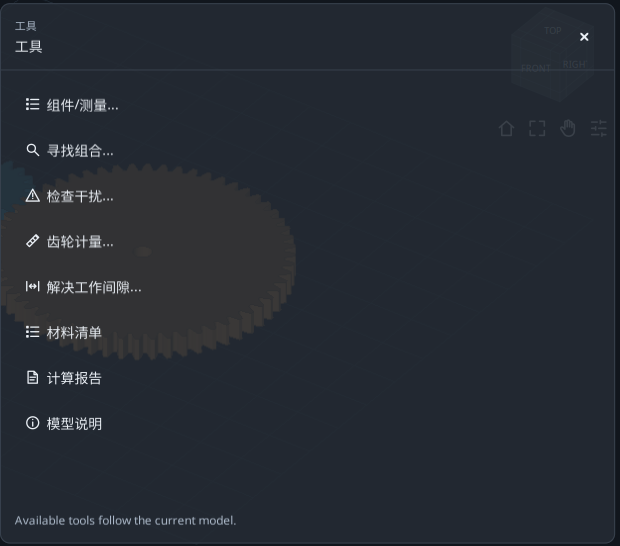

**预期结果.** 查看结果不会更改模型。组合搜索和侧隙求解需要明确点击应用。

**遇到问题时 / 结果解释.** **展开工具**扩大表单；**恢复工作区**恢复模型视图；**所有工具**切换工具，×关闭工具。会话草稿不能替代保存项目。

## 选择并隔离小齿轮

识别正确零件，同时保持其几何参数不变。

1. **选择单个零件.** 打开01，再进入**工具** → **组件/测量...**。在**零件**中选择第一行小齿轮，确认摘要显示仅选中一个组件。

2. **读取身份信息.** 展开**组件详细信息·mm 中的标称边界**。源名称是S1_Pinion。XYZ包围尺寸沿世界坐标轴测量，并非三个直径。

3. **隔离并恢复.** 点击**隔离**查看零件，再点击**恢复视图**恢复之前的显示过滤。Ctrl/Shift可增加所选零件。

4. **查看齿形.** 仅选中一个兼容齿轮时，**查看齿形**打开齿部视图，**返回模型**返回模型。理论尺寸请使用齿轮计量工具。

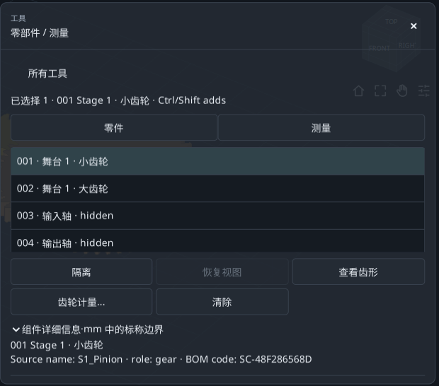

**预期结果.** 已找到小齿轮，齿数、模数及中心距均未改变。

**遇到问题时 / 结果解释.** 齿部或计量按钮不可用，通常是因为未选中一个兼容齿轮。轴不是齿轮。

## 测量两个可见表面点

获得A-B直线距离及XYZ坐标差。

1. **固定姿态.** 在Components中选择**测量**、**使用名义姿势**。若面板挡住大齿轮，启用Pan，将模型左移，然后关闭Pan。

2. **选择A和B.** 依次点击小齿轮、大齿轮上端面的实心区域。选择面板外可见表面，不要点击孔中心的空白区域。

3. **读取数值.** 查看直线距离和B−A ΔXYZ。两个上平面处于同一高度时，ΔZ约为零。

4. **重新测量.** **清除点**清除并重新开始。你的点击位置通常会产生与截图不同的距离。

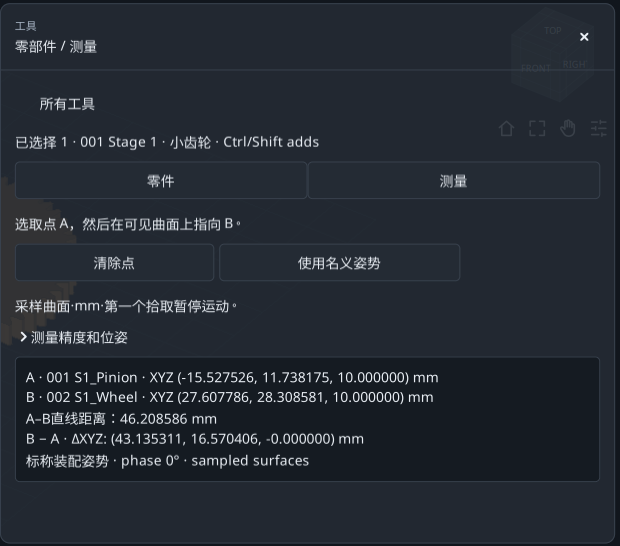

**预期结果.** 出现两个标记点、以mm表示的距离及三个坐标差。

**遇到问题时 / 结果解释.** 没有自动捕捉。这是采样表面两点间距离，不是解析直径、精确中心距或整个表面间最小间隙。

## 只导出所选小齿轮

区分导出选中零件与导出整个减速器。

1. **核对选择.** 返回**零件**，只选小齿轮，向下滚动到导出摘要，确认选择数量为1。

2. **先选目标文件夹.** 在顶部**导出**菜单中用**更改文件夹...**选择练习文件夹，然后返回工具。

3. **从工具导出.** 选择STEP用于CAD、STL用于网格、**DXF / SVG**用于兼容截面，或**套餐**导出包。等待确认后点击**打开文件夹**。

4. **核对文件.** 文件应只包含小齿轮，使用名义装配坐标。被隐藏但仍选中的零件也会导出。

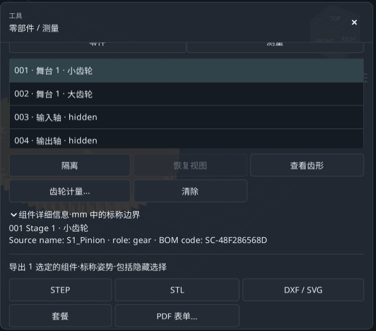

**预期结果.** 选择决定导出内容；显示或隐藏不能代替选择。

**遇到问题时 / 结果解释.** **PDF 表单…**需要选中一个组件，并打开企业零件表单。DXF/SVG截面不会自动成为加工模板。

## 寻找更紧凑的3:1齿轮副

比较18/54与20/60，同时固定模数、齿宽、变型及输入输出连接。

1. **从文件01开始.** 打开**工具** → **寻找组合...**，保持**编辑搜索设置**展开。

2. **设定目标.** **所需比例**输入3，**允许误差 ± (%)**输入0。这里是输入速度/输出速度的绝对值，不是0.333。

3. **选择排序方式.** 保持**任一方向**，在**结果比较依据**选择**最小包络尺寸**。当前连接使两轮反向旋转。

4. **保持宽松的尺寸上限.** X/Y/Z最大值均保留1000 mm。包络包含所有生成组件，包括隐藏组件。

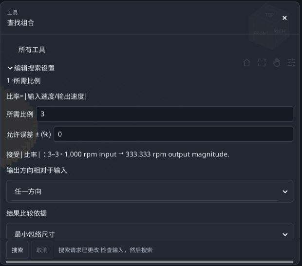

**预期结果.** 目标已设定。接下来只定义四个待测组合。

**遇到问题时 / 结果解释.** 该搜索需要具有唯一输入/输出传动比的总成。单个齿轮或差速器不提供这种唯一比值。

## 明确哪些参数允许变化

在**2。探索参数**中使用小范围的有限取值。

1. **小齿轮范围.** **输入小齿轮齿数**选择**变化**和**范围**：**来自**18、**To**20、**步骤**2，测试18和20。

2. **大齿轮范围.** **从动齿轮齿数**选择**变化**、**范围**：**来自**54、**To**60、**步骤**6，测试54和60。

3. **固定其他参数.** **更多尺寸**中的其他变量保持**保持最新状态**。两个值乘两个值，共四个候选。

4. **开始搜索.** Advanced中最多100个候选、60秒足够。点击**搜索**并等待。

**预期结果.** 18/54和20/60精确满足3:1，另外两个组合不满足。

**遇到问题时 / 结果解释.** 不同变量的取值数相乘。先少量搜索，并在开始前修正字段错误。

## 比较、应用并撤销方案

结果行在明确应用前只是建议方案。

1. **读取第一项.** 按最小包络排序，18/54在前：小齿轮20→18，大齿轮60→54，保持3:1及反向旋转。

2. **比较几何.** 名义XYZ约147.933 × 111.990 × 26 mm，有效重合度约1.64876。这些是几何结果，不是强度评定。

3. **应用前保存.** 选中18/54。需要记录时，先用**保存报告...**保存TXT，再点击**应用选定的**；应用会使该搜索失效。

4. **确认并撤销.** 模型齿数变为18和54。一次**撤销**恢复20/60。文件02提供可直接打开的紧凑方案。

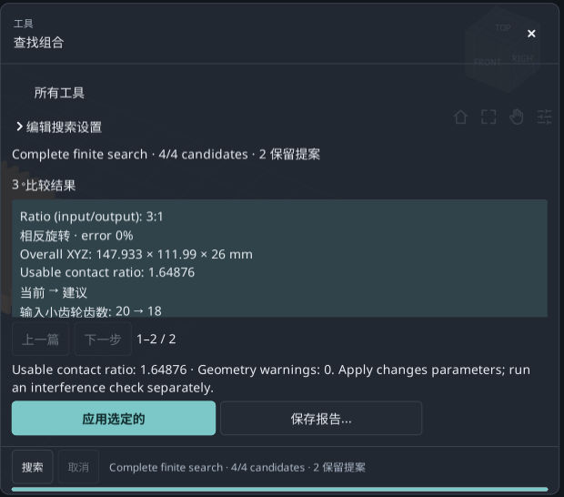

**预期结果.** 在保持目标传动比的同时缩小齿轮副，并获得可撤销的模型修改。

**遇到问题时 / 结果解释.** 选择未变化的20/60行时Apply不可用。修改模型或范围后必须重新搜索。

## 检查采样运动

先读取覆盖情况，再解释接触列表。

1. **回到文件01.** 打开**工具** → **检查干扰...**。不要使用上一练习的紧凑结果。

2. **设置采样.** **检查设置**：相位步长30°、边界容差0.01 mm、时间上限120 s。

3. **运行检查.** 点击**检查周期**并等待。隐藏支承件和外壳同样参与检查；隐藏不会排除它们。

4. **读取覆盖.** 此例完成37/37个姿态，步长≤30°。若显示INCOMPLETE，增加时间或增大步长后重试。

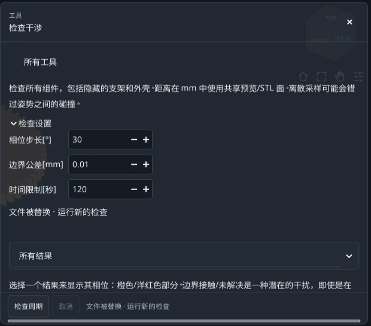

**预期结果.** 完整离散覆盖表示计划的37个姿态全部检查完成。

**遇到问题时 / 结果解释.** 按零件标识考虑的运动周期可能超过360°。步长越小工作量越大；仅看耗时无法证明覆盖完整。

## 区分接触与干涉

筛选改变列表，不改变已完成分析或覆盖范围。

1. **显示未解决接触.** 选择**未判定的接触**。基准模型标出小齿轮/输入轴和大齿轮/输出轴界面。

2. **检查一行.** 点击结果，显示对应相位及橙色/洋红零件。**恢复预览**恢复之前的视图；必要时先退出展开模式。

3. **比较分类.** **可能干涉**显示Intersection/Containment；**分开**显示分离对；**所有结果**恢复全部分类。

4. **保存并在修改后重跑.** **保存报告...**通过文件对话框保存TXT。更改设置或几何会使旧检查失效。

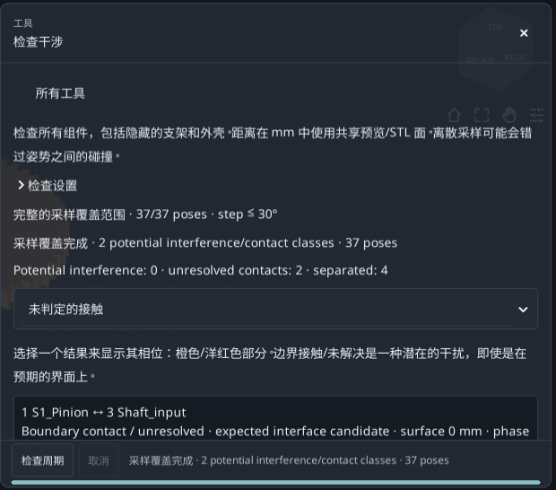

**预期结果.** 基准结果：0类潜在干涉、2类未解决接触、4类分离。

**遇到问题时 / 结果解释.** Boundary contact/unresolved不一定是模型错误。完整离散覆盖不能证明全程连续无碰撞。

## 计算理论跨球尺寸

使用正确的生成齿轮，而不是通过3D点击估算直径。

1. **选择小齿轮.** 打开01。在Components中只选择第一只小齿轮，再点击**齿轮计量...**。确认20齿、参考直径40 mm和S1_Pinion。

2. **使用建议测球.** 保持**球**，点击**使用理论计量直径**，保留计算值约3.534085 mm，不要照图重输舍入值。

3. **计算.** 点击**计算**。预期跨球尺寸约44.876412 mm、接触半径20 mm；这不是40 mm参考直径。

4. **导出查询.** **出口报告·TXT + JSON**把输入和结果保存在**导出** → **目标文件夹**所示文件夹。改变测球或组件后重新计算。

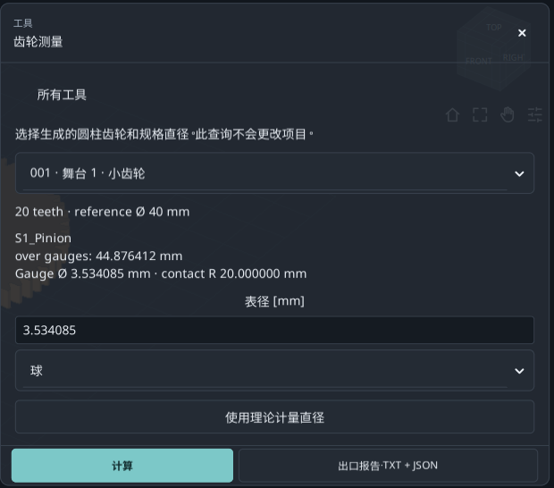

**预期结果.** 得到可复现的小齿轮理论测量值。此直齿例中轴向滚子给出相同横向尺寸。

**遇到问题时 / 结果解释.** 仅支持兼容的内/外直齿渐开线组件。不包含斜齿测量、真实量具可达性或实际公差。

## 读取Wildhaber跨齿公法线长度

这是平测砧跨指定齿数的测量尺寸。

1. **保持同一小齿轮.** 继续使用20齿S1_Pinion，不要切换到60齿大齿轮。

2. **打开跨齿部分.** 向下滚动至**公法线长度测量**。在**Wildhaber span · number of teeth**中选择3。

3. **读取W3.** W3约15.250402 mm，接触半径约20.281829 mm。3是跨齿数，不是减速器传动比。

4. **尊重可选范围.** 列表只包含生成齿形上可用的接触。不要强行指定不存在的齿数；内齿或斜齿不提供此项外齿平砧测量。

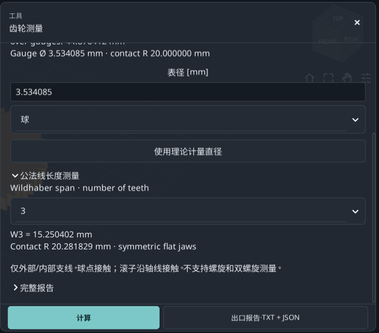

**预期结果.** 跨球尺寸与Wk是不同尺寸；均应记录组件及各自输入。

**遇到问题时 / 结果解释.** 显示的小数位数不定义制造公差、测量不确定度、齿轮精度等级或完整标准符合性。

## 把工作侧隙从0.15改为0.50 mm

为端面切向工作侧隙提出新的中心距。

1. **从文件01开始.** 打开**解决工作间隙...**。确认当前中心距80 mm、工作侧隙0.15 mm。

2. **输入目标.** 在**所需的工作横向切向间隙 [mm]**输入0.5。本练习不要直接修改模型中用于齿厚减薄的Backlash字段。

3. **核对范围.** 读取**Nominal target range**；本基准下0.5 mm位于允许范围。极限取决于当前几何。

4. **计算并预览.** 在**离散干扰设置**设步长30°、时间120 s、姿态上限721，点击**计算和预览**。

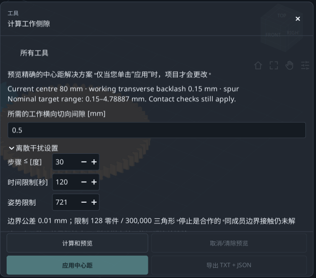

**预期结果.** 求解器提出并检查建议几何，此时尚未改变主项目。

**遇到问题时 / 结果解释.** 仅适用单个外啮合平行轴直齿/斜齿/双斜齿副，不支持多级、内啮合或行星传动。目标不是径向或法向侧隙。

## 接受新的中心距

同时阅读当前/建议值和检查信息。

1. **比较结果.** 预期中心距约80.466750 mm、工作侧隙约0.500000 mm、有效重合度约1.44449。

2. **阅读未解决界面.** 离散覆盖完整，但保留同一运动构件上与轴的两个未解决界面；它们没有被宣告解决。

3. **应用方案.** 点击**应用中心距**。高级尺寸中的**中心距增加 [mm]**从0变为约0.466750；参考中心距加增量得到新中心距。

4. **撤销前导出.** **导出 TXT + JSON**将方案及已应用状态保存在当前目标文件夹。随后**撤销**恢复80 mm。03是完成后的检查点。

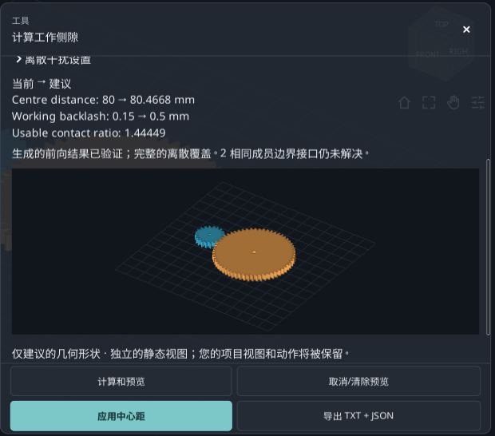

**预期结果.** 通过改变中心距达到目标，同时保持20/60齿及模数2 mm。

**遇到问题时 / 结果解释.** Apply不可用时读取原因：目标无效、检查不全、干涉或项目改变均可能要求重算。仅有预览不代表可应用。

## 查找零件、计算和注释

通过报告了解源模型并找到具体数值。

1. **打开物料清单.** 从01选择**工具** → **材料清单**，对照Components核对生成零件名称、代码和数量。

2. **打开计算报告.** **计算报告**打开**名义计算报告**，包含传动比、啮合几何及名义计算。

3. **在文档中搜索.** 在**搜索此文档...**尝试S1_Pinion。**上一页**/**下一步**切换匹配项，**全部复制**复制文本。

4. **阅读模型注释.** **模型说明**解释构造细节。使用模型或对应工具的导出功能保存相应输出。

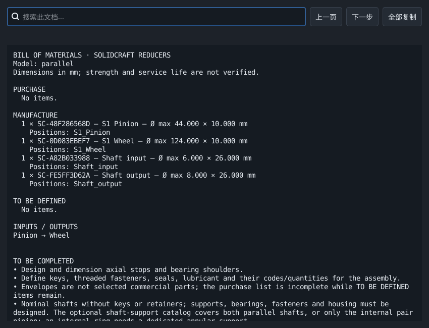

**预期结果.** 能够定位总成物料清单、名义计算、注释以及各工具查询。

**遇到问题时 / 结果解释.** 生成的清单不一定是完整采购清单；可能还需要企业决策和CAD补充设计。

## 结果不一致时

一次检查一个条件，不要同时修改大量参数。

1. **尺寸不同.** 重新打开01：20/60齿、模数2、齿宽10、直齿、中心距80 mm。02和03有意包含不同结果。

2. **找不到控件.** 滚动或使用**展开工具**，核对语言和版本。截图显示基于0.2.2的本地工具更新。

3. **Apply或Export不可用.** 选择会改变模型的方案或兼容零件，修正字段错误并在修改后重算。计量需要有效结果。

4. **测量变化或检查不完整.** 点选没有捕捉，数值会变。简化搜索或增加检查时间；关注覆盖，而不只是耗时。

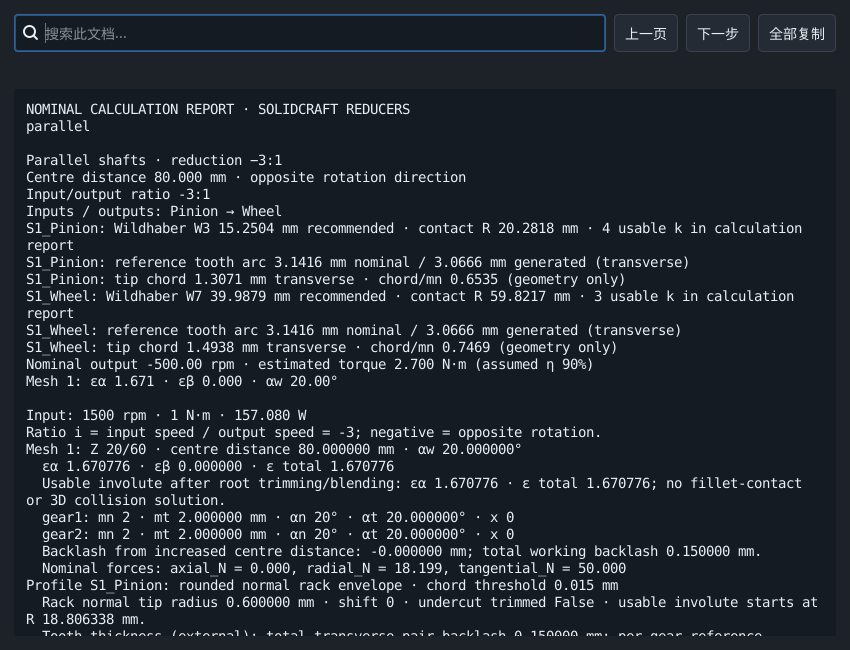

**预期结果.** 每次重复一个练习，保留初始项目与结果报告。

**遇到问题时 / 结果解释.** 先保存自己的工作。练习只涉及名义几何与离散运动，不是强度、寿命或生产批准。

## 参考资料与适用范围

教程结构参考KISSsoft官方教程及GearTrax逐字段操作说明。所参考的GearTrax帮助为2009年的历史版本。本指南的文字、示例和截图均属于RatioLab；引用不代表RatioLab具备这些产品的全部计算能力。

- [KISSsoft, Tutorial 15 - Bevel gears (2022)](https://www.kisssoft.com/files/eu64So/KISSsoft-Tutorial-015-Bevelgear-en.pdf)
- [KISSsoft，官方教程目录](https://development.startpage.services.kisssoft.com/)
- [Camnetics, GearTrax - Creating a Spur Gear（历史帮助，2009）](https://camnetics.com/geartrax/FlashHelp/geartrax2009/creating_a_spur_gear.htm)
- [Camnetics, GearTrax - Between Pins Example（历史帮助，2009）](https://camnetics.com/geartrax/FlashHelp/geartrax2009/between_pins_example.htm)

名义几何、理论测量值和离散检查不能证明强度、疲劳寿命或制造适用性。
