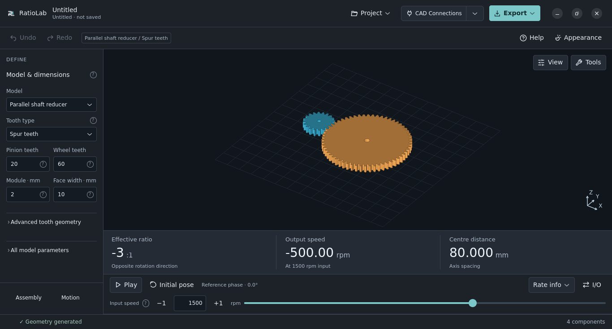

# RatioLab user guide

[Download and installation](installation.md) · [Agent integration](mcp.md)

## Workspace

The application uses the **Technical workspace**: a compact parameter panel on the left with paired primary dimensions and expandable advanced parameters, a dominant 3D preview, a prominent results band below the model and a single motion bar beneath it. **Tools** opens a translucent panel over the preview. The orientation cube and its compact navigation controls stay in the upper-right corner; the sliders icon opens Display options without resizing the preview. The window displays the RatioLab name and RL icon.



The parameter panel has three tabs:

- **Dimensions:** geometry, tooth counts, modules, profiles and clearances.
- **Motion:** input/output members, operating speed, torque and nominal loads.
- **Assembly:** bearings, fits, housing/flanges, standard hardware and existing eccentric shaft construction options.

Parameters update the preview and calculations automatically. Main geometry, shafts/bores and output connections are grouped; profile parameters and clearances are under **Advanced**. Nominal operating loads are collapsed under Motion. Read-only results show effective ratio/direction, output speed and a relevant geometric dimension; single gears show pitch diameter, tooth count and width. Nominal torque remains in the operating assumptions and calculation report, rather than appearing as a capacity rating.

Ordinary dimension edits prepare the next geometry and preview in the background.
You can continue editing; only the latest matching request replaces the model.
Export and geometry-dependent tools wait for the accepted result. Explicit
project loads and refreshes can still take time to finish.

The **Project** menu contains **New**, **Open…**, **Save**, **Save As…** and **Recent…**. **Export…** stays in the header; the second toolbar contains **Undo / Redo**, the current model, **Theme** and **Language**. The document line shows its full path and any unsaved changes. **CAD Connections** opens the SolidCraft and Autodesk Fusion connection chooser. After a successful connection, the main action becomes **Import in SolidCraft** or **Import in Fusion**; the arrow remains available to choose another CAD. Connecting does not import a model. The existing document, parameter and connection checks still apply. An eligible **Update to v…** button appears immediately to its left and opens update notes/options. **Tools** includes the bill of materials, calculation report and notes; the bottom bar shows model status and component count. In the browser, **Model** contains family and variant controls; the horizontal **Dimensions**, **Motion** and **Assembly** navigation beneath them selects the parameter section. The desktop app uses the same horizontal **Dimensions**, **Motion** and **Assembly** bar beneath its compact family and variant selectors. The panel remembers its active section, advanced group and scroll position when choices rebuild its fields. Linked dimensions explain their source and provide **Change source…** to open the relevant Assembly section.

With an analysis tool open, choose **Expand tool** beside **Tools**
to give the panel the workspace area. **Restore workspace** returns to the
previous split positions and view without losing selections or tool inputs.
Closing the tool or pressing Escape also restores the workspace.

Hover over a parameter or the **Model & dimensions** heading for a compact adjacent guide. Move into the guide to read or expand its original schematic; leaving both the parameter and guide dismisses it. Use the information button or **F1** for keyboard/touch access, and **Escape** or the close button to dismiss. Passive hover does not move input focus.

Use the **Theme** on/off switch to toggle directly between **Dark** (off, default)
and **Light** (on), and **Language** to
change interface labels. The choices match the documentation languages: English,
Italiano, Español, Français, Deutsch, Português (Portugal), Русский, 简体中文 and
தமிழ். Both choices apply immediately and are remembered for future sessions.
They do not change numeric text, units, model identifiers, project files or history.
Technical explanations, calculation reports and messages without a translation
remain in English. Desktop preferences are saved in the user profile; web
preferences are saved for the current browser and site. A failed preference save
keeps the selection for the current session and displays a notice.

The **Explode** slider in **View** moves continuously from the assembled pose at **0.00** to the exploded pose at **1.00**. Moving it pauses motion; **Start motion** or **Initial pose** returns to the assembled pose. Explosion affects only the preview: geometry exports and package previews use nominal assembly coordinates. Component selection and surface measurements follow the displayed pose; changing the amount clears existing measurement points.

Invalid input remains visible, with a field message when the generator identifies the cause. Geometry actions are blocked immediately while a geometry update is pending. Invalid geometry stops motion; the last valid model of the same family remains visible with an explicit warning that it does not match the current parameters. An incomplete or unconfirmed RPM entry keeps motion at the last valid speed. Pressing Enter, leaving the speed field or requesting a save/export confirms the entry; failed confirmation shows a field error and blocks geometry exports and CAD transfers until the speed is corrected, while prior motion continues. No automatic correction replaces an invalid numeric entry on focus loss.

Numeric fields omit unnecessary leading and trailing zeros when you press Enter or leave a completed entry. Automatically displayed values use up to six decimal places (scientific notation for very small values), while calculations and saved projects retain their full precision. Explicitly entered decimal places are preserved, apart from redundant zeros; no additional decimal rounding is applied to typed input.

Saved configurations from earlier versions still load their geometry and kinematics. Obsolete material, stress and production settings are ignored and omitted from newly saved configurations and reports. Previously exported files remain independent snapshots.

## Agent integration

RatioLab includes an offline **MCP server** with 13 tools for discovering the
catalog, creating/editing/saving projects, Undo/Redo, inspecting components and
BOMs, searching combinations, checking discrete interference and exporting
STEP/STL/SVG/DXF or headless packages. The same generators and validators are
used by the desktop app. Files stay in an explicitly configured workspace;
project revisions prevent stale edits and existing outputs are preserved.

Native installers include the `RatioLab-MCP` console companion (`.exe` on
Windows). Python installations provide `ratiolab-mcp`; headless use needs no
GTK/OpenGL session, CAD application, API key or additional Python packages.
See [MCP.md](mcp.md) for commands, Codex/client configuration, tool contracts
and limits. MCP projects exchange compatible JSON files with the GUI; the
server maintains its own project handles rather than controlling an open window.

## Active catalog

These fifteen families are available, in this order:

| Family | Main variants or purpose |
|---|---|
| Spur gear | Single involute gear |
| Helical gear | Adjustable helix angle and hand |
| Double helical gear | Joined helices or separated by a groove |
| Planetary gearbox | Spur, helical, double helical, one or two stages |
| Cycloidal reducer | Single or dual disc with opposing eccentrics |
| Strain wave reducer | Cup, flat cup, silk hat; generated matching ring |
| Worm and wheel | Cylindrical ZA / ZI with generated wheel |
| Parallel shaft reducer | One, two or three stages; spur, helical or double helical teeth |
| Internal gear reducer | Fixed axes; spur, helical, double helical |
| Bevel differential | Wrist or classic configuration; straight or spiral bevel gears |
| Wolfrom / 3K reducer | Two-rim spur; sun input, fixed first ring, second ring output |
| Bevel gear pair | Straight, spiral or circular Zerol-style traces; 90° shafts; reversible ports |
| Hypoid gear pair | Generated spiral pinion; signed shaft offset; reversible ports |
| Rack and pinion | Finite spur, helical or double-helical rack; rotary input and linear output |
| Face gear pair | Generated face wheel and spur/helical/joined or separated double-helical pinion; 90° shaft directions and signed offset |

Unsupported families are rejected by both the interface and generator. Previously exported files remain independent artifacts.

### Wolfrom / 3K reducer

Choose **Wolfrom / 3K reducer** for a sun-driven compound planetary train. Each
planet has two rigidly connected toothed portions. The first meshes with the sun
and fixed ring; the second meshes with the output ring. The common carrier is
an internal moving member. This arrangement differs from the carrier-output
planetary model above.

Set the sun, first-planet, second-planet and output-ring tooth counts and first
module. The fixed-ring count and second module are derived to preserve pitch
centres. Face widths and the axial gap describe the two separate tooth layers.
Invalid tooth phases, singular stationary-output sets and incompatible profiles
are rejected. Input RPM accepts both signs and zero; a negative signed ratio
means that the output reverses relative to the sun.

The [default nominal example](../examples/wolfrom-spur.config.json) is 600:1. This is an equation result, not a measured
ratio, efficiency or allowable load. Both paired ring profiles and their contact
checks are recorded in the calculation report. Automatic bearing/hardware
selection, helical and one-rim variants are outside this construction. See the
[Wolfrom equations, clocking and limits](technical/wolfrom.md).

### Bevel differential

Choose **Bevel differential** with its default **Wrist** configuration to generate three bevel gears,
two independent input stub shafts, an open carrier and a drilled output flange.
Belts, pulleys and motors are not generated; add the external drive in your CAD.
Set the module, input/output tooth counts, face width, shaft diameters and flange
dimensions in Dimensions and Assembly. **Supports** reveals the carrier and
nominal bearing envelopes and is enabled on the first visit to this family.

The choices are independent. In Assembly, **Output connection** selects the
original drilled flange, a solid shaft or a hollow shaft. Solid and hollow
shafts have an extension measured beyond the output carrier face. Hollow shafts
have a real continuous coaxial passage through the output gear/shaft/hub
assembly, with a minimum 1 mm shaft wall. This is the local output passage;
it does not establish an unrestricted cable route through the whole wrist or
through its tilt range. Flange-only dimensions and the hollow-passage dimension
are hidden when they do not apply.

**Carrier construction** offers the original open carrier or split members
with open bearing-seat halves. The split cheeks and bridges remain separate
parts; bridge lap tabs have matching joining holes, an axial clearance gap and
at least 1 mm layer thickness. Bridge ends butt against the cheek faces. Choose
the joining hole diameter and complete fastener selection, axial retention and
clamping in CAD; no stock fasteners or validated clamp capacity are inferred.

In Dimensions, **Side / output tooth ratio** offers custom counts, 1:1 teeth
or **Relative spin reduction 2:1**. The latter derives twice as many output
teeth as side teeth (up to 30 side teeth), reducing relative output spin by
two while retaining the carrier mean-speed equation. Derived output teeth are
read-only with **Change source…**; choose Custom to edit both counts. Exploring
presets preserves the earlier custom count in the current editing session.
Old configurations retain the original flange/open construction and their
custom counts. A
[hollow shaft / split carrier example](../examples/differential-wrist-hollow-split.config.json)
demonstrates the independent choices.

Set signed **Input A speed** in the motion bar and **Input B speed** under Motion.
The **Tilt**, **Spin** and **Combined** buttons demonstrate 12/12, 12/−12 and
12/0 rpm inputs. Both signs refer to the same world +X direction, although the
input shafts emerge on opposite sides. Equal speeds rotate the carrier about X;
opposing speeds rotate the output about its carrier's Z axis. Results
show both output speeds rather than a single reduction ratio. No combined power
balance or output torque is calculated without independent load data.

The ideal equations are `carrier = (A+B)/2` and
`output spin = (side teeth/output teeth) × (B−A)/2`. Output spin is relative to
the moving carrier. The working flanks are exact spherical involutes, with an
optional logarithmic spiral trace. Pressure angle is transverse. The planar end
caps form a custom blank, not a KHK standard full-depth blank. The generator
checks the common normal, root domain and continuous availability of ideal tooth
engagement; combinations with gaps between successive contacts are rejected.
Face width is limited to one third of the cone distance. Bearings and retention
require completion in CAD. STEP/STL share the preview surfaces in the nominal
pose; SVG/DXF are sections, not cutting templates. Start with the
[example configuration](../examples/differential-wrist.config.json).

The construction selector offers **Straight bevel** and **Spiral bevel**.
Spiral exposes an unsigned angle (0–45°) and local input hand (−1 or +1).
Both inputs use the selected local hand; the perpendicular output uses the
opposite hand. Sections retain fixed circular bores. Zero angle reproduces the
straight geometry exactly. Profile refinement and spiral trace chords use a
0.003 mm sampling criterion; this is not a global surface-error proof or a
manufacturing tolerance. Faceted surfaces, especially at zero backlash, still
need discrete motion checks. See the
[spiral example](../examples/differential-wrist-spiral.config.json) and the
[equations, references, custom blank and geometry limits](technical/differential.md).

The independent **Differential configuration** selector also offers **Classic**:
direct carrier input, two coaxial side outputs and an internal spider bevel on
a carrier-fixed pin. The perpendicular wrist output shaft/flange is removed.
A drilled annular carrier input mount clears side output A; the full mount
thickness is reserved before the side output's exposed extension. Choose solid,
hollow or flanged connections for both side outputs. Hollow side passages are
local; the spider and pin can obstruct a route through the complete mechanism.
Spider pin diameter and positive radial running clearance are explicit; axial
retainers and all mounting/fastening interfaces remain nominal.

For Classic, set **Carrier input speed** in the motion bar and **Prescribed side
speed difference B−A** under Motion. Outputs are `A=C−(B−A)/2` and
`B=C+(B−A)/2`, with all signs about world +X. The difference is a visualization
boundary condition, not a second motor or a speed split predicted from loads.
**Equal**, **A held** and **Counterrotate** demonstrate 12/0, 12/24 and 0/24 rpm
carrier/difference settings. A held is a prescribed zero side speed, not a
physical differential lock. Results and component roles identify the carrier
input, two outputs and internal spider; no output torque or traction is inferred.
The [classic example](../examples/differential-classic.config.json) can be
opened directly. No crown/pinion input stage, belts, pulleys or motors are generated.

## Preview and motion

### Orient and pan the preview

Drag with the **left mouse button** to orbit, with the **right mouse button** to
pan, and scroll to zoom. The **Pan** hand toggle also lets you pan with a left
or touch drag. Pan changes only the camera; it does not move mechanism parts.

Click a face, edge or corner of the orientation cube to choose one of 26 views;
drag the cube to orbit. **Home** restores and fits the isometric view. **Fit**
centres the model at the current orientation. With the cube focused, keys **1–6**
choose Front, Back, Right, Left, Top and Bottom; arrows orbit and **Home** fits.
The cube uses the same Z-up orientation as the preview.

The adjacent **Display options** icon retains Navigate/Select/Measure, Supports,
Housing, Section and the continuous Explode slider. Section and explosion remain
preview-only; pan and orientation do not edit the project or nominal exports.

**Supports**, **Housing**, **Exploded** and **Section** control the view. Cycloidal output pins remain visible when Supports is disabled, in both single and dual disc variants.

Use the motion controls below the results: **Start motion / Pause**, **Initial pose**, a precise RPM entry, the progressive RPM slider and ±1 controls. **Rate info** opens the current motion convention; **I/O connections** opens the Motion parameters. The reference phase is a readout of the current preview. Press Enter or leave the entry to apply; both decimal points and commas are accepted. All inputs at zero freeze the phase. Changing only valid RPM preserves the current phase.

Dragging the RPM slider previews the chosen number while the model retains its
applied speed. Release the slider to apply the final value as one Undo step.
Keyboard adjustments apply on key release; Save/Export also confirms a pending
slider choice. Cancelling the gesture leaves the applied speed unchanged.

Closing Rate info does not stop playback. Starting motion returns from exploded view to the assembly pose. At high speeds, video sampling may cause visual aliasing.

Animation illustrates kinematics. It does not verify continuous contact, collisions, force, fatigue or usable travel. CAD and STL exports use the nominal assembly pose; a complete export resets the preview before saving the PNG.

The preview panel shows geometry warnings for single-gear undercut and gear-pair interference. They update from calculation data when dimensions change; full warnings remain available in the calculation report and model notes.

**Check interference…** opens a discrete 3D check of every component, including
hidden supports and housing. Choose the phase step, boundary tolerance in mm
and time limit, then **Check cycle**. The full labelled orientation/orbit period
is computed from the actual motion plan; the report distinguishes that period
from a truncated prefix. The worker reports progress and supports Cancel.
Select a result to highlight its two components at the reported phase; the
preview overlay and **Restore preview** leave this temporary inspection view.
Parameters, Undo history and export geometry do not change. Editing, invalid
input, document replacement and closing invalidate obsolete results immediately.

The checker measures Euclidean distances on the shared preview/STL triangles,
including holes, concavities and 3D frames. Analytic cylinders in STEP can differ
from these facets. It separates positive clearance, boundary contact / unresolved
potential overlap, intersection with an interior witness, and containment with
positive surface margin. Expected constructed interfaces are annotated; their
intersections remain visible and suspect. Any reported depth is a witness
clearance lower bound, not exact penetration / minimum translation distance.
Save the detailed report from the check window. Results aggregate the minimum
surface distance per pair and observed class, with a selectable sample pose.

This is **discrete sampling, not continuous collision certification**. Limits
are 721 poses, 128 parts, 300,000 triangles and the selected time budget (default
120 seconds). Unfinished or unsupported checks are explicitly incomplete. Rigid
closed triangle surfaces and the known prescribed flexspline material map are
supported. The flexspline is rebuilt at each pose from its immutable reference
coordinates with the same triangle connectivity; stale or missing references,
unknown deformation and arbitrary warps fail explicitly. Generated worm and
bevel working geometry and the prescribed strain-wave envelope do not establish
continuous clearance or elastic response. Near-collinear triangulation faces
retain topology and use edge/point distances, with altitude below tolerance / 100.

## Components and surface measurements

Click a visible surface to select its component; Ctrl/Shift adds or removes
parts. **Components / measure…** provides a multiple-selection list with source
indices, readable names and visibility. Duplicate names remain distinct. Row
tooltips retain the original source name and role. Expand **Component details ·
nominal bounds in mm** for the selected parts' source names, roles, BOM codes
and sampled bounds. The display names do not rename parts in exports or projects.
**Isolate selected** reveals only those source positions, including explicitly
selected supports or housing; **Restore filters** restores the previous view.
Selection and inspection do not change parameters or Undo history. Changing only
RPM keeps component selections and isolation while clearing measurements tied to
the previous operating revision. Geometry edits and document replacement clear
obsolete selections and measurements.

**Measure two surface points** shows A/B in the preview, world XYZ coordinates
and straight point-to-point distance in mm. The first click pauses the displayed
pose; results identify nominal, motion/inspection or exploded coordinates.
Component dimensions are nominal sampled XYZ bounds. Measurements use shared
preview/STL facets; six decimals are display precision, not an exact CAD diameter
or a manufacturing tolerance. Animated flex/warp surface picking is explicitly
unavailable: use **Use nominal pose** to inspect the nominal sampled geometry.

The component window offers **STEP**, **STL**, **DXF / SVG** and **Selected
package** for the chosen source indices only. Supports, housing and hardware are
included only when selected. These files retain nominal assembly coordinates,
source names/indices, selective BOM quantities and explicit subset metadata;
view explosion, section and motion never become export geometry. Selected
packages include portable CAD scripts/assets and checksums. Their parameter
JSON and calculation report describe the source configuration; replay the CAD
script to recreate the subset. The header's existing complete exports continue
to include every component, regardless of selection or isolation.

## Find geometric combinations

**Find combinations…** searches the selected parallel, internal, planetary,
cycloidal, strain wave or worm assembly. A single gear has no independent
transmission ratio. Enter the target magnitude **|input speed / output speed|**,
relative tolerance in percent, and either sign, same (+), or opposite (−)
direction. The current I/O connection and each planetary stage remain fixed.

The Search dock guides you through **Desired ratio**, **Parameters to explore**
and **Compare results**. The ratio example and accepted interval update as you
enter the target and relative tolerance. A ratio below 1 describes an output
speed greater than the input speed. Direction follows the selected members and
their displayed axes, rather than an assumed reducer direction.

For each available tooth/roller count, planet count, module, width or cycloidal
pitch radius, choose **Keep current** or **Vary**. Set **From**, **To** and **Step**
with ordinary numeric fields; no grid syntax is required. Counts must be whole
numbers. Initial count ranges are a local ±4 window, clipped to parameter limits
(strain wave teeth use step 2); planet count and continuous dimensions initially
stay fixed. The finite candidate count updates immediately. Invalid required
inputs show a field message and disable Search until corrected.

For nonuniform lists or compound grids, choose **Custom values (advanced)** for
that parameter and enter comma-separated numbers or inclusive `low:high:step`
grids. Range and Custom values keep separate drafts when you switch between
them; only the selected mode is searched. **Keep current** preserves these
drafts too. No custom list is automatically resampled into a range. Each varying
parameter accepts at most 1,000 distinct values.

**Overall size limits** groups the XYZ limits; the active limits stay visible
in the dock, including while settings are collapsed. **Advanced** contains time
and candidate budgets and the full technical report. Default budgets are 50,000
visited candidates and 30 seconds. Results distinguish a complete domain from
a partial or cancelled search. For no matches, review ratio, ranges and size
limits; for partial coverage, also review the Advanced budgets before another
search. No constraint is relaxed automatically. Generation and surface section
construction are cooperative stop units.

Other dimensions, variants, number of stages, I/O, bearings and hardware stay
fixed. A candidate that would silently normalize a fixed dimension or an
enumerated value is rejected. This is a finite local search, not continuous
optimization or a global optimum claim.

Each retained proposal passes the definitive generator and uses its actual
signed analysis ratio, including reverse connections and all stages. XYZ limits
use the nominal bounding box of the **sampled shared preview/STL surface** in
world axes and millimetres, including all generated supports, housing and
hardware regardless of view filters. This is the export pose rather than a
motion swept envelope. Analytic circles in STEP can extend slightly beyond the
sampled bound. No interference, strength or load rating is inferred.

Proposals show ratio, error, overall XYZ size in mm and human-readable parameter
changes as **Current → Proposed**, with ratio magnitude and rotation direction
shown separately. Results and Apply stay visible while comparing. Open **Edit
search settings** to return to the form; **Results** returns to the existing
comparison until an edit invalidates it. Search and Cancel remain at the bottom
of the dock.
Ranking uses ratio error, bounding box volume, then XYZ lengths; at most 100
best proposals from the visited domain are retained. Equivalent parameter sets
are deduplicated; equal ratios with different geometry remain separate. Select
a proposal and press **Apply selected** to change the current
document as one Undo step. Undo/Redo preserve its identity, path, save checkpoint and other
families. Search itself never modifies parameters. Model/request edits, invalid
numeric drafts, replacement and closing invalidate old proposals; Apply also
invalidates interference checks. **Save report…** records the grids,
locked baseline, budgets, coverage and retained proposals.

## Input and output connections

Three-member mechanisms use full-width Input and Output selectors, followed by
an explicit Fixed to frame member. Two-stage planetary reducers retain separate
selectors for each stage. Wolfrom shows its fixed topology and nominal output;
expand **Motion details** for all member speeds and the sign convention.

**Motion → Drive · input and output** selects which member is driven, which delivers motion, and which is fixed. Planetary, cycloidal and strain wave drives offer all six physical member combinations. The planetary two-stage variants have independent connections for each stage.

Parallel shaft, internal gear and worm drives offer forward/reverse operation.
For a worm drive, **Static tooth friction coefficient μ** is optional explicit
physical data for the actual tooth contact and conditions; no value is inferred.
**Apply coefficient** validates it before changing the design. With wheel input,
RatioLab blocks the configuration when static friction reaches or exceeds the
lead-angle/normal-pressure-angle limit. The refusal explains the coefficient and
limit and keeps the previous valid design and project. A geometry edit that
crosses the same limit is refused as well. Motor rotation direction does not select wheel input. The existing per-family
speed input range still applies.

Below the limit the state is **potentially backdrivable**, without a guarantee of
real startup. With no coefficient, including older projects, the state is
**indeterminate** and wheel-driven motion is explicitly an ideal kinematic
relation. **Clear coefficient · unknown** removes that physical evidence and
shows this uncertainty; it does not alter the physical assembly. The coefficient
and assessment are retained in project/calculation metadata. Output-driven
strain-wave arrangements are also indeterminate without measured breakaway torque
and operating conditions for that hardware. Commercial catalog data are not
assigned to generated geometry. These checks do not certify a safety brake or
load holding. See the [static mesh criterion and limits](technical/calculations.md#static-worm-backdrivability). Role colors and nominal mounting interfaces follow the selected arrangement; see [IO-MODELS.md](technical/io-models.md).

## Printed cycloidal eccentric shaft

Cycloidal models offer **Eccentric shaft construction → FDM · printed shaft + 2 through bolts** in both modes. The printed shaft/cam stack is held by an asymmetric pair of off-axis M3 bolts, with removable bearing retainers, recessed heads, washers and nuts. It uses dedicated NSK 6804 eccentric bearings. Both single and dual disc builds keep the shaft and its metal reinforcement visible without Supports.

The selector preserves the entered shaft diameter and disc thickness. If they are incompatible, use **Apply compatible FDM dimensions** explicitly: input shaft Ø17 mm, bearing seat Ø32.2 mm and disc thickness 16 mm. The seat is linked to the 6804 bearing plus allowance. With eccentric input, choose either pin flange output with a fixed ring or **Ring / housing output with a fixed pin flange**. Housing output adds an annular six-hole load flange and a separate eight-hole stationary frame connection while preserving the two-bolt shaft. Other driving members and general automatic hardware require the standard construction. Example configurations are in [`examples/`](../examples/). Assembly, fit calibration, limitations and primary research sources are in [PRINTED-SHAFT.md](technical/printed-shaft.md). This is an untested physical prototype, without a load rating or a universal motor coupling.

## Bearings and hardware

**Face gear pair:** choose the pinion tooth type, both tooth counts, normal
module and band width. **Band setting beyond reference radius** places the pinion
span and the generated face teeth; inner and outer limits depend on undercut,
pointing and ideal engagement checks. Width is along the pinion shaft, so mapped
face-band ends can curve slightly. Advanced **Face addendum coefficient** controls
the custom stub crest; backing thickness and bores are independent. For double helical, **Joined** gives continuous teeth through the centre.
**Separated** adds a groove and exposes **Central band relief**. Joined trims
a common circular tooth band inside the supported pinion span; its radial width
can be slightly smaller than the pinion axial width. Positive speeds use pinion world +X through (0,offset,2rp) and face
wheel world +Z; the positive ratio follows these perpendicular right-hand axes.
**Signed shaft offset** shifts the pinion along world Y: zero gives intersecting
axes, a nonzero value gives skew axes at the same 90° direction angle. This
regenerates the face teeth and differs from radial band setting along the pinion
shaft. Absolute offset must be below half the reference wheel radius; geometric
checks may be tighter. Complete shafts/supports in CAD. See
[generation and limits](technical/face-gears.md).

**Rack and pinion:** choose **Spur teeth**, **Helical teeth** or **Double helical teeth**.
Set pinion and rack tooth counts, normal module, face width and base below the
roots. The matching rack trace follows the signed pinion helix; double helices
can join or have a central groove. Results show mm per pinion revolution, signed
linear speed and conservative working stroke. Positive +Z pinion rotation moves
the rack toward world +X. Preview stops at the stroke end: reverse input speed
or select Initial pose to return. Complete guide, mounting and end stops in CAD.
Fixed rectangular rack ends include untothed lands for the tooth sweep. Exports
retain the nominal initial pose. See [equations and limits](technical/rack.md).

**Hypoid gear pair:** choose the tooth counts, wheel reference module and width,
master spiral angle and signed shaft offset. The pinion is generated from the
master wheel with the offset included in the conjugacy equation. Shaft directions
are 90°; their shortest distance is the absolute offset. The sign mirrors the
construction and determines the trace hands. This first custom construction allows
up to 6% of the reference cone distance; branch, root-wall, regularity and connected
engagement checks can reject additional combinations. Module and pressure angle
refer to the chosen master, not standard hypoid manufacturing dimensions. Complete
supports and validate the exported pair for your application. See
[method and limits](technical/hypoid.md).

**Bevel gear pair:** two gear blanks on intersecting 90° shafts. **Tooth type**
selects straight, spiral or Zerol-style. Spiral exposes its angle and local hand;
Zerol-style exposes the developed trace curvature radius and hand, with zero mean
spiral angle. Its custom spherical flanks are not industrial Gleason octoids.
Set pinion/wheel teeth, outer module, face width along the pitch cone and both
bores. Motion → Drive connections swaps the input and output without swapping
the physical bore assignments. Positive speeds use pinion world +X and wheel
world +Z. The result cards show both pitch-cone angles. Shafts, supports and
retention are completed in CAD. These custom spherical-involute blanks are not
a standard cutter design; see [equations and limits](technical/bevel-pair.md).

The verified local NSK catalog provides nominal open deep groove ball bearing dimensions and official source links. It does not automatically substitute sealed variants, other clearances or manufacturers. Linked dimensions are highlighted and locked in the interface.

**Parallel-shaft stages:** use **Number of stages** and **Tooth type** in the model
selector. Both controls remain independent: one, two or three stages support
spur, helical and double-helical teeth. Changing stage count preserves tooth type.
Existing spur projects keep their original construction identifiers.
Each stage has its own tooth counts, normal module, face width and helix angle
when applicable. The mating wheel automatically has the opposite helix hand.
Double helices offer **Joined** teeth or **Separated** halves with a positive
central groove per stage; the groove is part of that stage’s total face width.
In Assembly,
**Centre-line turn · stage 2** sets the signed turn from the first to the second
centre line; stage 3 has its own relative turn. Shaft axes remain parallel.
Zero is straight, +90° folds left and −90° right viewed from above (+Z).
Each intermediate wheel, connecting hub and following pinion share a shaft.
The generator rejects nonmating swept-envelope overlap. These constructions use
manual shaft dimensions; automatic bearings/hardware and the working-backlash
solver remain single-stage features. See the [equations and limits](technical/parallel.md)
and the folded [two-stage](../examples/parallel-two-stage-folded.config.json) and
[three-stage](../examples/parallel-three-stage-folded.config.json) examples.

Automatic bearing and hardware options cover supported single spur/helical/double helical gears, planetary and cycloidal assemblies, plus fixed-axis shaft supports: **both shafts for single-stage parallel reducers**, and **the pinion shaft only for internal reducers**. The internal ring output still needs a dedicated annular bearing/support. The new supports share their real seats, shafts, applicable grooves, keys and spacers across preview, CAD, STL and BOM. Forward/reverse connections preserve the physical shaft ownership of rotating hardware.

Bearing-in-bore and common flange screws are disabled with reasons for parallel/internal pairs; their independent bearing blocks do not form a common frame. Generic automation is explicitly disabled for crossed-axis worm and deforming strain-wave constructions and the dedicated printed eccentric construction. Catalog omissions, such as keys or external retainers unavailable at a selected shaft diameter, are explained beside the controls and in BOM requirements. Existing supported assemblies retain their flange fastener options.

Grooves, keyways and through holes are represented in the shared geometry. Commercial hardware is simplified: threads, drive recesses and bearing raceways are not fully modelled. Codes are assigned only when selected from the catalog; unresolved envelopes remain **TO BE DEFINED**. Custom spacers are **MANUFACTURE** items.

## Desktop updates

The header shows **Update to [version]** when a newer downloadable release is
available. Open **Release notes and updates…** from the project menu for a
manual check, its result and the automatic-check preference. **Update now**
downloads and verifies the package before handing it to the supported native
installer. Closing uses **Save / Discard / Cancel**. The exact action depends on
the installation format; see [updates and release notes](updates.md).

## Save, load and export

**New**, **Open…**, **Save** and **Save As…** manage parameter JSON files in the existing `solidcraft-riduttori/1` format. Save updates the current file; an untitled project asks for a path. New, Open and window close offer **Save / Discard / Cancel** when edits are unsaved. Cancelled or failed operations preserve the active project. Recent files include missing paths, which report a load error without replacing the project.

**Undo / Redo** restore parameters, family, variant and assembly options. Consecutive edits to one field are grouped for 0.7 seconds; switching fields, saving or traversing history starts a new group. Reset defaults is undoable. Animation and view controls do not add history. Numeric text keeps its full float precision through focus changes; incomplete text remains an unsaved edit and cannot be saved as a normal configuration.

A separate recovery record stores unsaved edits, including incomplete numeric text, in the per-user application data directory under `projects/recovery/`. On the next launch, choose **Restore**, **Discard recovery** or **Keep for later**. Corrupt records are reported and kept until explicitly discarded. Save and deliberate discard clear the current session's recovery; forced process/window destruction leaves it available. Recovery contains the current draft and clean checkpoint, while the in-memory undo history is limited to 200 changes. The project line reports filesystem failures affecting recovery. Recent paths live in `projects/recent-projects.json` beside that directory. Each session captures its own paths and uses a distinct recovery filename.

Keyboard shortcuts: Ctrl+N (New), Ctrl+O (Open), Ctrl+S (Save), Ctrl+Shift+S (Save As), Ctrl+Z (Undo), Ctrl+Shift+Z or Ctrl+Y (Redo), Ctrl+W (Close), and Ctrl+E (Export). File actions and close wait for an active export or CAD operation to finish.

**Export…** remembers the destination folder and provides:

- **STL for 3D printing:** a binary assembly STL and a `.stl-parts/` folder with one STL per component.
- **STEP for CAD:** a `.step-export/` folder with `assembly.step`, one STEP per component in `step-parts/`, and approximation details in `step-info.json`. All catalog families and their variants are supported without a SolidCraft installation.
- **SVG / DXF profiles:** a `.profiles-export/` folder with closed outer contours and holes, in local section coordinates. `profiles.json` records axial positions, rotations and world placement. Helical and deformed parts are explicitly labelled **sections only**, rather than complete extrusion profiles or manufacturing developments.
- **Complete package:** one `.package/` folder containing standalone assembly/component STEP, SVG/DXF profiles, STL files, parameter JSON, CAD script and required assets, preview PNG, BOM and calculation reports. `manifest.json` lists checksums for every exported file.
- **BOM and calculations:** TXT, CSV and JSON component lists plus `.calculations.txt` and `.calculations.json` reports.

After an export succeeds, a persistent confirmation shows its output name and
destination. **Open folder** opens that export's destination, even if you later
choose a different folder for future exports. **Dismiss** closes the confirmation.
Failures and cancellations appear there too; a previous successful result is
labelled **Last export**. The same feedback applies to selected-component exports.

STL coordinates are in **millimetres**; select mm in the importer because STL has no unit field. The header export actions include all parts, including hidden supports, housing and nominal commercial components; use the component window for an explicit subset. Individual parts retain assembly coordinates and can be arranged on the slicer bed. STL export does not require SolidCraft.

STEP declares millimetres and retains distinct named bodies in their nominal assembly positions. Proven circular constructions with constant radius and axis become true cylindrical surfaces, including invariant bores in twisted parts. Tooth contours retain their sampled segments; helical, grooved and deformed surfaces keep their shared planar geometry where a whole cylindrical wall cannot represent them. `step-info.json` reports the measured radial difference from the sampled wall triangles, sampled and theoretical CAD volumes, and their difference. This is a limited circular-surface improvement, not an analytical reconstruction of tooth flanks or freeform geometry. CAD reader mass properties can introduce their own numerical approximation.

SVG uses physical `mm` dimensions and a one-to-one coordinate scale. DXF declares `$INSUNITS=4` (mm), with closed `OUTER` and `HOLES` polylines. Both retain the sampled section contours. Their XY coordinates are local to each section; apply the occurrence transform in `profiles.json` when positioning them in an assembly. A section through a deformed flexspline is not its undeformed manufacturing shape.

STEP, profile and complete-package folders are published only after every file succeeds. Existing exports are preserved; failed operations clean their temporary output. The complete package waits for a finished PNG before publication. STL assembly/component exports also preserve existing results and remove newly created files if publication fails. An interrupted process can leave a hidden staging directory or reservation file; these do not represent a completed export.

BOM and calculation windows support text search, previous/next matches and **Copy all**. Invalid configurations prevent geometry exports and CAD creation.

## Create in Autodesk Fusion

Under **CAD integrations**, install and run **RatioLabBridge** in Fusion, then use
**Connect / check Fusion** and **Create in Fusion**. Each send adds a new component
containing STEP solids, child components, RatioLab parameters and BOM metadata.
See the [Fusion setup and transfer guide](fusion360.md) for installation, supported
designs, import checks and the distinction between STEP solids and native Fusion
parametric features.

## Create in SolidCraft

Under **CAD integrations**, **Connect SolidCraft** connects to the authenticated local control service on port 7878 or launches the configured AppImage. **Create in SolidCraft** adds a new unique group to the active CAD document. Finish any active sketch before insertion. Save the document as `.solidcraft` or export it from CAD.

Each send creates a separate group; changing the generator does not update existing CAD bodies. Regenerate and remove the old group when replacing a design. Straight parts use native sketches and extrusions where possible. Twisted and other shared surfaces use faceted STEP BRep solids with explicit hole walls. CAD uses the same sampled coordinates as the preview rather than an interpolated smooth loft.

A checkpoint spans modelling batches and STEP imports. Failed commands or imports request restoration of the prior document and history. Imports with warnings are rejected. If a connection is interrupted, check SolidCraft before retrying: a received operation may still be running.

Compatible command scripts can also be replayed with:

```bash
solidcraft-cli run model.script.json --out part.step
```

For a complete package, run this command from **inside the package directory**. Its STEP references are relative to that directory, so the whole package can be moved together. The CAD script retains the existing native-sketch/faceted-surface path; the standalone `assembly.step` uses the circular-surface improvements described above.

## Theoretical gear metrology

Open **Tools → Gear metrology…** to select a cylindrical gear component,
enter a gauge diameter in mm and choose **Balls** or **Axial rollers**. Click
**Calculate** to see the theoretical dimension over external gauges or between
internal gauges, tooth-count parity, useful involute contact radius and root/tip
margins. The default diameter targets a useful reference contact; choose your
own diameter when needed. It is not a stock gauge size recommendation.

This tool supports external/internal spur teeth. Balls make point contacts;
axial rollers make line contacts with the same ideal transverse dimension.
Helical and double-helical measurements explicitly report unsupported.
Unavailable solutions explain root/blend or beyond-tip contacts, inability to
seat, or conservative gauge/jaw-clearance limits. Conservative root/tip-circle
checks may exclude usable gauges. Axial instrument access, finite roller length,
tolerances and elastic contact are not calculated.

**Export selected report · TXT + JSON** saves the query and its source component,
revision, parameters and actual involute geometry in a new folder under the
export destination. Queries do not change project parameters or undo history.
Editing parameters, including incomplete input, clears the old result; calculate
again after the model updates. Standard calculation reports and analysis exports
also include the default theoretical gauge measurement, nominal/generated tooth
thickness, and every geometrically usable external-spur Wildhaber tooth span.
These results quantify geometry and provide no safe thin-tip limit or strength
rating. See the [equations and supported domains](technical/calculations.md).

## Accuracy and limitations

These are dimensional design models, not certified production designs. Materials, manufacturing tolerances, lubrication, seals, fastening details, strength, bearing life and load capacity must be defined and verified. Reports provide nominal geometry, contact ratios, kinematic relations and static force estimates using assumed operating data; no ISO/AGMA strength verification is performed.

External cylindrical gears use a rounded normal rack envelope at the root, with trimming against the usable involute where undercut occurs. The tool's normal circular corner becomes an ellipse in transverse helical sections. Internal gears use a circular blend tangent to the involute and dedendum circle; a pinion-cutter envelope and cutter interference checks remain unimplemented. Involutes and root curves use adaptive midpoint/quarter checks at a nominal 0.015 mm chord threshold. Shared circular profiles use a maximum radial sampling deviation of 0.002 mm where specified. These sample thresholds do not certify global analytical profile error. Tool parameters, method, domain and usable involute limits are recorded in the calculation and CAD/profile metadata. The reports retain nominal contact ratios and additionally report usable involute contact ratios after root trimming/blending. Worm wheels use the matching screw helicoid envelope, including the swept generating-tip root transition. Strain-wave rings use the full swept outline of a thickened matching flexible tooth under the prescribed ellipse pitch-arc/normal map; the same material map drives animation and interference checks. Numerical ring enclosure relief is recorded separately from reference tooth backlash. These constructions and the spherical involute bevel flanks are documented with their supported domains and numerical limits in the [worm](technical/worm.md), [strain-wave](technical/strain-wave.md) and [differential](technical/differential.md) references. Tubes and freeform surfaces use their documented sampling. Complex bodies have a 250,000 face limit.

Strain-wave deformation is prescribed, without an elastic or loaded-contact solution. Reference tooth-thickness allowance does not establish loaded rotational lost motion. Nominal interface contact is not proof of torque transmission. Tests on presets do not certify all parameter combinations.


## Solve working backlash

For a **parallel external pair**, open **Tools → Solve working backlash…** and
enter the desired **working transverse tangential backlash** in mm. This is the
circumferential clearance at the working pitch circles; it differs from the
configured reference tooth allowance and from normal or radial backlash. Spur,
helical and double-helical pair variants are supported. Internal, planetary and
individual-gear centre adjustment is unavailable.

Click **Calculate & preview**. The tool solves the exact centre-distance relation,
generates a candidate, checks its actual useful involute contact ratio and runs
the existing discrete interference checker asynchronously. The report shows
current/proposed centre distance, change, reproduced backlash, contact ratio,
findings, sampled coverage and resource limits. Expand the interference settings
to choose a finer angular step, more poses or more time. Coarse default sampling
can miss collisions between poses; complete sampled coverage does not establish
continuous clearance or strength. Same-member boundary contacts remain unresolved
interfaces and appear separately from suspect intersections.

The small 3D view shows the proposal independently; the project's parameters,
main view, inspection pose, motion and Undo history remain unchanged during a
query. **Cancel / clear preview** stops cooperatively and clears the proposal.
Unreachable targets or rejected geometry explain the reason; partial or suspect
interference results cannot be applied.

After reviewing a ready proposal, click **Apply centre distance** intentionally.
It changes only the centre-distance parameter as one Undo step. Undo restores
the previous parameters; Redo reapplies them. Parameter edits (including
incomplete input), Undo/Redo, document replacement and closing the tool clear
old proposals. The ordinary calculation report reflects the applied model.
**Export TXT + JSON** saves the separate query, its source revision and parameters,
requested/proposed values, full discrete check and proposed/applied context in a
new folder under the export destination.
